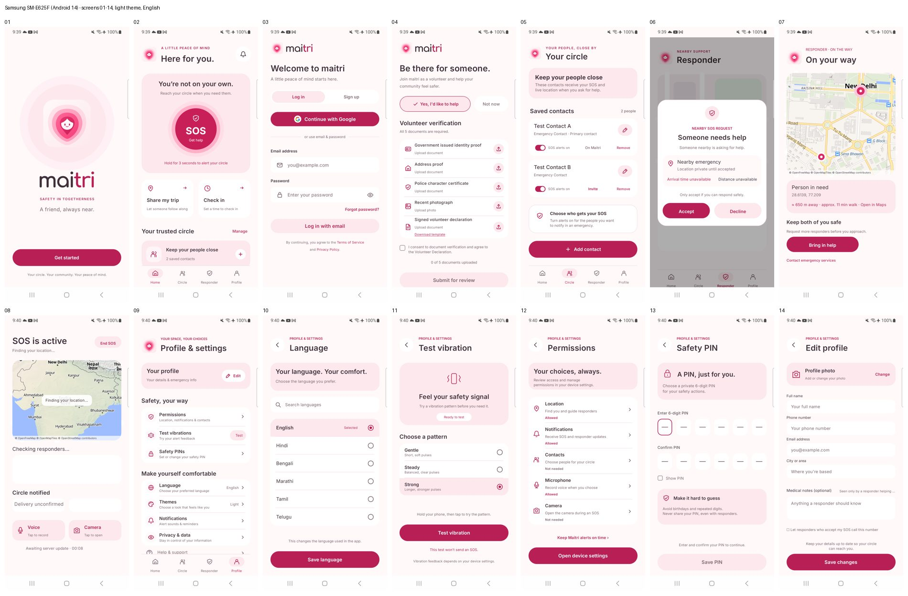
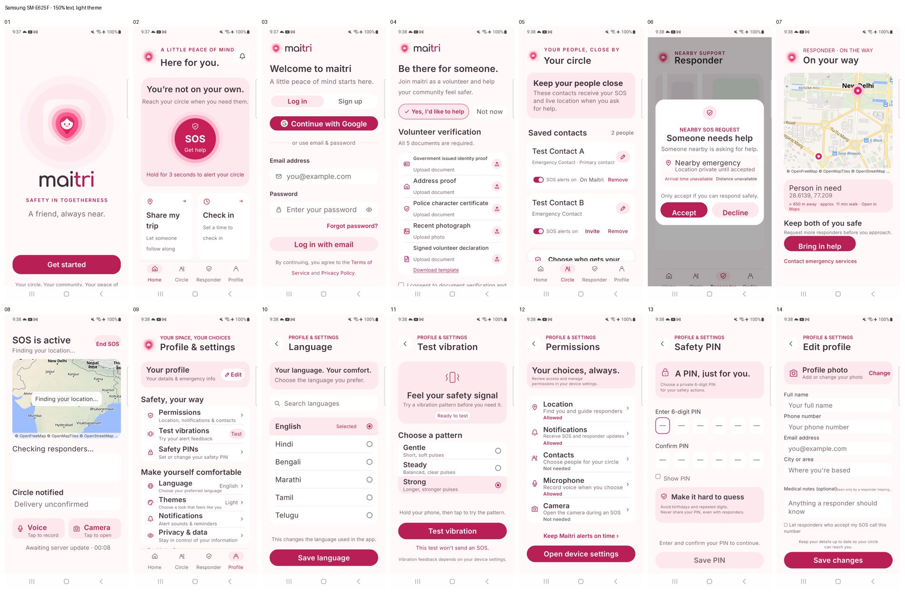
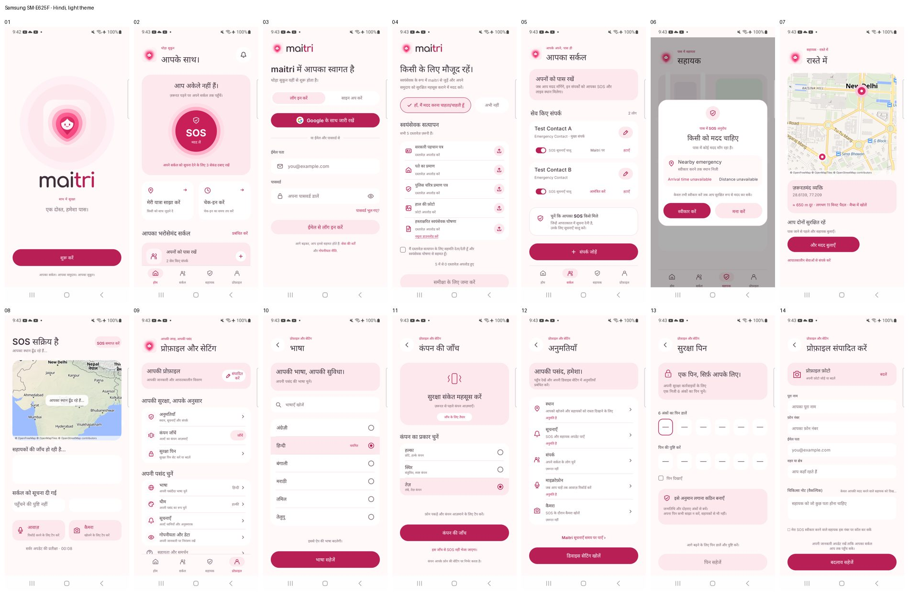
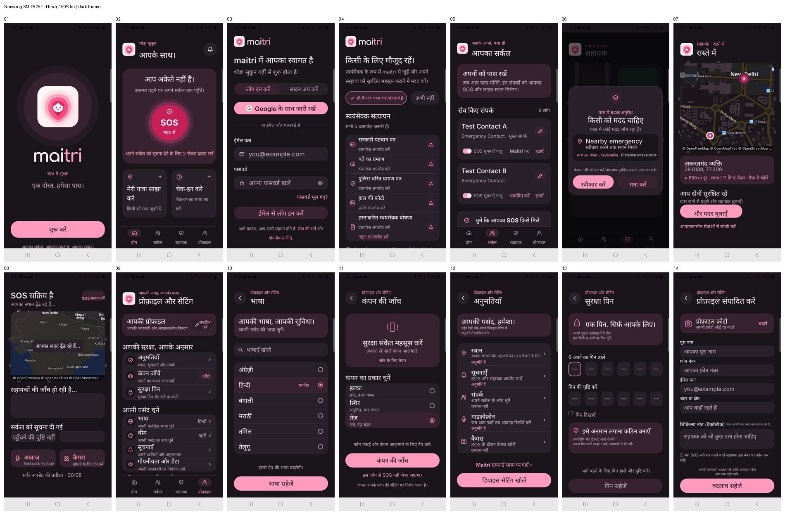

# Maitri beta test report

Build: `0.9.0-beta.1` (versionCode 900), signed release APK, R8 on, Inter typeface.
Server: Render Free, branch `beta-complete`, `ENVIRONMENT=beta`, Neon + R2.

## Devices

| Device | Model | Android | OpenGL ES | Notes |
|---|---|---|---|---|
| A | Samsung Galaxy F62 (SM-E625F) | 14 | 3.2 | One UI |
| B | Xiaomi/Redmi 22041216I | 14 | — | HyperOS 2.0, text size 150%, enlarged display size |
| Emulator | Pixel 10 Pro (API 37 image) | 17 | 3.0 | Design-width captures (390 dp) |
| Emulator | Maitri_API26 (Google Play image, x86) | 8.0 (API 26) | 2.0 | The app's minimum Android version |

## Device matrix, 2026-11-24 (evening)

| Check | Samsung A (Android 14) | API 26 emulator (Android 8.0) | API 37 emulator |
|---|---|---|---|
| Release build installs and launches | ✅ | ✅ | ✅ |
| Instrumented suite (24 tests) | ✅ **24/24** | ⚠️ 11/24: the other 13 can't read the screen through accessibility on this image (test-harness limit; screenshots below show the screens work) | ✅ 24/24 (before the OpenGL switch) |
| All 14 screens, light and dark | ✅ | ✅ | ✅ |
| All 14 screens at 150% text | ✅ | — | ✅ |
| All 14 screens in Hindi (normal and 150%) | ✅ | — | ✅ |
| Live map (screens 07, 08) | ✅ | ✅ fallback card (no OpenGL ES 3.0) | ✅ |
| Phone left as it was (release build, signed in, stay-awake restored) | ✅ | — | — |

How the Samsung run was done: the debug and test APKs were signed with the upload key (`-PsignDebugWithUpload=true`) and
installed over the release build, so nothing was uninstalled and the account stayed signed in. Tests ran with
`am instrument` (Gradle's connected task uninstalls the app afterwards). Afterwards the release build was installed
again the same way and the app's language and the phone's stay-awake setting were restored.

No SOS was created during the device matrix. The instrumented tests never contact the server: the SOS test uses a
stand-in callback, and the screen captures use fake account IDs that the network client refuses to send for. No
contact or volunteer was alerted and no SMS was composed.

### Screenshots from the Samsung (SM-E625F)

Light theme, English:

Dark theme, English:

150% text:

Hindi:

Hindi, 150% text, dark theme:

## Two-phone run, 2026-11-24 (afternoon)

| # | Test | Result | Notes |
|---|---|---|---|
| 0 | Install signed release, Google sign-in (both phones) | ✅ | Release key SHA-1 registered in Firebase |
| 0 | Runtime permissions via Profile → Permissions | ✅ | Android dialogs shown; status lines update |
| 1 | Medical note saved and read back | ✅ | `MEDICAL_NOTES_KEY` set |
| 2 | Profile photo upload | ✅ | R2 storage |
| 3 | Circle invite code A → B | ✅ | |
| 4 | SOS from A (hold 3 s) to the tester's own second account on B | ✅ | Beta mode accepts real SOS |
| 5 | Alert on B with the screen locked; map shows A | ✅ | Xiaomi: Autostart on, battery No restrictions |
| 6 | Live link opens | ✅ | `LIVE_LINK_SECRET`, `PUBLIC_URL` |
| 7 | Voice note + photo during SOS; B plays and views them; SOS ended with PIN | ✅ after fixes | See bugs 2–5 |
| 8 | B's inbox shows "SOS ended"; media still viewable | ✅ | |
| — | Hourly SOS limit message | ✅ | Hit at 3/hour; raised to 20 for testing |

## Bugs found and fixed

1. **Startup crash in the first release build.** R8 removed WorkManager's Room database constructor.
   Fixed with `app/proguard-rules.pro` (`173a1f0`).
2. **Take photo closed the app.** FileProvider had no root for `files/sos-media/` (`b760b6e`).
   Now covered by `FileProviderPathsTest`.
3. **Circle couldn't see SOS media.** It was owner-only by design. Changed so that the alerted circle members can
   list, play and view it, and volunteer responders can't (`3977fca`, `f5a9758`).
4. **Play/Stop on phone B crashed.** A local `stop()` shadowed `MediaPlayer.stop()` and recursed (`6c8811e`).
5. **Photo upload status shown under Voice.** The SOS screen now shows each tile's uploads separately (`6c8811e`).
6. **Large text (150%) broke Home and cut text elsewhere** (phone B): fixed in P10 (`97bc82e`, `b1bdd6c`).
7. **Maps crashed the app on phones without Vulkan** (found on the API 26 emulator): MapLibre's default artifact
   renders with Vulkan and kills the process with "No Vulkan compatible GPU found". Switched to the OpenGL ES
   artifact.
8. **Maps crashed on GPUs with only OpenGL ES 2.0** (API 26 emulator; also older budget "Android Go" phones):
   MapLibre needs ES 3.0 and fails natively. Phones below 3.0 now get a card with the coordinates and Open in Maps.
9. **Location-queue cleanup failed on Android 8–9:** `use { }` on a SQLiteOpenHelper threw ClassCastException
   (that class only became AutoCloseable later). The queue now implements Closeable itself.

## Open

- **Before inviting testers, delete `SOS_PER_HOUR` in Render** (or set it to 3).
- **Not run end to end yet:** check-in reminders (needs a second account to receive the missed check-in) and the
  volunteer responder flow (needs an approved volunteer account near a test SOS). Both are covered by backend tests.
- **Phone B** was disconnected for the evening run; its 150% text fixes were confirmed on Home earlier.
- **Translations** are machine-drafted and marked for review by native speakers.
