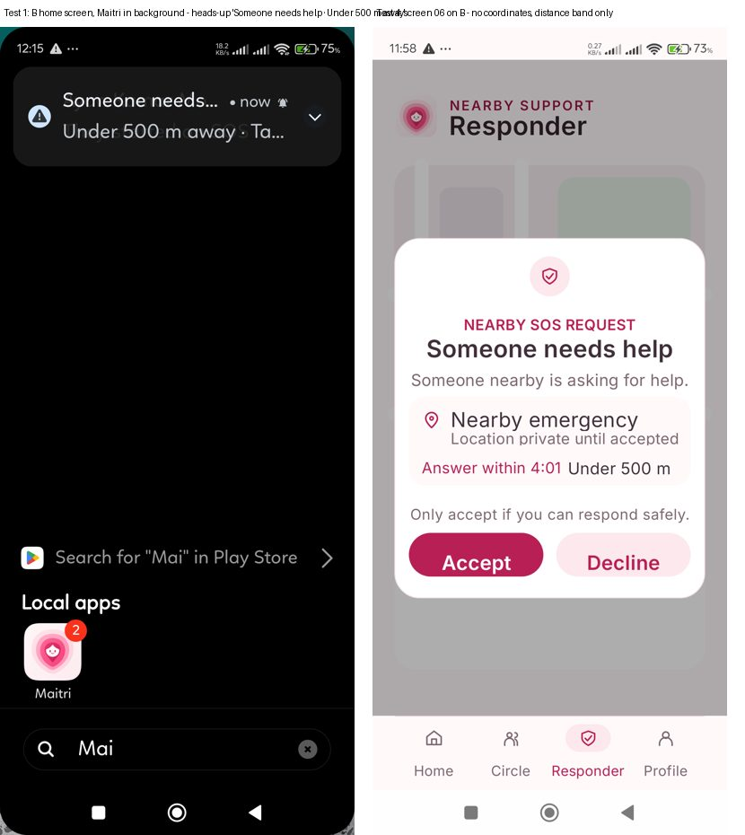
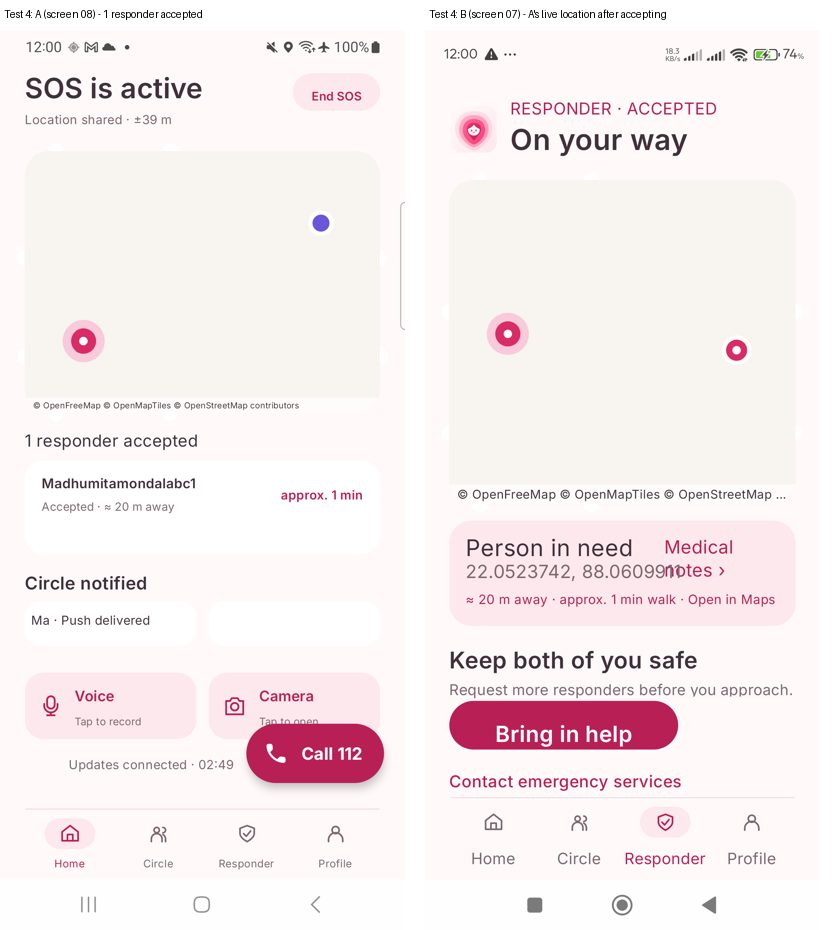
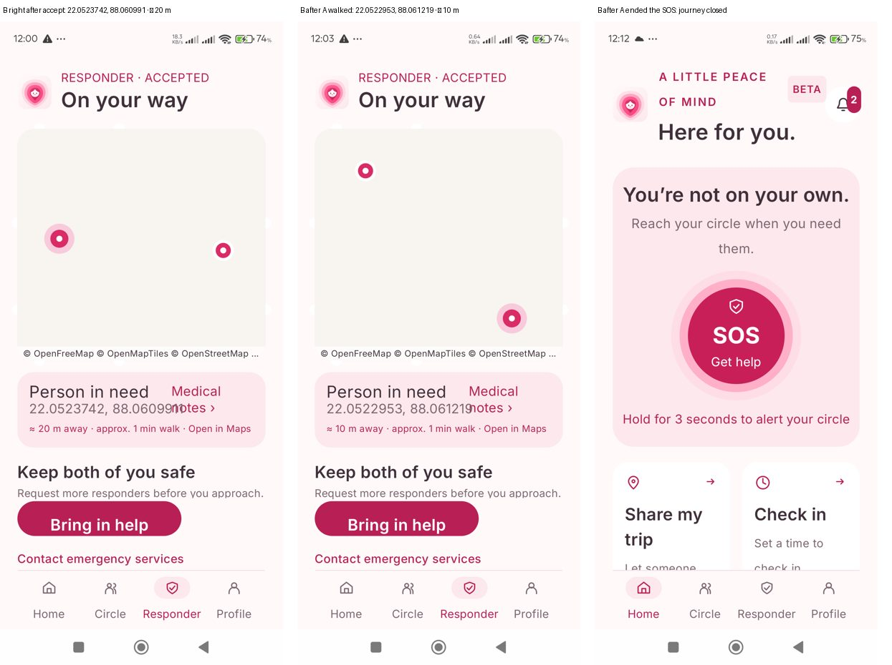
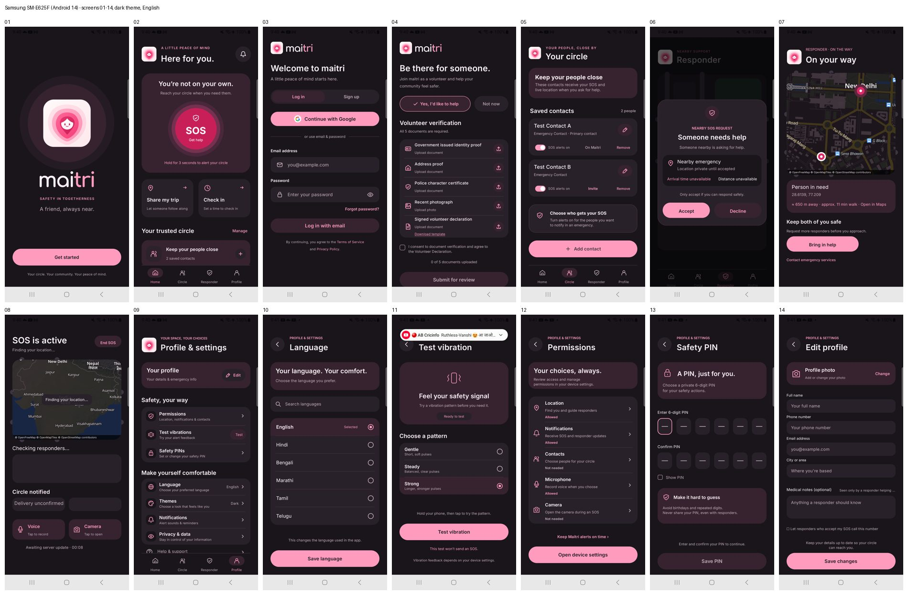

# Maitri beta test report

Build: `0.9.0-beta.1` (versionCode 900), signed release APK, R8 on, Inter typeface.
Server: Render Free, branch `beta-complete`, `ENVIRONMENT=beta`, Neon + R2.

## Devices

| Device | Model | Android | OpenGL ES | Notes |
|---|---|---|---|---|
| A | Samsung Galaxy F62 (SM-E625F) | 14 | 3.2 | One UI |
| B | Xiaomi/Redmi 22041216I | 14 | — | HyperOS 2.0, text size 150%, enlarged display size |
| Emulator | Pixel 10 Pro (API 37 image) | 17 | 3.0 | Design-width captures (390 dp) |
| Emulator | Maitri_API26 (Google Play image, x86) | 8.0 (API 26) | 2.0 | The app's minimum Android version |

## Responder alert tests, 2026-11-24/25 (night)

Phone A = person in need (Samsung SM-E625F). Phone B = volunteer (Xiaomi 22041216I, HyperOS), the only approved
volunteer, and also in A's circle. Server: Render, `master` after PR #4 (merge of `beta-complete`), `ENVIRONMENT=beta`.
Every SOS was real (beta mode) and reached only these two test accounts: confirmed in /admin that B is the only
approved volunteer, and A's only contact ("Ma") is B's account. No SMS was composed. Timings are from the SOS hold
starting on A to Android's `notification_alert` event on B.

### Pre-checks

| Check | Result |
|---|---|
| Server `/ready`, deployed `master` with PR #4, `ENVIRONMENT=beta` | ✅ |
| B: notifications allowed; SOS channel `urgent_sos_v2_steady` importance 4, sound + vibration | ✅ |
| B: battery optimisation exempt (deviceidle whitelist), standby bucket 5 | ✅ after fixing (was bucket 40 "rare") |
| B: location "Allow all the time" (new in this build) | ✅ |
| B: full-screen alerts allowed (Android 14 `USE_FULL_SCREEN_INTENT`) | ❌ off by default; see open items |
| A: precise location, location services on | ✅ |
| Same build on both phones | ✅ after updating B |
| B: old pre-Maitri app (`com.example.surakshanet`) registered for the same account | ❌ removed (it showed sample data and duplicated every alert) |

### Results (after the fixes below were deployed)

| Test | B's state | Circle alert | Volunteer request | Sound | Vibration | Screen | Result |
|---|---|---|---|---|---|---|---|
| 1 | Maitri in background, home screen | ~5 s | ~9–11 s, heads-up "Someone needs help · Under 500 m away" | ✅ | circle ✅ / request ❌ | on | ✅ |
| 2 | Maitri swiped out of Recents (process dead, not force-stopped) | ~6 s | ~10 s | ✅ | circle ✅ / request ❌ | on | ✅ |
| 3 | Screen off 60 s, forced deep Doze, process dead | 8.9 s | 12.3 s | ✅ | circle ✅ / request ❌ | **did not wake** | ⚠️ delivered with sound; no screen wake |
| 4 | Accept → live location | — | screen 06: "Under 500 m", no coordinates | — | — | — | ✅ accept, live position on B, "1 responder accepted" on A, B clears when SOS ends |

Pushes are sent with FCM `priority=high` (`outbox_worker.py`), which is why they arrive through Doze.

### Failures found, root causes and fixes

1. **Volunteers were only reachable with the Responder tab open** (Test 1 failed, accept refused in Test 4). The app
   reported a volunteer's location only from that tab, and the server invited only volunteers with a fix under 2 minutes
   old. Fixed (`6f1cd52`, `03a4012`): the server uses the last location up to 30 minutes old to choose whom to invite;
   the app reports it when Maitri opens, every 15 minutes in the background for volunteers who allow "all the time",
   and right before Accept.
2. **The request said "Nearby SOS simulation"** for a real SOS. Fixed: "Someone needs help · Under 500 m away · Tap to
   respond if you can do so safely."; "Practice SOS nearby" only for test SOS (invitations now carry `is_test`).
3. **The old pre-Maitri app on B** received the same pushes and showed hard-coded sample data ("Kolkata, Sector V").
   Uninstalled with the owner's permission.
4. Close-together markers zoomed the map past street level, and "Medical notes ›" overlapped the coordinates at 150%
   text on screen 07. Fixed (in the next build).

### Follow-up, 2026-11-25 morning

- **Screen wake and vibration confirmed** with B as a pure volunteer (A's circle emptied): B's screen switched on and
  Maitri opened over the lock screen 0.1 s after the request (full-screen alerts allowed in the new Responder card);
  the request logged buzz=1, beep=1. The missing vibration earlier was the overlap with the circle alert.
- **SOS stuck on "Connecting…" for 11 minutes (fixed).** Cause: an SOS still open when an update force-stopped
  Maitri left a saved session marked "shared" whose server confirmation lived only in memory; `canStart()` then
  refused to restart tracking until the server re-confirmed it, and nothing restarted the send loop. The same happens
  after a reboot or a dead battery mid-SOS. Fix: while an SOS waits for its server incident, Home restarts the sync and
  tracking every 5 s; the send loop retries every 5 s (not doubling waits) for two minutes before WorkManager takes
  over; after 20 s the screen says "Still trying to reach Maitri… If you need help now, call 112."; the server now
  logs failed `POST /api/incidents`. Verified on phone A: SOS open → update installed over it (force-stop) → SOS held
  again → "SOS is active" in 6 s with the location service running.
- The server was kept awake by the cron-job.org keep-alive, so the server wasn't the cause.

### Open

- **Screen wake:** fixed by asking volunteers to allow full-screen alerts (Android 14 default is off); confirmed above.
- **Request vibration:** only missing when the request overlaps the circle alert's vibration (someone who is both in
  the circle and a volunteer); a pure volunteer gets sound and vibration.
- **Stale request:** fixed; requests clear when the SOS ends (circle members) or the invitation expires (5 min).
- **Measurement note:** `cmd notification cancel_all` does nothing on MIUI, so detection uses `notification_alert`
  events, not the shade.

## Device matrix, 2026-11-24 (evening)

| Check | Samsung A (Android 14) | API 26 emulator (Android 8.0) | API 37 emulator |
|---|---|---|---|
| Release build installs and launches | ✅ | ✅ | ✅ |
| Instrumented suite (24 tests) | ✅ **24/24** | ⚠️ 11/24: the other 13 can't read the screen through accessibility on this image (test-harness limit; screenshots below show the screens work) | ✅ 24/24 (before the OpenGL switch) |
| All 14 screens, light and dark | ✅ | ✅ | ✅ |
| All 14 screens at 150% text | ✅ | — | ✅ |
| All 14 screens in Hindi (normal and 150%) | ✅ | — | ✅ |
| Live map (screens 07, 08) | ✅ | ✅ fallback card (no OpenGL ES 3.0) | ✅ |
| Phone left as it was (release build, signed in, stay-awake restored) | ✅ | — | — |

How the Samsung run was done: the debug and test APKs were signed with the upload key (`-PsignDebugWithUpload=true`) and
installed over the release build, so nothing was uninstalled and the account stayed signed in. Tests ran with
`am instrument` (Gradle's connected task uninstalls the app afterwards). Afterwards the release build was installed
again the same way and the app's language and the phone's stay-awake setting were restored.

No SOS was created during the device matrix. The instrumented tests never contact the server: the SOS test uses a
stand-in callback, and the screen captures use fake account IDs that the network client refuses to send for. No
contact or volunteer was alerted and no SMS was composed.

### Screenshots from the Samsung (SM-E625F)

Light theme, English:

Dark theme, English:

150% text:

Hindi:

Hindi, 150% text, dark theme:

## Two-phone run, 2026-11-24 (afternoon)

| # | Test | Result | Notes |
|---|---|---|---|
| 0 | Install signed release, Google sign-in (both phones) | ✅ | Release key SHA-1 registered in Firebase |
| 0 | Runtime permissions via Profile → Permissions | ✅ | Android dialogs shown; status lines update |
| 1 | Medical note saved and read back | ✅ | `MEDICAL_NOTES_KEY` set |
| 2 | Profile photo upload | ✅ | R2 storage |
| 3 | Circle invite code A → B | ✅ | |
| 4 | SOS from A (hold 3 s) to the tester's own second account on B | ✅ | Beta mode accepts real SOS |
| 5 | Alert on B with the screen locked; map shows A | ✅ | Xiaomi: Autostart on, battery No restrictions |
| 6 | Live link opens | ✅ | `LIVE_LINK_SECRET`, `PUBLIC_URL` |
| 7 | Voice note + photo during SOS; B plays and views them; SOS ended with PIN | ✅ after fixes | See bugs 2–5 |
| 8 | B's inbox shows "SOS ended"; media still viewable | ✅ | |
| — | Hourly SOS limit message | ✅ | Hit at 3/hour; raised to 20 for testing |

## Bugs found and fixed

1. **Startup crash in the first release build.** R8 removed WorkManager's Room database constructor.
   Fixed with `app/proguard-rules.pro` (`173a1f0`).
2. **Take photo closed the app.** FileProvider had no root for `files/sos-media/` (`b760b6e`).
   Now covered by `FileProviderPathsTest`.
3. **Circle couldn't see SOS media.** It was owner-only by design. Changed so that the alerted circle members can
   list, play and view it, and volunteer responders can't (`3977fca`, `f5a9758`).
4. **Play/Stop on phone B crashed.** A local `stop()` shadowed `MediaPlayer.stop()` and recursed (`6c8811e`).
5. **Photo upload status shown under Voice.** The SOS screen now shows each tile's uploads separately (`6c8811e`).
6. **Large text (150%) broke Home and cut text elsewhere** (phone B): fixed in P10 (`97bc82e`, `b1bdd6c`).
7. **Maps crashed the app on phones without Vulkan** (found on the API 26 emulator): MapLibre's default artifact
   renders with Vulkan and kills the process with "No Vulkan compatible GPU found". Switched to the OpenGL ES
   artifact.
8. **Maps crashed on GPUs with only OpenGL ES 2.0** (API 26 emulator; also older budget "Android Go" phones):
   MapLibre needs ES 3.0 and fails natively. Phones below 3.0 now get a card with the coordinates and Open in Maps.
9. **Location-queue cleanup failed on Android 8–9:** `use { }` on a SQLiteOpenHelper threw ClassCastException
   (that class only became AutoCloseable later). The queue now implements Closeable itself.

## Open

- **Before inviting testers, delete `SOS_PER_HOUR` in Render** (or set it to 3).
- **Not run end to end yet:** check-in reminders (needs a second account to receive the missed check-in) and the
  volunteer responder flow (needs an approved volunteer account near a test SOS). Both are covered by backend tests.
- **Phone B** was disconnected for the evening run; its 150% text fixes were confirmed on Home earlier.
- **Translations** are machine-drafted and marked for review by native speakers.
