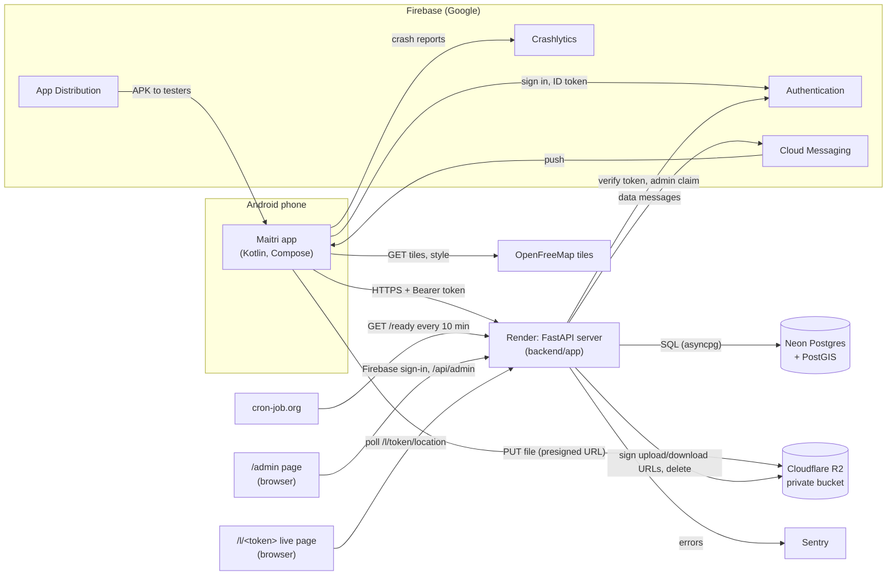
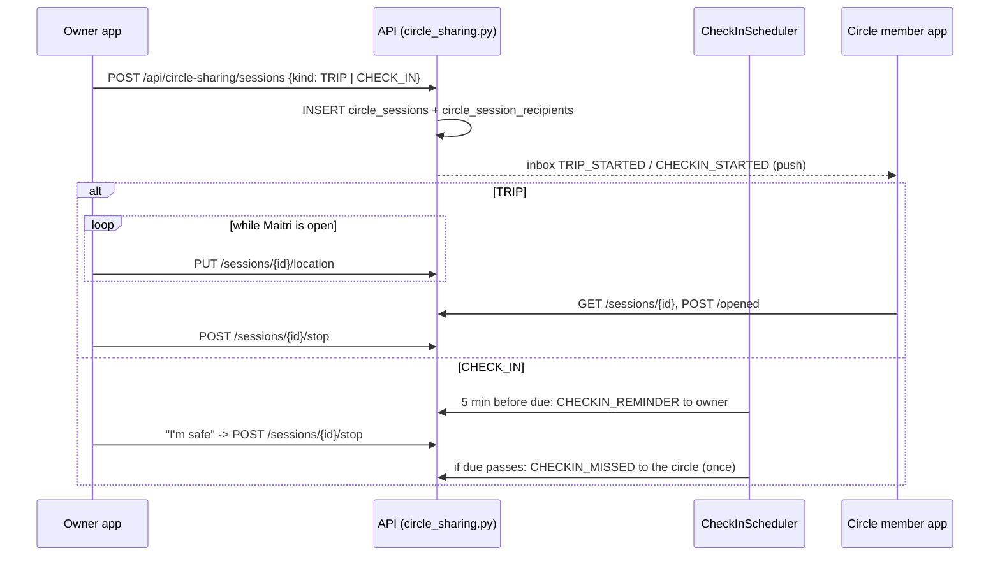
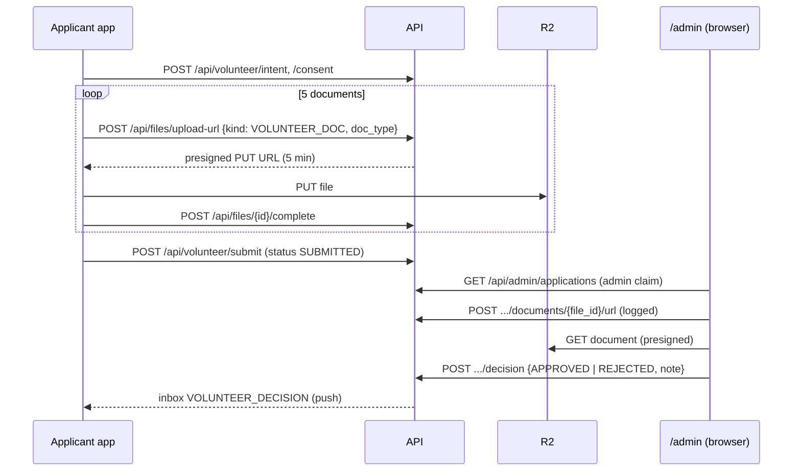

# Maitri project handbook

A complete guide to how Maitri works today: what it does, how the pieces fit, where every piece of data lives,
how to build and run it, and what its limits are. It is written for a student or new developer joining the
project.

**How to read the citations.** Every claim points at the code it comes from, written as `file: function` or
`file: route`. Paths are relative to the repository root. When the code and an older report disagree, this
handbook follows the code; the outdated reports are listed in [section 15](#15-stale-or-contradicting-documents).

**What "Unverified" means.** A few statements depend on things outside the repository (a dashboard setting, a
provider's current price or limit). They are marked **Unverified** and should be checked before you rely on them.

**Secrets.** This document never contains keys, passwords, connection strings, tokens or account IDs. It names the
environment variable or file that holds each one instead.

**Snapshot.** Written against `master` at commit `03faae9` (app version **0.9.4-beta.5**, versionCode 904,
`app/build.gradle.kts: defaultConfig`), backend migrations up to `0018`.

## Contents

1. [Overview](#1-overview)
2. [Architecture](#2-architecture)
3. [Tech stack](#3-tech-stack)
4. [External websites and services](#4-external-websites-and-services)
5. [Screens and features](#5-screens-and-features)
6. [Key flows end to end](#6-key-flows-end-to-end)
7. [Backend reference](#7-backend-reference)
8. [Data: where everything is stored](#8-data-where-everything-is-stored)
9. [Security and privacy](#9-security-and-privacy)
10. [Configuration and environments](#10-configuration-and-environments)
11. [Build, run, test and deploy](#11-build-run-test-and-deploy)
12. [Limitations and known issues](#12-limitations-and-known-issues)
13. [Costs](#13-costs)
14. [Glossary](#14-glossary)
15. [Stale or contradicting documents](#15-stale-or-contradicting-documents)
16. [Coverage check](#16-coverage-check)

Larger diagrams live in [`docs/diagrams/`](docs/diagrams/):
[architecture](docs/diagrams/architecture.md), [SOS flow](docs/diagrams/sos-flow.md),
[database ER diagram](docs/diagrams/er-diagram.md) and [other flows](docs/diagrams/flows.md).

---

## 1. Overview

### What Maitri does

Maitri is an Android personal-safety app. A person in danger **holds the SOS button for 3 seconds**. Maitri then:

- shares their live location with the people they trust (their **circle**),
- asks **verified volunteers** within 1 km to come and help,
- lets them record a short voice note or take a photo as evidence for their circle,
- and keeps going until the person ends the SOS with a **Safety PIN**.

It also supports everyday safety: **Share my trip** (the circle follows you while Maitri is open) and **Check in**
(if you don't check in by a set time, your circle is told).

### Who uses it

| Role | Who they are | What they do in Maitri | Where it's enforced |
|---|---|---|---|
| **User** | Anyone with a verified account | Sends SOS, manages their circle, shares trips, checks in | `backend/app/core.py: identity` (verified email or phone), `account` |
| **Circle member** | Someone a user added as a trusted contact. If they also have Maitri and linked by code, they get pushes | Receives SOS alerts, the live location, evidence; is told about missed check-ins | `backend/app/services/trusted_contacts.py: dispatch_incident_alerts`, `backend/app/circle.py` |
| **Volunteer / responder** | A user who applied, uploaded documents and was **approved** | Turns on "Available", gets nearby SOS requests, accepts, navigates to the person | `backend/app/routes.py: respond` (approval re-checked at accept), `backend/app/services/moving_geofence.py` |
| **Admin** | A Firebase account with the custom claim `admin: true` | Reviews volunteer applications on the `/admin` page | `backend/app/admin.py: admin`, `backend/scripts/set_admin_claim.py` |

### Current status: beta

- The server runs with `ENVIRONMENT=beta` (`render.yaml`). In beta **any verified account** may use the service and
  SOS alerts are **real** (not practice), limited to `SOS_PER_HOUR` per person (default 3)
  (`backend/app/config.py: Settings.open_access`, `real_incidents`; `backend/app/services/incidents.py: create`).
- The app is distributed to a small group of friends with **Firebase App Distribution**, not the Play Store
  (`app/build.gradle.kts`: `AppDistributionExtension`, group from `maitriTesterGroups`).
- Home shows a **BETA** label (`app/src/main/java/in/maitri/app/ui/MaitriHome.kt: MaitriHome`, `beta = VERSION_NAME.contains("beta")`).

### How it works, in one paragraph

The Android app (Kotlin, Jetpack Compose) signs people in with **Firebase Authentication** and talks to a
**FastAPI** server on **Render** over HTTPS, sending a Firebase ID token with every call. The server keeps its data
in a **Neon** PostgreSQL database with the **PostGIS** extension (for distance searches) and stores files (volunteer
documents, SOS photos and voice notes, profile photos) in a private **Cloudflare R2** bucket that the phone uploads
to directly with short-lived **presigned URLs**. When someone holds SOS, the app creates an *incident* and keeps
uploading its location; a *moving geofence* on the server finds approved, available volunteers within 1 km and
sends them a **Firebase Cloud Messaging (FCM)** data message; the volunteer's phone builds a heads-up or full-screen
alert. Circle members who have Maitri get a push too; the rest get an SMS that the user's own phone prepares, with
a **live-location web link**. A free **cron-job.org** ping keeps the Render server awake, **Sentry** collects server
errors, **Crashlytics** collects app crashes, and the map tiles come from **OpenFreeMap**.

---

## 2. Architecture

The full diagram with every arrow labelled is in [`docs/diagrams/architecture.md`](docs/diagrams/architecture.md).
A compact version:



### What each arrow carries, and when

| From → To | What is sent | When | Code |
|---|---|---|---|
| App → Firebase Auth | Email + password, Google ID token, or phone OTP code; gets back a Firebase ID token | Sign-in, and token refresh (about hourly; also at every cold start) | `app/.../data/FirebaseAuthRepository.kt`; `app/.../startup/Preloader.kt: start` |
| App → API | JSON over HTTPS with `Authorization: Bearer <ID token>`; never coordinates in push payloads | Every server call | `app/.../network/BackendApi.kt: BackendClient` (OkHttp interceptor adds the token) |
| API → Firebase Auth | The ID token, to verify it (and check it isn't revoked) | Every authenticated request | `backend/app/core.py: identity` (`auth.verify_id_token(..., check_revoked=True)`) |
| API → Neon | SQL through SQLAlchemy/asyncpg | Every request that needs data, plus background loops while the app is in use | `backend/app/database/engine.py`, `backend/app/main.py: lifespan` |
| API → R2 | Signs presigned PUT/GET URLs; deletes objects | When the app asks to upload or view a file; on retention and account deletion | `backend/app/storage.py`, `backend/app/files.py` |
| App → R2 | The file bytes, directly (the API never sees them) | After `POST /api/files/upload-url` | `app/.../network/Uploads.kt` |
| API → FCM | Data-only, high-priority messages (`event_type`, ids, times) | Volunteer invitations (outbox), circle alerts, check-in reminders, closes | `backend/app/services/outbox_worker.py: default_firebase_sender`; `backend/app/inbox.py: send_pending_pushes` |
| FCM → App | The data message; the app builds the notification itself | Same as above | `app/.../notification/SosFirebaseMessagingService.kt: onMessageReceived` |
| App → OpenFreeMap | Requests for the map style and vector tiles | When a map is shown; once a day a small area around the last location is pre-downloaded | `app/.../ui/MaitriMap.kt: OpenFreeMap`; `app/.../startup/MapWarmup.kt` |
| App → Crashlytics | Stack trace, app version, phone model (no user id or personal data) | After a crash, release builds only, unless turned off in Privacy & data | `app/.../MaitriApp.kt: CrashReports` |
| App Distribution → App | Signed release APK + release notes | When a developer runs `appDistributionUploadRelease` | `app/build.gradle.kts` |
| API → Sentry | Server exceptions, scrubbed of coordinates, emails, phones and live-link tokens | When an error happens and `SENTRY_DSN` is set | `backend/app/telemetry.py: init_sentry`, `scrub` |
| cron-job.org → API | `GET /ready` (never touches the database) | Every 10 minutes | `backend/app/main.py: ready`; `DEPLOYMENT.md` §4 |
| Browser (/admin) → API | Firebase web sign-in, then `/api/admin/...` with the admin claim | When an admin reviews applications | `backend/app/admin.py: admin_page`, `admin` |
| Browser (/l/token) → API | Polls `/l/<token>/location` | While a circle member without the app watches an SOS | `backend/app/live_link.py: live_page`, `live_location` |

### Inside the server

The server is one Python process (one Uvicorn worker) with three background loops started in
`backend/app/main.py: lifespan`:

| Loop | Runs | Does | Code |
|---|---|---|---|
| Geofence + retention | every `REEVALUATION_SECONDS` (30 s) while the API was used in the last 15 min, otherwise once an hour | Re-checks volunteers near open SOSes, cleans up circle sessions and inbox, applies retention, deletes old SOS media, auto-closes orphaned SOSes | `periodic_geofence`; `services/geofence.py: tick`; `maintenance.py: cleanup`; `privacy.py: purge_sos_media`; `services/incidents.py: expire_orphaned` |
| Outbox + inbox pushes | every 2 s while busy, otherwise once an hour | Sends pending volunteer invitations and inbox pushes through FCM | `periodic_outbox`; `services/outbox_worker.py: process_outbox_batch`; `inbox.py: send_pending_pushes` |
| Check-ins | sleeps until the next due time | Sends "Time to check in" 5 min before, and "missed check-in" to the circle | `checkins.py: CheckInScheduler.run`, `process_due` |

"While busy" is decided by `backend/app/activity.py: DbActivity`: background loops only touch the database when
the API had a request in the last `DB_IDLE_SECONDS` (900 s), plus one sweep per `IDLE_SWEEP_SECONDS` (3600 s). This
lets the free Neon database go to sleep when nobody uses Maitri.

Real-time updates (responders joining, their status, the SOS closing) go over a **WebSocket** with an in-memory
event bus, because there is only one worker and no Redis (`backend/app/services/realtime.py`,
`backend/start-render.sh`).

---

## 3. Tech stack

Versions come from `app/build.gradle.kts`, `gradle/libs.versions.toml`, `build.gradle.kts`,
`gradle/wrapper/gradle-wrapper.properties` and `backend/requirements.txt`. A "BOM" is a bill of materials: one
version number that fixes the versions of a whole family of libraries.

### Android app

| Library / tool | Version | What it does in Maitri | Where |
|---|---|---|---|
| Kotlin + Compose compiler plugin | 2.2.10 | Language; compiles the Compose UI | all of `app/src/main/java` |
| Android Gradle Plugin (AGP) | 9.5.2 | Builds the app | `build.gradle.kts`, `app/build.gradle.kts` |
| Gradle | 9.6.0 | Build tool | `gradle/wrapper/gradle-wrapper.properties` |
| Jetpack Compose (BOM) | 2026.02.01 | The whole UI | `app/.../ui/*.kt`, `navigation/SafetyApp.kt` |
| Material 3 + icons (core, extended) | from the Compose BOM | Buttons, dialogs, switches, icons | `ui/*.kt`; colours in `ui/theme/Theme.kt` |
| Navigation Compose | 2.8.9 | Moving between screens (routes such as `Home`, `Active`, `Incoming?invitationId=`) | `navigation/SafetyApp.kt: MainGraph` |
| Lifecycle (runtime, viewmodel-compose) | 2.8.7 | ViewModels and lifecycle-aware loading | `state/SafetyViewModel.kt` |
| Activity Compose | 1.8.0 | Hosts Compose in `MainActivity` | `MainActivity.kt` |
| Core SplashScreen | 1.0.1 | System splash with the logo, fading into "Getting things ready" | `MainActivity.kt: onCreate`; `res/values/themes.xml: Theme.Maitri.Starting` |
| DataStore Preferences | 1.1.7 | On-disk cache of server data for instant, offline screens | `startup/StartupCache.kt` |
| WorkManager | 2.10.1 | Reliable background work: SOS uploads, invitation details, volunteer location, SOS media upload | `network/TestIncidentSync.kt: IncidentUploadWorker`; `notification/InvitationNotificationWorker.kt`; `network/ResponderLocation.kt` |
| ProfileInstaller | 1.4.1 | Installs the shipped Baseline Profile on phones without Play | `app/build.gradle.kts` |
| Retrofit + Gson converter | 2.11.0 | Typed HTTP calls to the API | `network/BackendApi.kt` and the other `*Api` interfaces |
| OkHttp | 4.12.0 | HTTP client; adds the Bearer token; raw uploads to R2 | `network/BackendApi.kt: BackendClient`; `network/Uploads.kt` |
| Google Play services Location | 21.3.0 | GPS / fused location | `location/FusedLocationSource.kt`; `ui/ResponderMapCard.kt` |
| MapLibre Android (OpenGL) | 13.7.1 | Draws the maps with OpenFreeMap tiles; offline warm-up | `ui/MaitriMap.kt`; `startup/MapWarmup.kt` |
| Firebase BOM | 34.19.0 | Versions for the Firebase libraries below | `app/build.gradle.kts` |
| Firebase Auth | from BOM | Sign-in (email, Google, phone OTP code path) | `data/FirebaseAuthRepository.kt` |
| Credential Manager + Google ID | 1.5.0 / 1.1.1 | "Sign in with Google" | `ui/MaitriLogin.kt`; `state/AuthViewModel.kt: signInWithGoogle` |
| Firebase Cloud Messaging | from BOM | Receives pushes | `notification/SosFirebaseMessagingService.kt` |
| Firebase Crashlytics | from BOM (plugin 3.0.8) | Crash reports from release builds | `MaitriApp.kt: CrashReports` |
| kotlinx-coroutines-play-services | 1.9.0 | `await()` on Firebase/Play tasks | many files |
| google-services plugin | 4.6.0 | Reads `app/google-services.json` | `app/build.gradle.kts` |
| App Distribution plugin | 5.3.1 | Uploads builds to testers | `app/build.gradle.kts` |
| Baseline Profile plugin | 1.5.0 | Generates/ships the profile; builds `benchmarkRelease`/`nonMinifiedRelease` | `app/build.gradle.kts`; `baselineprofile/` |

Android levels: `minSdk = 26` (Android 8.0), `targetSdk = 37`, `compileSdk = 37` (`app/build.gradle.kts: defaultConfig`).

### Backend

| Library | Version range | What it does | Where |
|---|---|---|---|
| Python | 3.11 (`python:3.11-slim` image) | Runtime | `backend/Dockerfile` |
| FastAPI | ≥0.115,<1 | Web framework: routes, validation, dependencies | `backend/app/*.py` |
| Uvicorn (standard) | ≥0.34,<1 | ASGI server, started with **one worker** | `backend/start-render.sh` |
| SQLAlchemy (asyncio) | ≥2.0.38,<2.1 | Database access (Core + raw SQL) | `backend/app/database/v1.py`, routes |
| asyncpg | ≥0.30,<1 | PostgreSQL driver | `backend/app/database/engine.py` |
| GeoAlchemy2 | ≥0.17,<1 | PostGIS geography columns | `backend/app/database/v1.py` |
| Alembic | ≥1.14,<2 | Database migrations (0001–0018), run on every deploy | `backend/alembic/`, `backend/render-migrate.sh` |
| Pydantic + pydantic-settings | ≥2.10 / ≥2.7 | Request models; settings from environment variables | `backend/app/schemas.py`, `backend/app/config.py` |
| firebase-admin | ≥6.6,<8 | Verifies ID tokens, sends FCM, deletes Firebase users | `backend/app/core.py`, `services/outbox_worker.py`, `privacy.py` |
| argon2-cffi | ≥23.1 | Hashes Safety PINs | `backend/app/services/safety_pin.py` |
| cryptography | ≥43,<52 | AES-256-GCM for medical notes | `backend/app/privacy.py` |
| httpx | ≥0.28,<1 | Talks to R2 (delete); test client. R2 URLs are signed by hand-written AWS SigV4 code (`storage.py: presign`), not boto3, to save memory on the 512 MB instance | `backend/app/storage.py` |
| redis | ≥5,<9 | Optional distributed realtime bus (not used in production) | `backend/app/services/realtime.py` |
| sentry-sdk[fastapi] | ≥3.0,<4 | Server error reports | `backend/app/telemetry.py` |

### Database

| Component | Version | Notes | Where |
|---|---|---|---|
| PostgreSQL | 16 | Hosted on Neon (free tier) | `DATABASE_SCHEMA.md` (generated); `DEPLOYMENT.md` |
| PostGIS | from Neon | `geography` columns and `ST_DWithin` distance searches | `backend/app/services/moving_geofence.py`; enabled by `render-migrate.sh -x ensure_postgis=true` |

### Infrastructure

| Piece | What | Config |
|---|---|---|
| Render web service `surakshanet-api` | Docker, free plan, Singapore region, auto-deploy **off**, health check `/ready` | `render.yaml` |
| Neon | Free Postgres; direct (non-pooler) connection string in `DATABASE_URL` | `render.yaml` comment, `DEPLOYMENT.md` |
| Cloudflare R2 | Private bucket via the S3 API | `R2_*` env vars, `backend/app/storage.py` |
| GitHub Pages | Privacy policy, terms and account-deletion page from `docs/site` | `.github/workflows/pages.yml`; `app/.../network/Privacy.kt: SITE` |

### Tooling and testing

| Tool | What it checks | Where |
|---|---|---|
| JUnit 4 + kotlinx-coroutines-test | App unit tests (translations coverage, palette tokens, SOS alert texts, …) | `app/src/test/java/in/maitri/app/` |
| Compose UI test + Espresso | Instrumented screenshot/capture tests on a phone | `app/src/androidTest/java/in/maitri/app/` |
| Android Lint | Static checks; 0 errors is the bar | `./gradlew :app:lintDebug` |
| pytest + pytest-asyncio + httpx | Backend tests against an isolated PostGIS database | `backend/tests/`, `backend/tests/run_isolated.py` |
| Macrobenchmark 1.5.0 + UiAutomator 2.4.1 | Startup and frame timing; Baseline Profile generator | `baselineprofile/` |
| `backend/scripts/api_docs.py` | Regenerates `API_DOCUMENTATION.md`; a test fails if it's stale | `backend/tests/test_api_docs.py` |
| `tools/i18n.py` | Extracts `tr("…")` texts and merges translations | `tools/i18n/`, `app/src/main/assets/i18n/` |
| `tools/design_diff.py` | Scores screens against the design boards | `design-reference/scores.json` |

---

## 4. External websites and services

Free-tier limits change; treat every number here as **Unverified** until you check the provider's pricing page.

| Service | URL | What Maitri uses it for | Plan | Free-tier limits (Unverified) | Env vars / config | If it is down |
|---|---|---|---|---|---|---|
| Firebase console (Auth, FCM, Crashlytics) | console.firebase.google.com | Sign-in; push messages; crash reports; Google Sign-In config | Spark (free) | Auth free for email/Google; **phone OTP SMS needs the paid Blaze plan**; FCM free | `app/google-services.json`; server: `FIREBASE_PROJECT_ID`, `GOOGLE_APPLICATION_CREDENTIALS` (secret file) | No sign-in, no token checks (API returns 503 "Identity service unavailable"), no pushes. SOS creation fails without a valid token |
| Firebase App Distribution | console.firebase.google.com → App Distribution | Sends test builds to the `friends` group | Free | Free; tester limits **Unverified** | `maitriAppDistributionCredentials`, `maitriTesterGroups` in `local.properties`; `release-notes.txt` | No new builds reach testers; installed apps keep working |
| Google Play Console | play.google.com/console | Not used yet (planned for public release) | One-time registration fee | — | — | — |
| Render | dashboard.render.com | Hosts the FastAPI server (`surakshanet-api`) | Free web service | Sleeps after ~15 idle min; cold start up to ~1 min; 750 instance-hours/month | `render.yaml`; all server env vars; secret file for Firebase Admin | **Nothing works except what the app has cached.** SOS sends are queued on the phone and retried |
| Neon | console.neon.tech | PostgreSQL + PostGIS database | Free | Compute suspends after 5 idle min; ~100 CU-hours/month (per `backend/app/activity.py` docstring); storage limit **Unverified** | `DATABASE_URL` | API calls that need data fail (5xx); `/ready` still answers |
| Cloudflare R2 | dash.cloudflare.com → R2 | Private storage for volunteer documents, SOS photos/voice, profile photos | Free tier | ~10 GB storage, ~1M writes and ~10M reads/month, no egress fees | `R2_ACCOUNT_ID`, `R2_BUCKET`, `R2_ACCESS_KEY_ID`, `R2_SECRET_ACCESS_KEY`, optional `R2_ENDPOINT` | Uploads return 503 `STORAGE_NOT_CONFIGURED`/fail; photos and documents can't be viewed. SOS itself still works |
| cron-job.org | cron-job.org | Keeps Render awake: `GET /ready` every 10 min | Free | Jobs as often as every minute | Job set up in the cron-job.org dashboard (`DEPLOYMENT.md` §4) | Render sleeps when idle; the first request after a quiet spell waits for a cold start (up to ~1 min) |
| Sentry | sentry.io | Server error reports | Free Developer plan | ~5k errors/month | `SENTRY_DSN`, `SENTRY_TEST` | No error reports; the app is unaffected |
| OpenFreeMap / OpenStreetMap | openfreemap.org / openstreetmap.org | Map style and vector tiles (OSM data) | Free, no key | No published hard limit (**Unverified**) | `app/.../ui/MaitriMap.kt: OpenFreeMap.LIGHT_STYLE`; dark style bundled at `app/src/main/assets/map/maitri-dark.json` | Maps show without tiles (or from the warm-up cache); coordinates and "Open in Maps" still work on the fallback card |
| GitHub | github.com/ayankrmondal2003-rgb/Saathi | Source code, pull requests, Pages | Free | — | `.github/workflows/pages.yml` | No code changes; the running app is unaffected |
| GitHub Pages | ayankrmondal2003-rgb.github.io/Saathi | Privacy policy, terms, account-deletion page | Free | — | `docs/site/*.html`; `app/.../network/Privacy.kt: SITE` | Links from the app to the policy pages fail |
| Email (support) | — | "Email support" in Help | — | — | `app/.../ui/MaitriPrivacyData.kt: supportEmailIntent` | — |

---

## 5. Screens and features

**How to read this section.** App paths are under `app/src/main/java/in/maitri/app/` (shortened to `.../`).
Backend paths are under `backend/app/`. "→" means "leads to". Every server call carries the Firebase ID token, and
every authenticated route first runs `core.py: identity` (checks the token) and `account` (creates or updates the
`users` row), so `users` is written on almost every call; that is not repeated below.

**Two behaviours shared by every screen:**

- **Server waking up.** Render's free server may take up to a minute to start. The app shows a "Connecting to
  Maitri…" banner while requests are slow (`network/BackendApi.kt: BackendLatency`; `navigation/SafetyApp.kt:
  AccountBanner`). The startup screen also sends `GET /ready` at once to start the wake-up early
  (`startup/Preloader.kt: wakeServer`).
- **Offline / cached data.** Profile, volunteer status, unread count, Safety PIN status and circle links are cached
  on the phone (`startup/StartupCache.kt`) and shown immediately, then refreshed. Trusted contacts are stored on the
  phone too (`state/SafetyViewModel.kt`: `LocalContactRepository`).

Screen numbers 01–14 are the design boards in `design-reference/` (`maitri · Light theme · 01–14.svg`).

### Startup: "Getting things ready" (extra screen)

- **Purpose.** Shown on every cold start for 0.7–2.5 s while everything loads in parallel.
  Files: `ui/MaitriStartupScreen.kt`, `startup/Preloader.kt`, `startup/StartupCache.kt`, `startup/MapWarmup.kt`,
  gate in `navigation/SafetyApp.kt: SafetyNavigation`.
- **Controls.** None. It's a logo in a pulsing circle, the wordmark, the title and three animated dots; static if the
  phone's "Remove animations" is on (`ui/MaitriLoader.kt: reduceMotion`).
- **What happens.** Before the first frame, `MainActivity.onCreate` calls `Preloader.start`, which runs at the same
  time: token refresh (Firebase), `GET /ready`, `GET /api/incidents/active` (`routes.py: active_incident` → reads
  `incidents`), cache refresh (`GET /api/users/me`, `/api/volunteer/status`, `/api/inbox`,
  `/api/security/safety-pin/status`, `/api/circle-sharing/links`, `/api/circle/memberships`), FCM token
  registration (`POST /api/devices/register` → `devices`), and the map warm-up (OpenFreeMap). The screen waits for
  sign-in state plus the open-SOS check, at least 700 ms and at most 2.5 s (`SafetyApp.kt: SafetyNavigation`).
- **Then.** If an SOS is open → screen 08. If the app was opened from an SOS-request notification, this screen is
  skipped. Otherwise Welcome (signed out) or Home.
- **Offline.** After 2.5 s the app continues; everything keeps loading in the background.
- **Permissions.** None.

### 01 Welcome

- **Purpose.** First screen for signed-out users. File: `ui/MaitriWelcome.kt`.
- **Controls.** **Get started** → screen 03 (`SafetyApp.kt`: route `Intro` → `Login`). No server call.
- **Permissions.** None.

### 03 Log in / Sign up

- **Purpose.** Create an account or sign in. Files: `ui/MaitriLogin.kt`, `state/AuthViewModel.kt`,
  `data/FirebaseAuthRepository.kt`.
- **Controls.**

| Control | What happens |
|---|---|
| **Continue with Google** | Android Credential Manager shows the Google account picker → Google ID token → `FirebaseAuthRepository.signInWithGoogle` (Firebase). No Maitri server call until the first API request. |
| **Email + password, Log in** | `FirebaseAuthRepository.login` (Firebase). Email must be verified before the server accepts the account (`core.py: identity` → 403 "Verified email or phone required"). |
| **Sign up** (name, email, password) | `register` → Firebase creates the user and sends a verification email (`sendVerification`). The app shows a "verify your email" gate (`AuthViewModel`, `Gate.VERIFY`). |
| **Forgot password?** | `reset` → Firebase sends a password-reset email. |
| **Terms / Privacy** links | Open the GitHub Pages site (`network/Privacy.kt: SITE`). |

- **After sign-in.** The first API call creates the `users` row (`core.py: account`, an upsert on `firebase_uid`).
- **Phone OTP.** The code path exists (`FirebaseAuthRepository.verifyPhone`, `signInWithPhoneCode`, called from
  `state/AuthViewModel.kt`), but no screen file calls it: the phone slot on screen 03 shows Google sign-in instead,
  because Firebase's free Spark plan doesn't send OTP SMS.
- **Offline.** Firebase sign-in needs the internet.

### 02 Home

- **Purpose.** The SOS button, quick actions, circle summary and the bell. Files: `ui/MaitriHome.kt`
  (`MaitriHome`, `MaitriHomeContent`, `MaitriHoldButton`), Home route in `navigation/SafetyApp.kt`.
- **Controls.**

| Control | Step by step |
|---|---|
| **SOS (hold 3 s)** | `MaitriHoldButton` draws a ring that fills every frame, ticks at 1 s and 2 s, buzzes at 3 s → `SafetyViewModel.start(true)` creates a local session and a random idempotency key (`location/LocalTrackingRepository.kt: begin`, `network/TestIncidentSync.kt: enable`) → `SosLocationService` starts (foreground location service) → `TestIncidentSync.drain` → `POST /api/incidents` with `Idempotency-Key` (`routes.py: create` → `services/incidents.py: create` → inserts `incidents`, `incident_events`; rate limit `SOS_PER_HOUR` → 429 `SOS_RATE_LIMITED`) → location fixes every ~5 s → `POST /api/incidents/{id}/location` (`routes.py: incident_fix` → updates `incidents.latest_location`; the geofence then fills `incident_invitations` + `notification_outbox`). Home shows "SOS is active" and, once the server confirms, opens screen 08. See [flow 6.3](#63-sos-end-to-end). |
| **SOS (single tap / screen reader)** | Opens "Send SOS now?" (`MaitriHome`: `confirm` dialog) → **Send SOS** does the same as holding. |
| **Resume SOS / End SOS** (when a session is open) | `ui/MaitriHome.kt: SosSessionPanel`. Resume → confirm with `GET /api/incidents/{id}/snapshot` → screen 08. End → screen 08's PIN dialog, or ends a session the server never confirmed. |
| **Try again** (send stuck) | `TestIncidentSync.retryNow` → restarts the send loop. After 20 s of waiting the panel says "Still trying to reach Maitri… If you need help now, call 112." |
| **Bell** (with unread badge) | → Inbox (route `Inbox`). The badge comes from the cache, then `GET /api/inbox` every 60 s while Home is visible (`SafetyApp.kt`). |
| **Share my trip** / **Check in** | Open `ui/MaitriSharingDialog.kt` (see below). |
| **Manage** / circle card / **+** | → Circle tab (screen 05). |

- **Offline / waking.** The SOS never waits for the server. The incident key is saved on the phone; uploads retry
  every 5 s for 2 minutes, then via WorkManager; fixes are queued in SQLite (`location/IncidentFixQueue.kt`,
  database `incident_fix_queue.db`) and replayed (`network/TestIncidentSync.kt: replayPendingFixes`).
- **Permissions.** Location (asked when SOS starts, never blocks it), notifications (Android 13+).

### 08 SOS is active

- **Purpose.** What's happening during your SOS. File: `ui/MaitriActiveSos.kt`; route `Active`.
- **Shown:** map with your position and accepted responders (`ui/MaitriMap.kt`), "Location shared · ±N m",
  responders with approximate distance (`GET /api/incidents/{id}/snapshot` → `routes.py: snapshot`, reads `incidents`,
  `incident_invitations`, `incident_responders`, `responder_locations`), and "Circle notified" per contact
  (`GET /api/incidents/{id}/trusted-contacts` → `incident_contact_alerts`, `inbox_items`). Live updates over the
  WebSocket (`network/IncidentWebSocketClient.kt`; `POST /api/incidents/{id}/ws-ticket`).
- **Controls.**

| Control | Step by step |
|---|---|
| (automatic) circle alert | `POST /api/incidents/{id}/trusted-contacts/alert` (`routes.py: trigger_trusted_contact_alerts` → `services/trusted_contacts.py: dispatch_incident_alerts`): contacts linked to a Maitri account get an inbox item `CIRCLE_SOS` (`inbox_items`, pushed by FCM); the rest are returned as `sms_contacts`. Writes `incident_contact_alerts` (`PUSH` or `SMS`). |
| **Open messages** (SMS offer) | Opens the phone's SMS app with the contacts and a message containing the live link (`network/CircleAlerts.kt: sosSmsText`, `ACTION_SENDTO`). When the composer returns, `POST /api/incidents/{id}/trusted-contacts/sms-prepared` marks them "SMS prepared". Maitri **never sends SMS itself**. |
| **Record a voice note** | Asks consent and the microphone permission → records up to 60 s (`network/SosMedia.kt: MAX_VOICE_MS`) → WorkManager uploads: `POST /api/files/upload-url` (kind `SOS_VOICE`) → PUT to R2 → `POST /api/files/{id}/complete` (`files.py`, `stored_files`). Circle members can listen in `ui/CircleSosViewer.kt`. |
| **Take a photo** | Opens the phone's camera app (no CAMERA permission for Maitri) → same upload with kind `SOS_PHOTO`. |
| **Call 112** | Opens the dialer with 112 (`ui/Call112Button.kt`). Maitri never calls for you. |
| **End SOS** | Dialog "Enter Safety PIN to End SOS" → `POST /api/incidents/{id}/resolve` (`routes.py: resolve_incident` → `services/safety_pin.py: resolve_incident_with_pin`): checks ownership, PIN with Argon2, 5 wrong tries → 5-minute lock (`MAX_FAILED_ATTEMPTS`, `LOCKOUT_SECONDS`); writes `incident_resolution_attempts`, `incident_resolution_requests`, sets `incidents.status='CLOSED'`, runs `services/incidents.py: revoke_incident_access` (expires invitations, revokes responders and grants, tells the circle `CIRCLE_SOS_ENDED`, tells open volunteer requests `SOS_REQUEST_CLOSED`). The app shows "Incident safely resolved." |
| **Set PIN** (if none) | → screen 13. |

- **Offline.** The screen keeps showing the last known state; location uploads queue on the phone.
- **Permissions.** Location (precise preferred), microphone for voice notes, notifications.

### 05 Your circle (Circle tab)

- **Purpose.** Trusted contacts and circle links. Files: `ui/MaitriCircle.kt`, `ui/CirclesYouAreIn.kt`,
  `ui/ContactPickerHelper.kt`, `network/TrustedContactSync.kt`, `state/SafetyViewModel.kt`.

| Control | Step by step |
|---|---|
| **Add contact** (name, phone, relationship, SOS alerts, primary) | `SafetyViewModel.addOrUpdateContact` validates and saves on the phone → `POST /api/trusted-contacts` (`routes.py: create_trusted_contact` → `services/trusted_contacts.py: create_contact` → `trusted_contacts`; then `circle.py: request_phone_matches`: if the number belongs to a phone-verified Maitri account, that account gets a `CIRCLE_REQUEST` inbox item and a `circle_invites` row). |
| **Import from phone contacts** | Android's phone-number picker (`ContactPickerHelper.PickPhoneNumber`, no READ_CONTACTS) → same as Add. |
| **Edit** / **Remove** | `PUT` / `DELETE /api/trusted-contacts/{id}` (`trusted_contacts`). |
| **SOS alerts on/off** switch | Updates `notify_on_sos` (`PUT /api/trusted-contacts/{id}`). Off = this contact isn't alerted. |
| **Invite** (on a contact) | `POST /api/circle/invites` (`circle.py: create_invite` → `circle_invites`, single-use 8-character code, 24 h). The user shares the code. |
| **Enter a code from a friend** | `POST /api/circle/invites/accept` (`circle.py: accept_invite` → `circle_links`, `circle_invites`; 10 tries/hour → 429 `TOO_MANY_ATTEMPTS`, counted in `circle_invite_attempts`). The owner gets `CIRCLE_LINKED`. |
| **Circles you're in** → **Add … to my circle too** | `POST /api/circle/memberships/{link_id}/add-back` (`circle.py: add_back` → `trusted_contacts`, `circle_invites`, inbox `CIRCLE_REQUEST` to the owner). Mutual only after they accept. |

- **Shown.** "On Maitri" badge for linked contacts (`GET /api/circle-sharing/links`), memberships
  (`GET /api/circle/memberships`), both cached.
- **Offline.** Contacts are kept on the phone; changes sync when online (`SafetyViewModel.refreshContacts`).
- **Permissions.** None (the picker grants access to the chosen number only).

### Share my trip / Check in (dialog from Home)

- **File.** `ui/MaitriSharingDialog.kt`; server `circle_sharing.py`, `checkins.py`.
- **Share my trip.** Pick circle members and a duration → `POST /api/circle-sharing/sessions` (`kind=TRIP`,
  `Idempotency-Key`; `circle_sharing.py: create` → `circle_sessions`, `circle_session_recipients`; limit → 429
  "Sharing limit reached") → while Maitri is open, `PUT /api/circle-sharing/sessions/{id}/location`. **Stop
  sharing** → `POST .../stop`. Recipients see it in Inbox (`GET .../sessions/{id}`, `POST .../opened`).
- **Check in.** Pick a time → `POST /api/circle-sharing/sessions` (`kind=CHECK_IN`, `due_at`). 5 minutes before,
  `checkins.py: process_due` sends `CHECKIN_REMINDER`; if missed, the circle gets `CHECKIN_MISSED`. **I'm safe,
  check in now** → `POST .../stop`.
- **Offline.** Trip updates are sent only while Maitri is open ("Updates are sent while Maitri is open.").
- **Permissions.** Location for trips.

### Inbox (bell, extra screen)

- **Purpose.** Circle alerts, requests, reminders and pending SOS requests. File: `ui/MaitriInbox.kt`; server `inbox.py`.
- **Controls.** Open an item → `POST /api/inbox/{id}/read`; **Mark all read** → `POST /api/inbox/read-all`;
  circle request **Accept/Decline** → `POST /api/circle/requests/{id}/{decision}` (`circle.py: answer` →
  `circle_links`); trip / check-in item → `GET /api/circle-sharing/sessions/{id}`; SOS request → screen 06; circle
  SOS → `ui/CircleSosViewer.kt` (live location, voice notes and photos: `GET /api/files/incidents/{id}/media`,
  `GET /api/files/{id}/download-url`).
- **Loading.** The page blurs and the Maitri logo beats until the list arrives (`ui/MaitriLoader.kt: MaitriBusyOverlay`).
- **Server.** `GET /api/inbox` (`inbox.py: inbox`) lists `inbox_items` (hiding push-only kinds) plus open
  `incident_invitations`.

### Responder tab

- **Purpose.** Volunteer status, live map, availability, alert checks. Files: `ui/TestResponderDashboard.kt`,
  `ui/ResponderCards.kt`, `ui/ResponderMapCard.kt`, `ui/VolunteerStatusBadge.kt`, `network/ResponderLocation.kt`.

| Control | Step by step |
|---|---|
| Volunteer status card | `GET /api/volunteer/status` (`volunteer.py: get_volunteer_status` → `volunteer_applications`, `stored_files`). Shows Verified / Under review / Not approved (with reviewer's note and **Reapply**) / **Volunteer application** → screen 04. |
| Live map | Your own position only, from the phone (`FusedLocationProvider`, balanced power, only while visible); a 1 km dashed circle while Available. Never uploaded from this card. |
| **Community responder** switch | `PUT /api/users/me` with `responder_opt_in` (`routes.py: profile` → `users`). On Android 13+ asks for notifications. |
| **Available for nearby requests** switch | `PUT /api/users/me` with `responder_available`; then the phone reports its location: `PUT /api/responders/location` (`routes.py: responder_fix` → `responder_locations`; 409 if not newer) while the tab is visible, when Maitri opens, and every ~15 min in the background if allowed (`network/ResponderLocation.kt`). Turning it off deletes the volunteer's location row (`routes.py: profile`). |
| Request alerts → **Fix** buttons | Open the right setting: notifications, the SOS requests channel, lock-screen (full-screen) alerts, battery, background location. |
| Recent requests | `GET /api/responders/invitations` (`routes.py: inbox` → `incident_invitations`). |

- **Loading.** A loader card until the profile arrives; cached profile shows at once.
- **Permissions.** Location (foreground; background only with "Allow all the time"), notifications, full-screen
  intent (Android 14+).

### 04 Volunteer verification

- **Purpose.** Apply to be a volunteer. File: `ui/MaitriVolunteer.kt`; server `volunteer.py`, `files.py`.

| Control | Step by step |
|---|---|
| **Yes, I'd like to help** / **Not now** | `POST /api/volunteer/intent` (`volunteer_applications`). |
| Each of 5 documents → **Upload / Take photo / Choose file** | `POST /api/files/upload-url` (kind `VOLUNTEER_DOC`, `doc_type`) → PUT to R2 → `POST /api/files/{id}/complete` (`stored_files`, `volunteer_applications.has_*`). **Replace/Remove** → `DELETE /api/files/{id}`. |
| **Download template** | Shares the bundled declaration PDF. |
| Consent checkbox | `POST /api/volunteer/consent`. |
| **Submit for review** | `POST /api/volunteer/submit` → status `SUBMITTED`. An admin reviews on `/admin`. |

- **Loading.** "Checking your application…" loader until the status arrives (cached status shows at once).
- **Permissions.** None (camera app / file picker grant access to the chosen file only).

### 06 Nearby SOS request

- **Purpose.** A volunteer sees a request and answers it. Files: `ui/MaitriIncoming.kt`, `ui/SosRequestActivity.kt`
  (lock-screen version), `notification/SosRequestAlerts.kt`.
- **Shown.** Distance band only ("Under 500 m"), never a place; countdown to expiry (`InvitationDto.expiresAt`).
- **Controls.** **Accept** → sends a fresh location first (`ResponderLocation.reportNow` → `PUT /api/responders/location`)
  → `POST /api/responders/invitations/{id}/response` (`ACCEPTED`; `routes.py: respond` → checks opt-in, available,
  **approved application**, fresh location inside the radius; inserts `incident_responders`; may close other
  requests if `RESPONDERS_NEEDED` is reached) → screen 07. **Decline** → same route with `DECLINED`.
- **Banner and lock-screen alert.** See [flow 6.3](#63-sos-end-to-end) step "responder alert".
- **Permissions.** Notifications, full-screen intent (Android 14+), location.

### 07 On your way

- **Purpose.** The accepted volunteer navigates to the person. File: `ui/MaitriResponderJourney.kt`;
  `location/IncidentTrackingRepository.kt`.

| Control | Step by step |
|---|---|
| Map, distance, approx. walk | `GET /api/incidents/{id}/snapshot` + WebSocket; walking time is straight-line × 1.3 at 80 m/min (`ui/MaitriMap.kt: walkingMinutes`). |
| **Update status** (On the way / Helping / Can't help / Leave) | `PUT /api/incidents/{id}/responders/status` (`incident_responders`, `incident_events`; broadcasts `RESPONDER_STATUS_CHANGED`). |
| **Call** | Only if the person allowed it (`users.share_phone_in_sos`, migration 0016); otherwise hidden. |
| **Medical notes ›** | Shown only to an authorized responder on an active SOS (`privacy.py: notes_for_responder`). |
| **Bring in help** | `POST /api/incidents/{id}/request-help` (`routes.py: request_help` → `services/moving_geofence.py: invite`: invites more eligible volunteers now). |
| **Report a false alarm or a problem** | `POST /api/incidents/{id}/report` (`incident_events`, type `RESPONDER_REPORT`). |
| **Contact emergency services** | Dialer with 112. |

### 09 Profile & settings

- **File.** `ui/MaitriSettings.kt` (drawn on the design board with native text), `ui/SettingsLayout.kt`.
- **Rows.** Your profile → 14; Permissions → 12; Test vibrations → 11; **Keep vibrating for SOS requests** (on the
  phone only, `notification/SosRequestAlerts.kt: keepVibrating`; link "Ring during Do Not Disturb" opens the
  channel settings); Safety PINs → 13; Language → 10; Themes (dialog: System / Light / Dark, saved on the phone,
  `ui/theme/Theme.kt: ThemeController`); Notifications (Android settings); Privacy & data; Help & support (dialog:
  Beta info, Email support); **Sign out** (`AuthViewModel.logout`, clears the startup cache).
- **Server.** `GET /api/volunteer/status` for the green check next to "Your profile" when approved.

### 10 Language

- **File.** `ui/MaitriLanguage.kt`. English, Hindi, Bengali, Marathi, Tamil, Telugu. **Save language** stores the
  choice on the phone and sets the Android per-app locale (`ui/SettingsLayout.kt: MaitriLocale.save`). Texts come
  from `assets/i18n/*.json` via `tr()` (`I18n.kt`). No server call.

### 11 Test vibration

- **File.** `ui/MaitriVibration.kt`. Gentle / Steady / Strong; **Test vibration** buzzes without sending anything.
  The choice is saved on the phone (`notification/NotificationHelper.kt: AlertVibration`) and recreates the alert
  channels with that pattern.

### 12 Permissions

- **File.** `ui/MaitriPermissions.kt`. Rows for Location, Notifications, Contacts, Microphone, Camera, each opening
  the system prompt or settings. On Android 14+ an extra row **Show SOS requests on the lock screen** appears while
  that permission is off. **Keep Maitri alerts on time** shows battery tips per phone maker
  (`batteryTips`). **Open device settings** opens Maitri's app info.

### 13 Safety PIN

- **File.** `ui/MaitriPin.kt`; server `services/safety_pin.py`.
- **Controls.** Set a 6-digit PIN (`POST /api/security/safety-pin/setup`), change it (`.../change`), **Forgot your
  PIN?** → confirm your account password with Firebase, then `.../recover`. Weak PINs (one digit repeated,
  sequences) are refused on the phone. Stored as an Argon2 hash in `safety_credentials`; 5 wrong tries lock it for
  5 minutes. Status cached for instant display.
- **Duress PIN.** The server supports a second "duress" PIN that keeps the SOS running while appearing to end it
  (`safety_pin.py: resolve_incident_with_pin`, step 5, status `ESCALATION_REQUIRED`). The app has **no screen to set
  one** (only `network/PinResolution.kt` handles the response).

### 14 Edit profile ("Your profile")

- **File.** `ui/MaitriEditProfile.kt`; data `data/ProfileLocalStore.kt`; server `routes.py`, `privacy.py`, `files.py`.
- **Controls.** Profile photo **Change** (camera or gallery → resized to ≤512 px, EXIF removed → kind
  `PROFILE_PHOTO` upload → `POST /api/files/profile-photo` → `users.photo_file_id`); full name, phone, city, "Let
  responders who accept my SOS call this number" → **Save changes** → `PATCH /api/users/me`
  (`routes.py: profile_details`); medical notes → `PUT /api/users/me/medical-notes` (encrypted, see section 9);
  **Change email** → Firebase verification link.
- **Loading.** Blurred page with the beating logo until the saved profile arrives.
- **Offline.** Medical notes save on the phone and move to the server next time ("Medical notes saved on this phone
  only for now.").

### Privacy & data (extra screen)

- **File.** `ui/MaitriPrivacyData.kt`; server `privacy.py`.
- **Controls.** **Send crash reports** switch (on the phone; `MaitriApp.kt: CrashReports.set`); **Export my data** →
  `GET /api/users/me/export` (`privacy.py: export`: a JSON file with your profile including decrypted medical notes, trusted
  contacts, circles you belong to, SOS incidents, trips and check-ins, volunteer application, responder activity,
  stored files, notifications and devices) → saved/shared; **Delete my account** → re-enter password (fresh sign-in required) →
  `DELETE /api/users/me` (refused while an SOS is open; deletes R2 files, all rows, then the Firebase user) → local
  data wiped; Privacy policy / Terms links.

### Beta info (extra screen)

- **File.** `ui/MaitriBetaInfo.kt`. Static text about the beta and the version. In builds made with
  `-PmaitriCrashTest=true` only, a **Send test crash report** button (never in tester builds).

### Full-screen SOS request (extra screen)

- **File.** `ui/SosRequestActivity.kt`. Shown over the lock screen by a full-screen notification. Large **Accept**
  (asks to unlock first, then screen 06 accepts) and **Decline**, the distance band, a countdown and **Silence**.
  Volume keys silence it. Closes itself on "SOS ended".

### Circle SOS viewer (extra screen)

- **File.** `ui/CircleSosViewer.kt`. For a circle member: the person's live location, and voice notes and photos
  from their SOS (`GET /api/files/incidents/{id}/media`, then short-lived download URLs). Volunteers never see media
  (`files.py: can_see_incident_media`).

### /admin page (web, extra screen)

- **File.** `backend/app/admin.py: admin_page` (HTML served by the API) and `/api/admin/*` routes.
- **Flow.** Sign in with Firebase in the browser → list `SUBMITTED` applications → open one (documents via 5-minute
  download links, each access logged in `admin_audit_log`) → **Approve** or **Reject** with a note
  (`decide` → `volunteer_applications`; rejected volunteers become unavailable; the applicant gets a
  `VOLUNTEER_DECISION` inbox push).
- **Access.** Only accounts with the Firebase custom claim `admin: true` (`admin.py: admin`).

### Live-location page /l/&lt;token&gt; (web, extra screen)

- **File.** `backend/app/live_link.py`. A read-only page for circle members without the app. The token is an HMAC
  of the incident id with `LIVE_LINK_SECRET` (`make_token`). The page polls `/l/<token>/location`; it shows no name,
  phone or notes, and stops working when the SOS ends.

### Privacy, terms and account-deletion pages (web)

- **Files.** `docs/site/index.html`, `privacy.html`, `terms.html`, `delete-account.html`, published by GitHub Pages
  (`.github/workflows/pages.yml`).

### Not a screen, but visible: notifications

| Notification | Built by | Channel |
|---|---|---|
| Nearby SOS request (heads-up, full-screen, Accept/Decline/Silence, countdown, keeps alerting) | `notification/SosRequestAlerts.kt: show` | `sos_requests_v1_<pattern>` (high) |
| "SOS ended" / "Help is already on the way" | `SosRequestAlerts.closed` | same |
| Circle SOS, missed check-in | `notification/NotificationHelper.kt: showInboxNotification` | `urgent_sos_v2_<pattern>` |
| Trips, check-in started, circle requests, volunteer decision | same | `circle_updates_v1` |
| SOS location sharing (ongoing while an SOS is open) | `location/SosLocationService.kt` | `demo_tracking` (named "Demo location tracking", an old name; see section 12) |
| "Allow SOS requests on your lock screen" (after an update, volunteers) | `notification/FullScreenReminder.kt` | `maitri_setup_v1` |

---

## 6. Key flows end to end

Diagrams use Mermaid (GitHub draws them). Longer versions are in [`docs/diagrams/`](docs/diagrams/).

### 6.1 Sign up / log in and the server's token check

```mermaid
sequenceDiagram
  participant U as User
  participant App as App (MaitriLogin, AuthViewModel)
  participant FB as Firebase Auth
  participant API as API (core.py)
  participant DB as Neon
  U->>App: Continue with Google / email + password
  App->>FB: signInWithCredential / signInWithEmailAndPassword
  FB-->>App: Firebase user + ID token (JWT, ~1 h)
  Note over App: Sign-up sends a verification email;<br/>the app waits on Gate.VERIFY
  App->>API: any /api call, Authorization: Bearer <ID token>
  API->>FB: verify_id_token(check_revoked=True)
  FB-->>API: claims (uid, email_verified, phone_number, admin)
  API->>API: 403 unless email verified or phone verified;<br/>outside beta: 403 unless uid in TEST_ACCOUNT_UIDS
  API->>DB: INSERT users ... ON CONFLICT (firebase_uid) DO UPDATE
  API-->>App: response
```

- Code: `data/FirebaseAuthRepository.kt`, `state/AuthViewModel.kt`, `network/BackendApi.kt` (OkHttp interceptor gets
  the token with `getIdToken(false)`, adds the header, and refreshes on 401 in `TestIncidentSync.recover`),
  `backend/app/core.py: identity`, `account`.
- A **JWT** (JSON Web Token) is a signed text token; the server checks the signature with Google's public keys, so
  it never sees the password.

### 6.2 First app start (startup screen, preloading, cache)

```mermaid
sequenceDiagram
  participant OS as Android
  participant Main as MainActivity
  participant Pre as Preloader
  participant Cache as StartupCache (DataStore)
  participant API as API
  OS->>Main: cold start; system splash (logo)
  Main->>Pre: start()
  par in parallel
    Pre->>Cache: load disk cache into memory
    Pre->>API: GET /ready (wake Render)
    Pre->>API: GET /api/incidents/active
    Pre->>API: profile, volunteer, inbox, PIN, circle -> save to Cache
    Pre->>API: POST /api/devices/register (FCM token)
    Pre->>OS: map warm-up (OpenFreeMap tiles, once a day)
  end
  Main->>Main: splash fades into "Getting things ready"
  Main->>Main: wait >= 0.7 s and <= 2.5 s for sign-in + open-SOS check
  alt open SOS
    Main->>Main: go straight to screen 08
  else
    Main->>Main: Home (screens read Cache at once, refresh later)
  end
```

- Code: `MainActivity.kt: onCreate`; `startup/Preloader.kt: start`; `startup/StartupCache.kt`;
  `startup/MapWarmup.kt`; `navigation/SafetyApp.kt: SafetyNavigation` (gate), Home's `consumeOpenActiveSos`.
- Measured on a Samsung SM-E625F (release, Baseline Profile): first frame ~324 ms, Home fully drawn ~1.13 s
  (`BETA_TEST_REPORT.md` and the PR #11 description). Treat as **Unverified** on other phones.

### 6.3 SOS end to end

The full diagram is in [`docs/diagrams/sos-flow.md`](docs/diagrams/sos-flow.md). Step by step:

| # | Step | App code | Server code | Tables / services |
|---|---|---|---|---|
| 1 | Hold SOS 3 s; a session key (UUID) is created and saved on the phone | `ui/MaitriHome.kt: MaitriHoldButton`; `state/SafetyViewModel.kt: start`; `location/LocalTrackingRepository.kt: begin` | — | phone: `sos_location`, `test_incident_sync` prefs |
| 2 | Foreground location service starts; GPS every ~5 s (min 2 s) | `location/SosLocationService.kt`; `location/FusedLocationSource.kt` (`TrackingConfig.INTERVAL_MS`) | — | — |
| 3 | Incident created (idempotent: the same key never makes two) | `network/TestIncidentSync.kt: drain`, `createOrAdopt` | `routes.py: create` → `services/incidents.py: create` | `incidents`, `incident_events`; rate limit `SOS_PER_HOUR` |
| 4 | Location uploads; queued in SQLite while offline | `TestIncidentSync.record`, `replayPendingFixes`; `location/IncidentFixQueue.kt` | `routes.py: incident_fix` → `services/incidents.py` | `incidents.latest_location` (no trail is stored) |
| 5 | Moving geofence: approved, available volunteers within `RADIUS_METERS` (1 km) whose last location is < 30 min old | — | `services/moving_geofence.py: invite` (PostGIS `ST_DWithin`), run on each fix and every 30 s (`geofence.py: tick`) | `responder_locations`, `incident_invitations`, `notification_outbox` |
| 6 | FCM data message to the volunteer (no coordinates) | — | `services/outbox_worker.py: process_outbox_batch` (every 2 s while busy) | `notification_outbox`, `devices` |
| 7 | Responder alert: heads-up over any app; full-screen on the lock screen (Android 14 needs permission); keeps vibrating (FLAG_INSISTENT) until answered, max 2 min | `notification/SosFirebaseMessagingService.kt`; `notification/SosRequestAlerts.kt: show`; `ui/SosRequestActivity.kt` | `GET /api/responders/invitations` (distance band, within 2.5 s) | — |
| 8 | Accept (fresh location first) → screen 07 | `ui/MaitriIncoming.kt: submitDecision`; `network/ResponderLocation.kt: reportNow` | `routes.py: respond` (approval + fresh fix + radius) | `incident_responders`, `incident_invitations` |
| 9 | Live tracking for both sides | `network/IncidentWebSocketClient.kt`; `location/IncidentTrackingRepository.kt` | `routes.py: ws_ticket`, `ws_root`; `services/realtime.py` | in-memory bus |
| 10 | Circle alert: push to linked members, SMS composer for the rest, live link | `ui/MaitriActiveSos.kt`; `network/CircleAlerts.kt` | `services/trusted_contacts.py: dispatch_incident_alerts`; `live_link.py` | `inbox_items` (`CIRCLE_SOS`), `incident_contact_alerts`, `trusted_contact_grants` |
| 11 | Evidence: voice note (≤60 s) / photo → R2 | `network/SosMedia.kt`; `network/Uploads.kt` | `files.py: upload_url`, `complete` | `stored_files`; R2 |
| 12 | End with Safety PIN | `ui/MaitriActiveSos.kt` | `services/safety_pin.py: resolve_incident_with_pin` | `safety_credentials`, `incident_resolution_attempts`, `incident_resolution_requests`, `incidents` |
| 13 | Clean-up: invitations expire, access revoked, circle told "ended", open volunteer requests told "SOS ended" | `SosRequestAlerts.closed` | `services/incidents.py: revoke_incident_access`, `close_requests` | `incident_invitations`, `incident_responders`, `trusted_contact_grants`, `inbox_items` (`CIRCLE_SOS_ENDED`, `SOS_REQUEST_CLOSED`) |
| 14 | Retention: location erased 7 days after closing; media after 30 days | — | `maintenance.py: cleanup`; `privacy.py: purge_sos_media` | `incidents`, `stored_files`; R2 |

```mermaid
sequenceDiagram
  participant V as Victim app
  participant API as API
  participant DB as Neon
  participant FCM as FCM
  participant R as Volunteer app
  V->>API: POST /api/incidents (Idempotency-Key)
  API->>DB: INSERT incidents
  loop every ~5 s
    V->>API: POST /api/incidents/{id}/location
    API->>DB: UPDATE incidents.latest_location
    API->>DB: geofence: INSERT incident_invitations + notification_outbox
  end
  API->>FCM: data message RESPONDER_INVITATION_CREATED
  FCM->>R: push (no coordinates)
  R->>API: GET /api/responders/invitations (distance band)
  R->>R: heads-up / full-screen alert, keeps vibrating
  R->>API: PUT /api/responders/location, then POST .../response ACCEPTED
  API->>DB: INSERT incident_responders
  API-->>V: WebSocket RESPONDER_JOINED
  V->>API: POST /api/incidents/{id}/resolve (PIN)
  API->>DB: incidents CLOSED; revoke access
  API->>FCM: SOS_REQUEST_CLOSED / CIRCLE_SOS_ENDED
```

### 6.4 Open-SOS recovery (the old 409 fix)

If a phone loses track of its SOS (reinstall, cleared data, the app was killed during an update), creating a new
one would collide with the open one. The server answers **409 `INCIDENT_ALREADY_OPEN`** with the existing
`incident_id`; the app **adopts** it instead of failing (`network/IncidentRecovery.kt: parseIncidentConflict`,
`network/TestIncidentSync.kt: createOrAdopt`, `reconcile`). At start-up `SafetyViewModel.bind` →
`reconcileIncident` calls `GET /api/incidents/active` and resumes or clears the local session. A watchdog on Home
restarts the sync and tracking every 5 s while an SOS waits for its server confirmation
(`navigation/SafetyApp.kt`, the `stillTrying` effect). Fatal codes (e.g. 403 `REAL_INCIDENTS_DISABLED`) end the local
session (`IncidentRecovery.kt: isFatalSync`).

### 6.5 Share my trip and check-in



Code: `ui/MaitriSharingDialog.kt`; `backend/app/circle_sharing.py: create`, `update_location`, `stop`,
`snapshot`, `opened`; `backend/app/checkins.py: process_due`, `CheckInScheduler`. Missed check-ins reach only circle
members who have the app and are linked.

### 6.6 Volunteer application → R2 → admin review → approval gate



The approval gate is enforced twice: only approved volunteers are invited
(`services/moving_geofence.py`), and approval is re-checked when accepting (`routes.py: respond`:
"Volunteer approval required").

### 6.7 Circle contacts, pairing codes and invite codes

There are two kinds of codes:

| Code | Purpose | Lifetime / limits | Code |
|---|---|---|---|
| **Invite code** (8 chars, e.g. `ABCD-EF23`) | Links a trusted contact to the friend's Maitri account, so SOS alerts reach them as pushes | 24 h, single use, 10 tries per hour per account; stored only as a SHA-256 hash | `backend/app/circle.py: new_code`, `code_hash`, `create_invite`, `accept_invite` |
| **Pairing code** | Older consent-based pairing for trips and check-ins | Rate-limited (429) | `backend/app/circle_sharing.py: pairing`, `bind` |

Phone match: when a saved contact's number equals a phone-verified Maitri account, that account gets a circle
request in its inbox (`circle.py: request_phone_matches`). "Add back" turns a one-way link into a mutual one, with
both people choosing it (`circle.py: add_back`).

### 6.8 File upload and download with presigned URLs

A **presigned URL** is a link to one file in R2 with a signature and an expiry built in, so the phone can upload or
download that one file directly without having the storage keys.

1. App asks: `POST /api/files/upload-url` with kind (`VOLUNTEER_DOC`, `SOS_PHOTO`, `SOS_VOICE`, `PROFILE_PHOTO`),
   MIME type and size (`files.py: upload_url`). The server checks the type list and `MAX_UPLOAD_BYTES` (10 MB),
   creates a `stored_files` row (status `PENDING`) and returns a PUT URL valid for `UPLOAD_URL_SECONDS` (300 s).
   The object key contains only the kind, the owner's internal id and a random id: no names or file names.
2. App PUTs the bytes to R2 (`network/Uploads.kt`).
3. App confirms: `POST /api/files/{id}/complete` → status `UPLOADED`.
4. Download: `GET /api/files/{id}/download-url` → a GET URL valid for `DOWNLOAD_URL_SECONDS` (300 s), only for the
   owner, the admin (logged), or circle members allowed to see that SOS's media (`files.py: can_see_incident_media`).

### 6.9 Data export and account deletion

- **Export:** `GET /api/users/me/export` → JSON attachment (`privacy.py: export`), shared from the phone.
- **Delete:** needs a sign-in within the last 10 minutes (`REAUTH_SECONDS = 600`; otherwise 401 `REAUTH_REQUIRED`), refused while an SOS is open;
  deletes R2 objects, then rows that don't cascade, then `users`, then the Firebase user (`privacy.py:
  delete_account`). The app also wipes local files (`ui/MaitriPrivacyData.kt`). A web page explains the same for
  people without the app (`docs/site/delete-account.html`).

### 6.10 Keep-alive ping and Neon sleeping

```mermaid
sequenceDiagram
  participant Cron as cron-job.org
  participant API as Render API
  participant DB as Neon
  loop every 10 min
    Cron->>API: GET /ready
    API-->>Cron: 200 (no database access)
  end
  Note over API,DB: Background loops touch Neon only if the API had a request<br/>in the last 15 min, plus one sweep per hour
  Note over DB: Neon suspends after ~5 idle min; the next query wakes it (~1 s)
```

Code: `backend/app/main.py: ready` (process-only), `database_health` (`/health/db`, wakes the database: don't point
monitors at it); `backend/app/activity.py: DbActivity`. Render still sleeps if the cron job stops (**Unverified**
whether the job is still enabled: check the cron-job.org dashboard).

---

## 7. Backend reference

### 7.1 Every API route

Generated from the route decorators in `backend/app/*.py`. "Access" and "What it does" come from
`API_DOCUMENTATION.md`, which `backend/tests/test_api_docs.py` checks against the code. "Tables touched" was found by
following each route function into the helper and `services/` functions it calls (two levels deep); every
authenticated route also upserts `users` (`core.py: account`). "Limits" lists the rate-limit or lockout mechanisms
in that code path.


#### `/api/admin`

| Method | Path | Access | What it does | Code | Tables touched | Limits |
|---|---|---|---|---|---|---|
| GET | `/api/admin/applications` | admin | Volunteer applications waiting for review, newest first. | `backend/app/admin.py: applications` | `users`, `volunteer_applications` |  |
| GET | `/api/admin/applications/{application_id}` | admin | One application with its documents' metadata. | `backend/app/admin.py: application` | `admin_audit_log`, `stored_files`, `users`, `volunteer_applications` |  |
| POST | `/api/admin/applications/{application_id}/decision` | admin | Approve or reject an application, with a note to the applicant. | `backend/app/admin.py: decide` | `admin_audit_log`, `inbox_items`, `users`, `volunteer_applications` |  |
| POST | `/api/admin/applications/{application_id}/documents/{file_id}/url` | admin | Short-lived download link for one document of the application. Logged. | `backend/app/admin.py: document_url` | `admin_audit_log`, `stored_files`, `volunteer_applications` |  |

#### `/api/circle`

| Method | Path | Access | What it does | Code | Tables touched | Limits |
|---|---|---|---|---|---|---|
| POST | `/api/circle/invites` | account | Creates an 8-character invite code for one trusted contact (valid 7 days). | `backend/app/circle.py: create_invite` | `circle_invites`, `trusted_contacts` |  |
| POST | `/api/circle/invites/accept` | account | The contact enters the code: links their account to that trusted contact. Rate limited. | `backend/app/circle.py: accept_invite` | `circle_invite_attempts`, `circle_invites`, `circle_links`, `trusted_contacts`, `users` | ATTEMPTS_PER_HOUR, TOO_MANY_ATTEMPTS |
| GET | `/api/circle/memberships` | account | Circles this account belongs to (whose SOS alerts it receives), and whether it has added each owner back. | `backend/app/circle.py: memberships` | `circle_invites`, `circle_links`, `users` |  |
| POST | `/api/circle/memberships/{link_id}/add-back` | account | Save the circle's owner as my contact and send them a circle request (their choice to accept). | `backend/app/circle.py: add_back` | `circle_invites`, `circle_links`, `inbox_items`, `trusted_contacts`, `users` |  |
| GET | `/api/circle/requests` | account | Circle requests waiting for this account's answer (made by phone-number match). | `backend/app/circle.py: requests` | `circle_invites`, `users` |  |
| POST | `/api/circle/requests/{request_id}/{decision}` | account | Accept or decline a circle request (`decision` is accept or decline). | `backend/app/circle.py: answer` | `circle_invites`, `circle_links` |  |

#### `/api/circle-sharing`

| Method | Path | Access | What it does | Code | Tables touched | Limits |
|---|---|---|---|---|---|---|
| GET | `/api/circle-sharing/links` | account | This account's linked contacts (people who receive its alerts in the app). | `backend/app/circle_sharing.py: links` | `circle_links`, `trusted_contacts` |  |
| POST | `/api/circle-sharing/links` | account | Links a contact using a pairing code. | `backend/app/circle_sharing.py: bind` | `circle_links`, `circle_pairing_codes`, `trusted_contacts` |  |
| DELETE | `/api/circle-sharing/links/{link_id}` | account | Removes a link; that person stops receiving alerts and shared locations. | `backend/app/circle_sharing.py: revoke_link` | `circle_links` |  |
| POST | `/api/circle-sharing/pairing-code` | account | Creates a short-lived pairing code for a contact. | `backend/app/circle_sharing.py: pairing` | `circle_pairing_codes`, `users` |  |
| GET | `/api/circle-sharing/requests/{key}` | account | Looks up a trip or check-in by the Idempotency-Key it was created with (retry after a lost reply). | `backend/app/circle_sharing.py: lookup_request` | `circle_links`, `circle_session_recipients`, `circle_sessions`, `trusted_contacts`, `users` |  |
| GET | `/api/circle-sharing/sessions` | account | Trips and check-ins shared with this account or started by it. | `backend/app/circle_sharing.py: sessions` | `circle_links`, `circle_session_recipients`, `circle_sessions`, `trusted_contacts`, `users` |  |
| POST | `/api/circle-sharing/sessions` | account | Starts a shared trip or a timed check-in for chosen contacts. Needs Idempotency-Key. | `backend/app/circle_sharing.py: create` | `circle_links`, `circle_pairing_codes`, `circle_session_recipients`, `circle_sessions`, `inbox_items`, `trusted_contacts`, `users` |  |
| GET | `/api/circle-sharing/sessions/{session_id}` | account | A trip or check-in: status, due time and, while active, the latest location. | `backend/app/circle_sharing.py: snapshot` | `circle_links`, `circle_session_recipients`, `circle_sessions`, `trusted_contacts`, `users` |  |
| PUT | `/api/circle-sharing/sessions/{session_id}/location` | account | The owner's latest location for an active trip. | `backend/app/circle_sharing.py: update_location` | `circle_sessions` |  |
| POST | `/api/circle-sharing/sessions/{session_id}/opened` | account | A recipient opened the shared trip or check-in (shown to the owner). | `backend/app/circle_sharing.py: opened` | `circle_links`, `circle_session_recipients`, `circle_sessions`, `trusted_contacts`, `users` |  |
| POST | `/api/circle-sharing/sessions/{session_id}/stop` | account | Ends a trip, or checks in safely. | `backend/app/circle_sharing.py: stop` | `circle_sessions` |  |

#### `/api/devices`

| Method | Path | Access | What it does | Code | Tables touched | Limits |
|---|---|---|---|---|---|---|
| POST | `/api/devices/register` | account | Registers this phone's push token for the account. | `backend/app/routes.py: register_device` | `devices` |  |
| POST | `/api/devices/{device_id}/test-alert` | account | Sends a test push to one of the account's phones. | `backend/app/routes.py: test_alert` | `devices` |  |
| DELETE | `/api/devices/{token}` | account | Removes a push token (sign-out). | `backend/app/routes.py: unregister_device` | `devices` |  |

#### `/api/files`

| Method | Path | Access | What it does | Code | Tables touched | Limits |
|---|---|---|---|---|---|---|
| GET | `/api/files/incidents/{incident_id}/media` | account | Uploaded SOS photos and voice notes for one SOS, oldest first, for its owner and their alerted circle. | `backend/app/files.py: incident_media` | `incidents`, `stored_files` |  |
| GET | `/api/files/profile-photo` | account | Download link for this account's profile photo, if one is set. | `backend/app/files.py: get_profile_photo` | `stored_files`, `users` |  |
| POST | `/api/files/profile-photo` | account | Makes an uploaded image the profile photo (the previous one is deleted). | `backend/app/files.py: set_profile_photo` | `stored_files`, `users` |  |
| POST | `/api/files/upload-url` | account | Presigned upload to private storage for a volunteer document, SOS photo or voice note, or profile photo. | `backend/app/files.py: upload_url` | `incidents`, `stored_files`, `volunteer_applications` |  |
| DELETE | `/api/files/{file_id}` | account | Deletes one of this account's files from storage. | `backend/app/files.py: delete_file` | `stored_files`, `volunteer_applications` |  |
| POST | `/api/files/{file_id}/complete` | account | Confirms an upload: the server checks the stored object's size before the file is usable. | `backend/app/files.py: complete` | `stored_files`, `volunteer_applications` |  |
| GET | `/api/files/{file_id}/download-url` | account | Short-lived download link: own files, or SOS media from an SOS this account was alerted to. | `backend/app/files.py: download_url` | `stored_files` |  |

#### `/api/inbox`

| Method | Path | Access | What it does | Code | Tables touched | Limits |
|---|---|---|---|---|---|---|
| GET | `/api/inbox` | account | Inbox items: circle SOS alerts, SOS ended, circle requests, check-in reminders and missed check-ins. | `backend/app/inbox.py: inbox` | `inbox_items`, `incident_invitations`, `incidents` |  |
| POST | `/api/inbox/read-all` | account | Marks every inbox item read. | `backend/app/inbox.py: mark_all_read` | `inbox_items` |  |
| POST | `/api/inbox/{item_id}/delivered` | account | The app calls this when the push reached the phone: the only honest basis for "Delivered". | `backend/app/inbox.py: mark_delivered` | `inbox_items` |  |
| POST | `/api/inbox/{item_id}/read` | account | Marks one inbox item read. | `backend/app/inbox.py: mark_read` | `inbox_items` |  |

#### `/api/incidents`

| Method | Path | Access | What it does | Code | Tables touched | Limits |
|---|---|---|---|---|---|---|
| POST | `/api/incidents` | account | Starts an SOS with the first location. Needs Idempotency-Key; at most SOS_PER_HOUR real SOS per hour. | `backend/app/routes.py: create` | `incidents` | SOS_RATE_LIMITED, sos_per_hour |
| GET | `/api/incidents/active` | account | The caller's own open (non-CLOSED) incident, so the app can resume it after losing local state. | `backend/app/routes.py: active_incident` | `incidents` |  |
| POST | `/api/incidents/{incident_id}/invitations/{invitation_id}/revoke` | account | The owner removes a responder who accepted. | `backend/app/routes.py: revoke` | `incident_events`, `incident_invitations`, `incident_responders`, `incidents`, `notification_outbox` |  |
| GET | `/api/incidents/{incident_id}/location` | account | Latest location of the person in need, for the owner and authorized responders. | `backend/app/routes.py: location` | `incident_invitations`, `incident_responders`, `incidents` |  |
| POST | `/api/incidents/{incident_id}/location` | account | The owner's new location fix during the SOS. | `backend/app/routes.py: incident_fix` | `incident_invitations`, `incident_responders`, `incidents`, `trusted_contact_grants`, `users` |  |
| POST | `/api/incidents/{incident_id}/report` | account | An accepted responder flags an SOS (e.g. a false alarm). Recorded for review; nothing changes for the owner. | `backend/app/routes.py: report_incident` | `incident_events`, `incident_invitations`, `incident_responders`, `incidents` |  |
| POST | `/api/incidents/{incident_id}/request-help` | account | An authorized responder asks for more nearby responders ("Bring in help"). | `backend/app/routes.py: request_help` | `incident_invitations`, `incident_responders`, `incidents` |  |
| POST | `/api/incidents/{incident_id}/resolve` | account | Ends the SOS with the safety PIN. A duress PIN looks the same but escalates. | `backend/app/routes.py: resolve_incident` | `incident_resolution_attempts`, `incident_resolution_requests`, `incidents`, `notification_outbox`, `safety_credentials`, `trusted_contacts` | locked_until |
| PUT | `/api/incidents/{incident_id}/responders/status` | account | A responder's status: on the way, helping, can't help. | `backend/app/routes.py: update_responder_status` | `incident_events`, `incident_invitations`, `incident_responders`, `incidents` |  |
| GET | `/api/incidents/{incident_id}/snapshot` | account | Full incident state for the owner: responders with names, distance and status; location; circle delivery. | `backend/app/routes.py: snapshot` | `incident_invitations`, `incident_responders`, `incidents`, `responder_locations`, `users` |  |
| GET | `/api/incidents/{incident_id}/trusted-contacts` | account | Delivery status of the SOS for each trusted contact. | `backend/app/routes.py: get_incident_contact_statuses` | `inbox_items`, `incident_contact_alerts` |  |
| POST | `/api/incidents/{incident_id}/trusted-contacts/alert` | account | Alerts trusted contacts: pushes to linked ones, returns the others for an SMS from the phone. | `backend/app/routes.py: trigger_trusted_contact_alerts` | `circle_links`, `incident_contact_alerts`, `users` |  |
| POST | `/api/incidents/{incident_id}/trusted-contacts/sms-prepared` | account | The owner's messaging app was opened with these contacts and came back. Not proof of sending. | `backend/app/routes.py: report_sms_prepared` | `incident_contact_alerts` |  |
| POST | `/api/incidents/{incident_id}/ws-ticket` | account | One-time ticket for the incident WebSocket. | `backend/app/routes.py: ws_ticket` | `incident_invitations`, `incident_responders`, `incidents` |  |

#### `/api/responders`

| Method | Path | Access | What it does | Code | Tables touched | Limits |
|---|---|---|---|---|---|---|
| GET | `/api/responders/invitations` | account | Pending SOS requests for this volunteer. | `backend/app/routes.py: inbox` | `incident_invitations`, `incidents`, `responder_locations` |  |
| POST | `/api/responders/invitations/{invitation_id}/response` | account | Accept or decline an SOS request. | `backend/app/routes.py: respond` | `inbox_items`, `incident_events`, `incident_invitations`, `incident_responders`, `incidents`, `notification_outbox`, `responder_locations`, `volunteer_applications` |  |
| PUT | `/api/responders/location` | account | A volunteer's current location, used to find nearby responders. | `backend/app/routes.py: responder_fix` | `responder_locations` |  |

#### `/api/security`

| Method | Path | Access | What it does | Code | Tables touched | Limits |
|---|---|---|---|---|---|---|
| POST | `/api/security/safety-pin/change` | account | Changes the safety and duress PINs (needs the current PIN). | `backend/app/routes.py: change_safety_pin` | `safety_credentials` | locked_until |
| POST | `/api/security/safety-pin/recover` | account | Resets the PINs after a fresh sign-in. | `backend/app/routes.py: recover_safety_pin` | `safety_credentials` | locked_until |
| POST | `/api/security/safety-pin/setup` | account | Sets the safety PIN (and optional duress PIN) for the first time. | `backend/app/routes.py: setup_safety_pin` | `safety_credentials` | locked_until |
| GET | `/api/security/safety-pin/status` | account | Whether PINs are set, and any lockout. | `backend/app/routes.py: safety_pin_status` | none (or via helpers; see notes) | locked_until |

#### `/api/trusted-contacts`

| Method | Path | Access | What it does | Code | Tables touched | Limits |
|---|---|---|---|---|---|---|
| GET | `/api/trusted-contacts` | account | The account's trusted contacts. | `backend/app/routes.py: get_trusted_contacts` | `trusted_contacts` |  |
| POST | `/api/trusted-contacts` | account | Adds a trusted contact. | `backend/app/routes.py: create_trusted_contact` | `trusted_contacts`, `users` |  |
| DELETE | `/api/trusted-contacts/{contact_id}` | account | Removes a trusted contact (and its circle link). | `backend/app/routes.py: delete_trusted_contact` | `trusted_contacts` |  |
| PUT | `/api/trusted-contacts/{contact_id}` | account | Edits a trusted contact, including whether they get SOS alerts. | `backend/app/routes.py: update_trusted_contact` | `trusted_contacts`, `users` |  |
| POST | `/api/trusted-contacts/{contact_id}/primary` | account | Makes a contact the primary one. | `backend/app/routes.py: set_primary_trusted_contact` | `trusted_contacts` |  |

#### `/api/users`

| Method | Path | Access | What it does | Code | Tables touched | Limits |
|---|---|---|---|---|---|---|
| DELETE | `/api/users/me` | account | Deletes the account everywhere: database rows, private files in R2, and the Firebase sign-in. | `backend/app/privacy.py: delete_account` | `incidents`, `stored_files`, `users` |  |
| GET | `/api/users/me` | account | The signed-in account: profile, responder settings, volunteer status. | `backend/app/routes.py: me` | none (or via helpers; see notes) |  |
| PATCH | `/api/users/me` | account | Updates part of the profile. | `backend/app/routes.py: profile_details` | `users` |  |
| PUT | `/api/users/me` | account | Updates the profile and responder availability. | `backend/app/routes.py: profile` | `incident_responders`, `responder_locations`, `users` |  |
| GET | `/api/users/me/export` | account | Everything Maitri keeps about this account, as JSON. Files are listed, not included (they're private). | `backend/app/privacy.py: export` | `users` |  |
| GET | `/api/users/me/medical-notes` | account | The account's medical notes (stored encrypted; shown to an accepted responder during an SOS). | `backend/app/privacy.py: get_notes` | `users` |  |
| PUT | `/api/users/me/medical-notes` | account | Saves medical notes (encrypted with MEDICAL_NOTES_KEY; 503 if the key isn't set). | `backend/app/privacy.py: put_notes` | `users` |  |

#### `/api/volunteer`

| Method | Path | Access | What it does | Code | Tables touched | Limits |
|---|---|---|---|---|---|---|
| POST | `/api/volunteer/consent` | account | Records consent to document verification and the volunteer declaration. | `backend/app/volunteer.py: set_volunteer_consent` | `volunteer_applications` |  |
| POST | `/api/volunteer/intent` | account | "Yes, I'd like to help" or "Not now" on the volunteer screen. | `backend/app/volunteer.py: set_volunteer_intent` | `volunteer_applications` |  |
| GET | `/api/volunteer/status` | account | Volunteer application status and which documents are uploaded. | `backend/app/volunteer.py: get_volunteer_status` | `stored_files`, `volunteer_applications` |  |
| POST | `/api/volunteer/submit` | account | Submits the application for review (all five documents and consent required). | `backend/app/volunteer.py: submit_volunteer_application` | `volunteer_applications` |  |
| POST | `/api/volunteer/upload-document` | account | Per Security Policy 2.3 identity documents go only to private storage with short-lived signed URLs. Returns a presigned upload (see app/files.py); 503 while that storage is not configured. | `backend/app/volunteer.py: upload_volunteer_document` | `incidents`, `stored_files`, `volunteer_applications` |  |

#### `Health and public pages`

| Method | Path | Access | What it does | Code | Tables touched | Limits |
|---|---|---|---|---|---|---|
| GET | `/admin` | public | Volunteer review page (HTML). Signs in with Firebase; its API calls need the admin claim. | `backend/app/admin.py: admin_page` | none (or via helpers; see notes) |  |
| GET | `/health` | public | Liveness: the process is up. | `backend/app/main.py: health` | none (or via helpers; see notes) |  |
| GET | `/health/db` | public | Deep check for manual diagnosis. It wakes the database; never point a monitor or keep-alive at it. | `backend/app/main.py: database_health` | `incidents` |  |
| GET | `/l/{token}` | public | Public live-location page for an active SOS (map, last update). Stops working when the SOS ends. | `backend/app/live_link.py: live_page` | none (or via helpers; see notes) |  |
| GET | `/l/{token}/location` | public | The live-location page's data: latest position and time, while the SOS is active. | `backend/app/live_link.py: live_location` | `incidents` |  |
| GET | `/ready` | public | Cheap: answers from this process only and never opens a database connection, so Render's health check and the cron-job.org keep-alive keep the API warm without waking a suspended Neon compute. Database problems surface on the first API call and on /health/db. | `backend/app/main.py: ready` | none (or via helpers; see notes) |  |

#### `WebSocket`

| Method | Path | Access | What it does | Code | Tables touched | Limits |
|---|---|---|---|---|---|---|
| WS | `/api/ws/incidents/{incident_id}` | ticket | Live incident updates (same as /ws/incidents/...; kept for older app builds). | `backend/app/routes.py: ws_api` | none (or via helpers; see notes) |  |
| WS | `/ws/incidents/{incident_id}` | ticket | Live incident updates for the owner and authorized responders. Needs a ws-ticket. | `backend/app/routes.py: ws_root` | `incident_invitations`, `incident_responders`, `incidents`, `responder_locations`, `trusted_contact_grants`, `users` |  |

**Other limits and checks not visible in the table:**
- SOS fixes must be newer than the last one and not in the future; 409 `STALE_OR_DUPLICATE_LOCATION` for volunteer
  fixes (`routes.py: responder_fix`).
- Volunteer searches run at most every `MIN_SEARCH_INTERVAL_SECONDS` (2 s) per incident and only after moving
  `MOVEMENT_THRESHOLD_METERS` (30 m) (`services/moving_geofence.py: parameters`).
- Invitations last `INVITATION_TTL_SECONDS` (300 s).
- Volunteer fixes used for matching must be ≤ `MAX_ACCURACY_METERS` (100 m) and ≤ 30 min old; accepting needs one
  ≤ `MAX_LOCATION_AGE_SECONDS` (120 s).

### 7.2 Background jobs

| Job | Interval | What it does | Code |
|---|---|---|---|
| `periodic_geofence` | `REEVALUATION_SECONDS` = 30 s while busy; hourly sweep when idle | Volunteer search tick; circle-session and inbox clean-up; retention; SOS media purge; auto-close orphaned SOSes (no activity for `ORPHANED_INCIDENT_HOURS` = 12 h) | `main.py: lifespan`; `services/geofence.py: tick`; `circle_sharing.py: cleanup`; `inbox.py: cleanup`; `maintenance.py: cleanup`; `privacy.py: purge_sos_media`; `services/incidents.py: expire_orphaned` |
| `periodic_outbox` | 2 s while busy; hourly when idle | Volunteer invitations (with retries and token clean-up) and inbox pushes (back-off 30 s × 2ⁿ, up to 6 tries) | `services/outbox_worker.py: process_outbox_batch`; `inbox.py: send_pending_pushes` |
| `CheckInScheduler.run` | Sleeps until the next due check-in (retries after 60 s on errors) | Reminders 5 min before and missed check-ins | `checkins.py` |
| Retention (`python -m app.maintenance`) | Can also be run by hand | One bounded batch | `maintenance.py` |

### 7.3 Realtime (WebSocket) events

1. The app asks for a ticket: `POST /api/incidents/{id}/ws-ticket` (single use, valid 60 s; `services/realtime.py:
   TicketManager`, role owner or responder).
2. It connects to `/ws/incidents/{id}` (or `/api/ws/incidents/{id}`) with the ticket.
3. The server sends JSON events (`RealtimeEvent`, `protocol_version` "1.0"):

| Event type | Sent when | Code |
|---|---|---|
| `INCIDENT_SNAPSHOT` | On connect: current state | `routes.py` (WebSocket handler, line ~554) |
| `LOCATION_UPDATED` | A new victim fix was accepted | `routes.py: incident_fix` |
| `RESPONDER_JOINED` | A volunteer accepted | `routes.py: respond` |
| `RESPONDER_STATUS_CHANGED` | A responder changed status | `routes.py: update_responder_status` |
| `RESPONDER_LEFT` | A responder left / was revoked | `routes.py: revoke`, `update_responder_status` |
| `INCIDENT_CLOSED` | The SOS ended or expired | `services/realtime.py: close_incident` |
| `REVOKE_USER` | A connected user lost access | `services/realtime.py` |
| `TRUSTED_CONTACT_INCIDENT_CLOSED` | The SOS was ended with the PIN (told to circle viewers) | `services/safety_pin.py: resolve_incident_with_pin` |

Without `REDIS_URL` the event bus and tickets live in this one process, which is why `start-render.sh` always
starts exactly one worker.

### 7.4 Startup sequence on Render

1. Render builds `backend/Dockerfile` (Python 3.11 slim) and runs `sh /app/start-render.sh` (`render.yaml:
   dockerCommand`).
2. `start-render.sh` checks `DATABASE_URL`, `FIREBASE_PROJECT_ID` and (on Render) `GOOGLE_APPLICATION_CREDENTIALS`;
   warns if `REDIS_URL` is missing; checks the Firebase secret file is readable (exit 78 if not).
3. `render-migrate.sh` → `alembic -x ensure_postgis=true upgrade head` (creates the PostGIS extension if needed,
   applies migrations 0001–0018). If a migration fails, the API does not start.
4. `uvicorn app.main:create_app --factory --workers 1`.
5. `create_app` → `init_sentry` (if `SENTRY_DSN`) → lifespan: database engine, Firebase Admin (checks the credential
   project matches `FIREBASE_PROJECT_ID`), realtime hub, the three background loops.

Render logs show `[startup] …` lines for each step (`start-render.sh`, `main.py`).

---

## 8. Data: where everything is stored

### 8.1 Database schema

The database has **25 tables**. They are created only by the Alembic migrations in `backend/alembic/versions/`
(raw, idempotent SQL), which run on every deploy before the API starts (`backend/render-migrate.sh`). The column
lists below come from `DATABASE_SCHEMA.md`, which `backend/tests/test_schema_doc.py` regenerates from a freshly
migrated database and checks; the purposes and relationships were read from the migrations,
`backend/app/database/v1.py` and the code that uses each column.

The relationship diagram is in [`docs/diagrams/er-diagram.md`](docs/diagrams/er-diagram.md). In words: almost
everything hangs off `users`; an SOS is an `incidents` row with its `incident_invitations`, `incident_responders`,
`incident_events`, resolution rows, circle alerts (`incident_contact_alerts`, `trusted_contact_grants`) and media
(`stored_files`); a circle is `trusted_contacts` plus `circle_links`/`circle_invites`; trips and check-ins are
`circle_sessions` with their recipients.

**Words used below:** *geography* is a PostGIS type for a point on the Earth, measured in metres; *jsonb* is JSON
stored in a binary form; *uuid* is a random 128-bit id; *bytea* is raw bytes.


#### `admin_audit_log`

What admins opened and decided (accountability).

| Column | Type | Null | Purpose |
|---|---|---|---|
| `id` | uuid | no | Unique id (UUID). |
| `admin_uid` | text | no | Firebase uid of the admin who acted. |
| `action` | text | no | What they did (opened a document, decided). |
| `application_id` | uuid | yes | Links to `volunteer_applications`. |
| `file_id` | uuid | yes | Document opened, if any. |
| `decision` | text | yes | APPROVED / REJECTED, for decisions. |
| `note` | text | yes | Reviewer's note. |
| `created_at` | timestamp with time zone | no | When the row was created. |

#### `circle_invite_attempts`

Code tries, for the hourly limit.

| Column | Type | Null | Purpose |
|---|---|---|---|
| `firebase_uid` | text | no | Who tried a code (for the 10-per-hour limit). |
| `created_at` | timestamp with time zone | no | When the row was created. |

#### `circle_invites`

Invite codes and phone-match requests for linking a contact to a Maitri account.

| Column | Type | Null | Purpose |
|---|---|---|---|
| `id` | uuid | no | Unique id (UUID). |
| `owner_id` | uuid | no | Links to `users`. |
| `contact_id` | uuid | no | Links to `trusted_contacts`. |
| `code_hash` | text | yes | Hash only (the original is never stored). |
| `target_user_id` | uuid | yes | Links to `users`. |
| `created_at` | timestamp with time zone | no | When the row was created. |
| `expires_at` | timestamp with time zone | no | When it stops being valid. |
| `accepted_at` | timestamp with time zone | yes | When the friend accepted. |
| `declined_at` | timestamp with time zone | yes | When the friend declined. |

#### `circle_links`

A contact linked to a Maitri account: the owner's SOS reaches the recipient as a push.

| Column | Type | Null | Purpose |
|---|---|---|---|
| `id` | uuid | no | Unique id (UUID). |
| `owner_id` | uuid | no | Links to `users`. |
| `contact_id` | uuid | no | Links to `trusted_contacts`. |
| `recipient_id` | uuid | no | Links to `users`. |
| `created_at` | timestamp with time zone | no | When the row was created. |
| `revoked_at` | timestamp with time zone | yes | When the link was removed. |

#### `circle_pairing_codes`

Older pairing codes for trips/check-ins.

| Column | Type | Null | Purpose |
|---|---|---|---|
| `token_hash` | text | no | Hash only (the original is never stored). |
| `recipient_id` | uuid | no | Links to `users`. |
| `owner_id` | uuid | no | Links to `users`. |
| `created_at` | timestamp with time zone | no | When the row was created. |
| `expires_at` | timestamp with time zone | no | When it stops being valid. |
| `consumed_at` | timestamp with time zone | yes | When the code was used. |

#### `circle_session_recipients`

Who receives each trip or check-in.

| Column | Type | Null | Purpose |
|---|---|---|---|
| `session_id` | uuid | no | Links to `circle_sessions`. |
| `link_id` | uuid | no | Links to `circle_links`. |
| `notification_status` | text | no | How the recipient was told (e.g. available in app). |
| `opened_at` | timestamp with time zone | yes | When the recipient opened it. |

#### `circle_sessions`

Trips and check-ins.

| Column | Type | Null | Purpose |
|---|---|---|---|
| `id` | uuid | no | Unique id (UUID). |
| `owner_id` | uuid | no | Links to `users`. |
| `kind` | text | no | TRIP or CHECK_IN. |
| `idempotency_key` | uuid | no | Stops a retried request creating a second session. |
| `request_hash` | text | no | Hash only (the original is never stored). |
| `created_at` | timestamp with time zone | no | When the row was created. |
| `expires_at` | timestamp with time zone | no | When it stops being valid. |
| `stopped_at` | timestamp with time zone | yes | When the owner stopped it. |
| `latest_fix` | jsonb | yes | Latest trip location (JSON; replaced, not a trail). |
| `fix_received_at` | timestamp with time zone | yes | When that fix arrived. |
| `due_at` | timestamp with time zone | yes | Check-in deadline. |
| `reminded_at` | timestamp with time zone | yes | When the 5-minute reminder was sent. |
| `missed_at` | timestamp with time zone | yes | When the circle was told about a missed check-in. |

#### `devices`

Push tokens per phone.

| Column | Type | Null | Purpose |
|---|---|---|---|
| `id` | uuid | no | Unique id (UUID). |
| `user_id` | uuid | no | Links to `users`. |
| `device_identifier` | character varying | no | Per-install id generated by the app. |
| `platform` | character varying | no | android. |
| `created_at` | timestamp with time zone | no | When the row was created. |
| `last_seen_at` | timestamp with time zone | no | Last registration/refresh. |
| `fcm_token` | text | yes | Push token for this phone. |
| `is_active` | boolean | no | False once FCM says the token is invalid or the user signs out. |
| `disabled_at` | timestamp with time zone | yes | When it was deactivated. |

#### `inbox_items`

In-app inbox and the push queue.

| Column | Type | Null | Purpose |
|---|---|---|---|
| `id` | uuid | no | Unique id (UUID). |
| `user_id` | uuid | no | Links to `users`. |
| `kind` | text | no | CIRCLE_SOS, CIRCLE_SOS_ENDED, CHECKIN_REMINDER, CHECKIN_MISSED, TRIP_STARTED, CHECKIN_STARTED, CIRCLE_REQUEST, CIRCLE_LINKED, VOLUNTEER_DECISION, SOS_REQUEST_CLOSED (push-only). |
| `title` | text | no | Short title (≤120). |
| `body` | text | no | Text (≤500). |
| `data` | jsonb | no | Ids for the app (JSON, no coordinates). |
| `incident_id` | uuid | yes | Links to `incidents`. |
| `created_at` | timestamp with time zone | no | When the row was created. |
| `read_at` | timestamp with time zone | yes | When read. |
| `push_status` | text | no | PENDING / SENT / DELIVERED / FAILED / NO_DEVICE / NOT_NEEDED. |
| `push_attempts` | integer | no | Tries so far (max 6). |
| `next_push_at` | timestamp with time zone | yes | Next try (back-off). |
| `pushed_at` | timestamp with time zone | yes | When FCM accepted it. |
| `delivered_at` | timestamp with time zone | yes | When the phone confirmed it. |

#### `incident_contact_alerts`

How each circle contact was alerted for an SOS.

| Column | Type | Null | Purpose |
|---|---|---|---|
| `incident_id` | uuid | no | Links to `incidents`. |
| `contact_id` | uuid | no | Links to `trusted_contacts`. |
| `channel` | text | no | PUSH (Maitri user) or SMS (prepared on the owner's phone). |
| `inbox_item_id` | uuid | yes | Links to `inbox_items`. |
| `sms_prepared_at` | timestamp with time zone | yes | When the owner's SMS composer returned. |
| `created_at` | timestamp with time zone | no | When the row was created. |

#### `incident_events`

Audit trail of an SOS.

| Column | Type | Null | Purpose |
|---|---|---|---|
| `id` | uuid | no | Unique id (UUID). |
| `incident_id` | uuid | no | Links to `incidents`. |
| `event_type` | character varying | no | What happened (INCIDENT_CREATED, ACCEPTED, RESPONDER_REPORT, ...). |
| `actor_user_id` | uuid | no | Links to `users`. |
| `created_at` | timestamp with time zone | no | When the row was created. |
| `metadata` | jsonb | no | Extra details (JSON). |

#### `incident_invitations`

Volunteers asked to help.

| Column | Type | Null | Purpose |
|---|---|---|---|
| `id` | uuid | no | Unique id (UUID). |
| `incident_id` | uuid | no | Links to `incidents`. |
| `recipient_user_id` | uuid | no | Links to `users`. |
| `status` | character varying | no | PENDING / ACCEPTED / DECLINED / EXPIRED. |
| `invited_at` | timestamp with time zone | no | When the volunteer was asked. |
| `expires_at` | timestamp with time zone | no | When it stops being valid. |
| `responded_at` | timestamp with time zone | yes | When they answered. |

#### `incident_resolution_attempts`

Every PIN try (lockout, audit).

| Column | Type | Null | Purpose |
|---|---|---|---|
| `id` | uuid | no | Unique id (UUID). |
| `incident_id` | uuid | no | Links to `incidents`. |
| `actor_user_id` | uuid | no | Links to `users`. |
| `attempt_result` | text | no | SUCCESS, WRONG_PIN, RATE_LIMITED, DURESS_SIMULATION, ... |
| `created_at` | timestamp with time zone | no | When the row was created. |
| `request_id` | text | yes | Request this attempt belongs to. |
| `metadata` | jsonb | no | Details (JSON). |

#### `incident_resolution_requests`

Requests to end an SOS.

| Column | Type | Null | Purpose |
|---|---|---|---|
| `id` | uuid | no | Unique id (UUID). |
| `incident_id` | uuid | no | Links to `incidents`. |
| `requester_user_id` | uuid | no | Links to `users`. |
| `status` | text | no | VERIFIED / DURESS_FLAGGED / ... |
| `requested_at` | timestamp with time zone | no | When ending was requested. |
| `verified_at` | timestamp with time zone | yes | When the PIN was verified. |
| `completed_at` | timestamp with time zone | yes | When closing finished. |
| `reason` | text | yes | e.g. USER_RESOLVED. |

#### `incident_responders`

Volunteers who accepted, with their status.

| Column | Type | Null | Purpose |
|---|---|---|---|
| `id` | uuid | no | Unique id (UUID). |
| `incident_id` | uuid | no | Links to `incidents`. |
| `responder_user_id` | uuid | no | Links to `users`. |
| `authorization_status` | character varying | no | AUTHORIZED / REVOKED. |
| `assistance_status` | character varying | no | ACCEPTED / ON_THE_WAY / HELPING / UNABLE_TO_HELP / LEFT_INCIDENT. |
| `accepted_at` | timestamp with time zone | no | When they accepted. |
| `access_expires_at` | timestamp with time zone | no | Access ends (accept + 2 h). |
| `revoked_at` | timestamp with time zone | yes | When access was revoked. |
| `assistance_updated_at` | timestamp with time zone | yes | Last status change. |

#### `incidents`

One row per SOS.

| Column | Type | Null | Purpose |
|---|---|---|---|
| `id` | uuid | no | Unique id (UUID). |
| `victim_user_id` | uuid | no | Links to `users`. |
| `idempotency_key` | uuid | no | The phone's session key: the same key never creates a second SOS. |
| `request_hash` | character varying | no | Hash only (the original is never stored). |
| `is_test` | boolean | no | Practice SOS (true) or real (false; beta only). |
| `status` | character varying | no | ACTIVE / CLOSED / ESCALATION_REQUIRED. |
| `latest_location` | geography | yes | Latest position only (PostGIS geography); erased 7 days after closing. |
| `location_accuracy_meters` | double precision | yes | GPS accuracy of that fix. |
| `location_is_mock` | boolean | yes | Fix came from a mock-location app. |
| `location_recorded_at` | timestamp with time zone | yes | When the phone measured it. |
| `location_received_at` | timestamp with time zone | yes | When the server got it. |
| `radius_meters` | integer | no | Volunteer search radius (1000). |
| `started_at` | timestamp with time zone | no | SOS start. |
| `ended_at` | timestamp with time zone | yes | SOS end. |
| `evaluated_at` | timestamp with time zone | yes | Last volunteer search. |
| `evaluated_center` | geography | yes | Where that search was centred (moving geofence). |

#### `notification_outbox`

Volunteer invitations waiting to be pushed.

| Column | Type | Null | Purpose |
|---|---|---|---|
| `id` | uuid | no | Unique id (UUID). |
| `invitation_id` | uuid | yes | Links to `incident_invitations`. |
| `incident_id` | uuid | no | Links to `incidents`. |
| `recipient_user_id` | uuid | no | Links to `users`. |
| `event_type` | text | no | RESPONDER_INVITATION_CREATED (and older test types). |
| `delivery_status` | text | no | PENDING / SENDING / RETRY_SCHEDULED / FCM_ACCEPTED / CANCELLED / PERMANENT_FAILURE. |
| `created_at` | timestamp with time zone | no | When the row was created. |
| `attempt_count` | integer | no | Tries so far. |
| `fcm_message_id` | text | yes | FCM's id for the accepted message. |
| `last_attempt_at` | timestamp with time zone | yes | Last try. |
| `next_attempt_at` | timestamp with time zone | yes | Next try. |
| `failure_reason` | text | yes | Why it was cancelled or failed. |
| `accepted_token_hashes` | ARRAY | no | Hashes of tokens FCM already accepted (no double sends). |
| `contact_id` | uuid | yes | Links to `trusted_contacts`. |

#### `responder_locations`

Each available volunteer's last position (one row per volunteer).

| Column | Type | Null | Purpose |
|---|---|---|---|
| `user_id` | uuid | no | Links to `users`. |
| `location` | geography | no | Volunteer's last position (geography). |
| `accuracy_meters` | double precision | no | Its accuracy. |
| `recorded_at` | timestamp with time zone | no | When measured (must be < 30 min to be invited). |
| `received_at` | timestamp with time zone | no | When received. |
| `is_mock` | boolean | no | Mock location flag. |
| `searched_at` | timestamp with time zone | yes | Last search from this volunteer's side. |
| `searched_center` | geography | yes | Where that search was centred. |

#### `safety_credentials`

Argon2 hashes of Safety and duress PINs.

| Column | Type | Null | Purpose |
|---|---|---|---|
| `id` | uuid | no | Unique id (UUID). |
| `user_id` | uuid | no | Links to `users`. |
| `credential_type` | text | no | PRIMARY_PIN or DURESS_PIN. |
| `pin_hash` | text | no | Hash only (the original is never stored). |
| `created_at` | timestamp with time zone | no | When the row was created. |
| `updated_at` | timestamp with time zone | no | When the row last changed. |
| `last_changed_at` | timestamp with time zone | no | Last change. |
| `failed_attempt_count` | integer | no | Wrong tries in a row (5 → lock). |
| `locked_until` | timestamp with time zone | yes | Locked until (5 min). |

#### `stored_files`

Metadata of files in R2.

| Column | Type | Null | Purpose |
|---|---|---|---|
| `id` | uuid | no | Unique id (UUID). |
| `owner_user_id` | uuid | no | Links to `users`. |
| `kind` | text | no | VOLUNTEER_DOC / SOS_PHOTO / SOS_VOICE / PROFILE_PHOTO. |
| `doc_type` | text | yes | Which volunteer document. |
| `incident_id` | uuid | yes | Links to `incidents`. |
| `object_key` | text | no | Key in R2 (no names or file names). |
| `mime_type` | text | no | Checked against an allowlist. |
| `size_bytes` | bigint | no | ≤ 10 MB. |
| `status` | text | no | PENDING / UPLOADED. |
| `created_at` | timestamp with time zone | no | When the row was created. |
| `uploaded_at` | timestamp with time zone | yes | When completed. |

#### `trusted_contact_grants`

Circle members' time-limited access to an SOS.

| Column | Type | Null | Purpose |
|---|---|---|---|
| `id` | uuid | no | Unique id (UUID). |
| `incident_id` | uuid | no | Links to `incidents`. |
| `contact_id` | uuid | no | Links to `trusted_contacts`. |
| `recipient_user_id` | uuid | yes | Links to `users`. |
| `authorization_status` | text | no | AUTHORIZED / REVOKED. |
| `access_expires_at` | timestamp with time zone | no | When the contact's access ends. |
| `granted_at` | timestamp with time zone | no | When granted. |
| `revoked_at` | timestamp with time zone | yes | When revoked. |

#### `trusted_contacts`

Each user's circle.

| Column | Type | Null | Purpose |
|---|---|---|---|
| `id` | uuid | no | Unique id (UUID). |
| `owner_user_id` | uuid | no | Links to `users`. |
| `display_name` | text | no | Contact's name. |
| `phone_number` | text | no | As typed. |
| `normalized_phone_number` | text | no | Digits (with + if given), for matching and duplicates. |
| `label` | text | no | Relationship (Sister, ...). |
| `is_primary` | boolean | no | Primary contact. |
| `is_verified` | boolean | no | Reserved; always false today (**Unverified** use). |
| `source` | text | no | MANUAL / CONTACT_PICKER / ... |
| `notify_on_sos` | boolean | no | Alert this contact on SOS (the switch on screen 05). |
| `include_location_link` | boolean | no | Stored; not read by any server query today. |
| `notify_on_closure` | boolean | no | Stored; not read by any server query today. |
| `allow_live_tracking` | boolean | no | May follow trips (`circle_sharing.py`). |
| `preferred_channel` | text | no | SMS or APP (stored; dispatch decides by link). |
| `created_at` | timestamp with time zone | no | When the row was created. |
| `updated_at` | timestamp with time zone | no | When the row last changed. |

#### `users`

One row per Firebase account.

| Column | Type | Null | Purpose |
|---|---|---|---|
| `id` | uuid | no | Unique id (UUID). |
| `firebase_uid` | character varying | no | Firebase account id. |
| `display_name` | character varying | no | Name from Firebase / screen 14. |
| `email` | character varying | no | Verified email (empty if phone-only). |
| `email_verified` | boolean | no | From the token. |
| `phone_verified` | boolean | no | Phone confirmed by Firebase OTP. |
| `responder_opt_in` | boolean | no | Community responder switch. |
| `responder_available` | boolean | no | Available for nearby requests switch. |
| `account_status` | character varying | no | ACTIVE (others are refused). |
| `phone_number` | character varying | yes | Verified or typed number. |
| `city` | character varying | yes | Optional city (screen 14). |
| `share_phone_in_sos` | boolean | no | Let accepted responders call this number. |
| `created_at` | timestamp with time zone | no | When the row was created. |
| `updated_at` | timestamp with time zone | no | When the row last changed. |
| `photo_file_id` | uuid | yes | Links to `stored_files`. |
| `medical_notes` | bytea | yes | AES-256-GCM ciphertext (key MEDICAL_NOTES_KEY). |

#### `volunteer_applications`

One application per user.

| Column | Type | Null | Purpose |
|---|---|---|---|
| `id` | uuid | no | Unique id (UUID). |
| `user_id` | uuid | no | Links to `users`. |
| `status` | text | no | NOT_STARTED / DRAFT / SUBMITTED / UNDER_REVIEW / APPROVED / REJECTED / REQUIRES_CORRECTION. |
| `intent` | text | no | HELP or NOT_NOW. |
| `has_govt_id` | boolean | no | Document uploaded. |
| `has_address_proof` | boolean | no | Document uploaded. |
| `has_police_cert` | boolean | no | Document uploaded. |
| `has_photo` | boolean | no | Document uploaded. |
| `has_declaration` | boolean | no | Document uploaded. |
| `consent_declared` | boolean | no | Accepted the declaration. |
| `submitted_at` | timestamp with time zone | yes | When submitted. |
| `reviewed_at` | timestamp with time zone | yes | When decided (shown as the approval date). |
| `reviewer_notes` | text | yes | Note shown to the applicant. |
| `created_at` | timestamp with time zone | no | When the row was created. |
| `updated_at` | timestamp with time zone | no | When the row last changed. |

#### `volunteer_documents`

**Legacy** (migration 0009): no server code reads or writes it; documents now live in `stored_files`.

| Column | Type | Null | Purpose |
|---|---|---|---|
| `id` | uuid | no | Unique id (UUID). |
| `application_id` | uuid | no | Links to `volunteer_applications`. |
| `user_id` | uuid | no | Links to `users`. |
| `doc_type` | text | no | Legacy column (table unused by the code). |
| `file_name` | text | no | Legacy column (table unused by the code). |
| `file_size_bytes` | integer | no | Legacy column (table unused by the code). |
| `mime_type` | text | no | Legacy column (table unused by the code). |
| `storage_key` | text | yes | Legacy column (table unused by the code). |
| `uploaded_at` | timestamp with time zone | no | Legacy column (table unused by the code). |

### 8.2 Migration history

| File | What it adds |
|---|---|
| `0001_test_incidents.py` | Initial test incident schema. |
| `0002_moving_geofence.py` | Moving search checkpoints and transactional invitation outbox. |
| `0003_fcm_notifications.py` | FCM device registration and delivery tracking outbox. |
| `0004_realtime_tracking.py` | Real-time responder coordination assistance status. |
| `0005_safety_pin_resolution.py` | Safety credentials, incident resolution requests, attempts, and escalation state. |
| `0006_notification_receipts.py` | Track Firebase acceptance independently across a recipient's test devices. |
| `0007_trusted_contact_alerts.py` | Trusted emergency contact alerts, notification preferences, and incident tracking grants. |
| `0008_circle_sharing.py` | Separate consent-based trips/check-ins; no changes to emergency incident tables. |
| `0009_volunteer_applications.py` | Volunteer applications and document metadata lifecycle. |
| `0010_profile_details.py` | Optional profile contact details edited from Maitri screen 14. |
| `0011_phone_identities.py` | Accounts verified by phone OTP (Firebase Phone Auth) instead of email. |
| `0012_stored_files.py` | Metadata for files kept in private object storage (R2). |
| `0013_real_incidents.py` | Allow real (non-test) incidents. |
| `0014_circle_inbox_checkins.py` | Circle alerts without an SMS provider, the in-app inbox, circle invites and missed check-ins. |
| `0015_admin_review_photos.py` | Volunteer review by admins (audit log, decision inbox item) and server-stored profile photos. |
| `0016_sos_responder_details.py` | Consent to share the owner's phone number with accepted responders during an SOS (screen 07 "Call"). |
| `0017_medical_notes.py` | Medical notes stored encrypted on the server (AES-256-GCM, key MEDICAL_NOTES_KEY; see app/privacy.py). |
| `0018_sos_request_closed.py` | Push-only inbox kind SOS_REQUEST_CLOSED: tells a volunteer their open request closed (SOS ended, or enough volunteers accepted) so the phone stops alerting. |

### 8.3 Data map

| Data | Where | Encrypted? | Who can see it | How long it's kept | How it's deleted |
|---|---|---|---|---|---|
| Account (name, email, uid) | Firebase Auth; `users` | In transit (HTTPS); at rest by the providers (**Unverified** for Neon's at-rest encryption; see Neon docs) | The user; the server | Until the account is deleted | Delete account (`privacy.py: delete_account`) removes the row and the Firebase user |
| Phone number | `users.phone_number`; Firebase (if verified) | As above | The user; accepted responders during an SOS only if `share_phone_in_sos` | Until deleted | Edit on screen 14; account deletion |
| Trusted contacts | Phone (`trusted_contacts` prefs) and `trusted_contacts` table | As above | The owner | Until removed | Remove on screen 05; account deletion |
| Circle links / invites | `circle_links`, `circle_invites` (code hash only) | Codes hashed (SHA-256) | Owner and recipient | Invites purged 7 days after expiry (`inbox.py: cleanup`) | Revoke; account deletion |
| SOS incidents | `incidents` (latest point only, no trail) | As above | Owner; authorized responders and circle members while active | Location erased **168 h** after closing (`maintenance.py: cleanup`); the row (metadata) stays until the account is deleted | Retention job; account deletion |
| SOS location fixes queued offline | Phone SQLite `incident_fix_queue.db` | No (app-private storage) | The phone | Pruned when sent or expired (`PruneIncidentFixesWorker`) | Automatically |
| Volunteer locations | `responder_locations` (one row per volunteer) | As above | The server only (never shown to victims) | Replaced on each report; deleted when "Available" is turned off | `routes.py: profile` |
| Medical notes | `users.medical_notes` | **Yes: AES-256-GCM**, key `MEDICAL_NOTES_KEY`, bound to the account id | The owner; a responder authorized on the owner's active SOS | Until deleted | Clear on screen 14; account deletion |
| Volunteer documents | R2 (`VOLUNTEER_DOC`) + `stored_files` | R2 encrypts at rest (**Unverified**: Cloudflare default); links expire in 5 min | The applicant; admins (each view logged) | Until replaced or the account is deleted (no automatic expiry found in the code) | Remove on screen 04; account deletion |
| SOS photos and voice notes | R2 (`SOS_PHOTO`, `SOS_VOICE`) + `stored_files`; a copy on the phone (`filesDir/sos-media`) until uploaded | As above | The sender; circle members alerted for that SOS (never volunteers) | **30 days** (`SOS_MEDIA_DAYS`, `privacy.py: purge_sos_media`) | Retention job; account deletion |
| Profile photo | R2 (`PROFILE_PHOTO`); `users.photo_file_id`; phone copy (`ProfileLocalStore`) | As above; EXIF removed, ≤512 px | The user (**Unverified** whether others see it anywhere) | Until replaced/deleted | Change on screen 14; account deletion |
| FCM tokens | `devices`; phone (`fcm_prefs`) | As above | The server | Deactivated when invalid or on sign-out | `DELETE /api/devices/{token}`; account deletion |
| Inbox / notifications | `inbox_items` | As above | The recipient | **30 days** (`inbox.py: cleanup`) | Automatic |
| Safety PINs | `safety_credentials` | **Argon2 hash** (never the PIN) | Nobody can read it | Until changed or the account is deleted | — |
| Admin actions | `admin_audit_log` | As above | Admins (database) | Kept indefinitely: no retention query covers it (`maintenance.py`) | Manual only |
| SOS audit trail | `incident_events` | As above | Owner/server | **30 days** (`AUDIT_DAYS`, `maintenance.py: cleanup`) | Automatic |
| Settings (theme, language, vibration, keep-vibrating, crash reports) | Phone only (SharedPreferences) | No | The phone | Until changed or the app is uninstalled | Uninstall / clear data |
| Startup cache | Phone DataStore `startup_cache` | No | The phone | Replaced on refresh; cleared on sign-out | Sign-out (`SafetyViewModel.bind`) |
| Crash reports | Firebase Crashlytics | Google-managed | The developers | Firebase's retention (**Unverified**) | Turn off in Privacy & data (deletes unsent reports) |
| Server error reports | Sentry | Sentry-managed; scrubbed before sending | The developers | Sentry plan retention (**Unverified**) | — |

### 8.4 What is stored only on the phone

From the `getSharedPreferences(...)`, DataStore and SQLite names in `app/src/main/java`:

| Store | What |
|---|---|
| `maitri_theme_pref` | Theme (System/Light/Dark); the only thing included in Android backup (`res/xml/backup_rules.xml`) |
| `maitri_language_prefs` | App language |
| `alert_prefs` | Vibration pattern (screen 11) |
| `sos_requests`, `sos_requests-active` | Keep-vibrating setting; requests currently shown |
| `privacy_prefs` | Send crash reports on/off |
| `fullscreen_reminder` | Which app version already showed the lock-screen reminder |
| `responder_location` | Whether this volunteer is available (for background reports) |
| `sos_location`, `test_incident_sync` | The open SOS session key and server confirmation |
| `incident_fix_queue.db` (SQLite) | SOS location fixes waiting to upload |
| `sos_media` + `filesDir/sos-media` | Voice notes/photos waiting to upload |
| `trusted_contacts`, `trusted_contacts_sync` | Circle contacts (also on the server) |
| `local_profiles` | Cached profile |
| `startup_cache` (DataStore) | Cached server data (section 6.2) |
| `fcm_prefs`, `device_installation` | FCM token and installation id |
| `seen_sos_invitations`, `circle_request_ids`, `sos_sms_prompts` | De-duplication of alerts and prompts |
| `map_warmup` | Date of the last map tile warm-up (tiles themselves are in MapLibre's offline database) |
| `onboarding`, `location_permission`, `maitri_permission_prefs` | Prompt history |

---

## 9. Security and privacy

### 9.1 Authentication and authorisation

- **Authentication** (who are you?): Firebase ID tokens, verified on every request with revocation checks
  (`core.py: identity`). An account needs a verified email or a Firebase-verified phone number.
- **Access in each environment:** beta = any verified account; development/test/production = only
  `TEST_ACCOUNT_UIDS` (`config.py: open_access`, `core.py: identity`).
- **Authorisation** (what may you do?): each route checks ownership or a grant. Examples: only the owner may update
  or end their SOS (`safety_pin.py: resolve_incident_with_pin` step 1; `routes.py: incident_fix`); responders read an
  SOS only through an active `incident_responders` row (`services/incidents.py: may_read`); circle members through a
  `trusted_contact_grants` row; files through `files.py: can_see_incident_media` and ownership checks; WebSockets need
  a single-use ticket bound to user, incident and role (`services/realtime.py`).
- **Admin claim:** `/api/admin/*` requires the Firebase custom claim `admin: true` (`admin.py: admin`), set with
  `backend/scripts/set_admin_claim.py --key <service account json> --uid <uid>` (remove with `--remove`).

### 9.2 Encryption

| Where | How | Code |
|---|---|---|
| In transit | HTTPS to Render, Firebase, R2 and OpenFreeMap; the app's network security config **Unverified** (no cleartext exception seen) | — |
| Medical notes at rest | AES-256-GCM with `MEDICAL_NOTES_KEY` (32 bytes, base64); ciphertext bound to the account id; losing the key makes notes unreadable | `backend/app/privacy.py` |
| Safety PINs | Argon2id (time cost 2, memory 64 MB) | `services/safety_pin.py: _hasher` |
| Invite/pairing codes | SHA-256 hashes only | `circle.py: code_hash`; `circle_sharing.py` |
| Live links | HMAC-SHA256 with `LIVE_LINK_SECRET` | `live_link.py: make_token` |
| Files | Private bucket; presigned URLs expire in 5 min; object keys carry no personal data | `files.py`, `storage.py` |
| Database / R2 at rest | Provider-managed (**Unverified**) | — |

### 9.3 Secrets handling

- Server secrets are Render environment variables marked `sync: false` in `render.yaml` (typed in the dashboard,
  never committed) and one **secret file** for the Firebase Admin key at `GOOGLE_APPLICATION_CREDENTIALS`.
- App build secrets live in `local.properties` (git-ignored): keystore path/passwords, App Distribution credentials
  path, API URLs (section 10.2).
- Logs: startup errors name only setting names, never values (`config.py: load_settings`); Sentry events are
  scrubbed (`telemetry.py: scrub`); the server never logs tokens.
- `app/google-services.json` is in the repo; it contains public Firebase client identifiers, not secrets (Firebase's
  documented model). **Unverified** that API key restrictions are set in Google Cloud.

### 9.4 Abuse controls

| Control | Limit | Code |
|---|---|---|
| Real SOS per person | `SOS_PER_HOUR` (default 3) per rolling hour → 429 `SOS_RATE_LIMITED` | `services/incidents.py: create` |
| Safety PIN | 5 wrong tries → locked 5 min | `services/safety_pin.py` |
| Circle invite codes | 10 tries/hour/account | `circle.py: accept_invite` |
| Pairing codes / sharing | 429 when the limit is reached | `circle_sharing.py: pairing`, `create` |
| Volunteer approval | Only approved volunteers are invited; re-checked on accept | `moving_geofence.py`; `routes.py: respond` |
| Location sanity | Accuracy and age limits; mock-location flag kept separate from real fixes | `config.py`; `routes.py` |
| Beta mode | Open access only when `ENVIRONMENT=beta` | `config.py` |
| False-alarm reports | Responders can report an SOS | `routes.py: report_incident` |
| Account deletion | Fresh sign-in (10 min) and no open SOS | `privacy.py: delete_account` |

### 9.5 What the privacy policy must say

The published policy is `docs/site/privacy.html`. Based on the code, it must cover at least: location is shared
only during an SOS, a trip you start, or while you're an available volunteer (including the opt-in ~15-minute
background report); volunteers see only a distance band until they accept; circle members get your live location
and evidence; medical notes are encrypted and shown only to an accepted responder during your SOS; retention (SOS
location 7 days after closing, media 30 days, inbox 30 days); crash reports (Crashlytics, opt-out) and server error
reports (Sentry, scrubbed); the processors (Google Firebase, Render, Neon, Cloudflare, Sentry, OpenFreeMap); data
export and deletion; that Maitri does not call 112 or send SMS itself. **Unverified:** whether `privacy.html` still
matches every point above (the background volunteer location and lock-screen alerts were added after it was
written; check it).

### 9.6 Known security risks

- Beta mode lets any verified account send **real** SOS alerts to nearby volunteers (only rate-limited).
- The duress PIN can only be set through the API; there's no screen, so it isn't usable in practice.
- One server worker; a crash or restart drops WebSocket connections (apps reconnect and poll).
- Volunteer documents (ID, police certificate) are sensitive and have no automatic expiry in the code.
- The profileable flag is only on benchmark builds, not release (`app/build.gradle.kts`, Baseline Profile plugin).

---

## 10. Configuration and environments

### 10.1 Server environment variables

All are read by `backend/app/config.py: Settings` (names are case-insensitive; `.env` is read locally).

| Env var | Required | Default | Purpose |
|---|---|---|---|
| `DATABASE_URL` | **yes** | — | Neon PostgreSQL URL (direct endpoint); converted to `postgresql+asyncpg` |
| `FIREBASE_PROJECT_ID` | **yes** | — | Firebase project; Admin credential must match |
| `GOOGLE_APPLICATION_CREDENTIALS` | yes on Render | — | Path to the Firebase Admin key (Render secret file `/etc/secrets/firebase-admin.json`) |
| `ENVIRONMENT` | no | `development` | `development` / `test` / `beta` / `production` (see 10.4) |
| `TEST_ACCOUNT_UIDS` | no | `[]` | JSON array of allowed Firebase uids outside beta |
| `SOS_PER_HOUR` | no | `3` | Real SOS per person per rolling hour |
| `RESPONDERS_NEEDED` | no | `0` | Volunteers needed per SOS; 0 = unlimited |
| `RADIUS_METERS` | no | `1000` | Volunteer search radius (max 1000) |
| `INVITATION_TTL_SECONDS` | no | `300` | How long a volunteer request lasts |
| `RESPONDER_LOCATION_MAX_AGE_SECONDS` | no | `1800` | Max age of a volunteer's location when inviting |
| `MAX_LOCATION_AGE_SECONDS` | no | `120` | Max age of the fix sent before accepting |
| `MAX_ACCURACY_METERS` | no | `100` | Accuracy needed for matching |
| `MAX_SOS_ACCURACY_METERS` | no | `5000` | Coarsest SOS fix still stored |
| `MAX_LAST_KNOWN_AGE_SECONDS` | no | `600` | The first SOS fix may be a last-known fix this old |
| `MIN_SEARCH_INTERVAL_SECONDS` | no | `2` | Minimum time between searches per incident |
| `MOVEMENT_THRESHOLD_METERS` | no | `30` | Movement that triggers a new search |
| `REEVALUATION_SECONDS` | no | `30` | Background search interval |
| `ORPHANED_INCIDENT_HOURS` | no | `12` | Auto-close an SOS with no activity this long |
| `CLOSED_LOCATION_HOURS` | no | `168` | Erase SOS location this long after closing |
| `SOS_MEDIA_DAYS` | no | `30` | Delete SOS photos/voice after this many days |
| `EXPIRED_INVITATION_DAYS`, `EXPIRED_GRANT_DAYS`, `AUDIT_DAYS` | no | `7`, `7`, `30` | Retention of expired invitations, grants, PIN audit rows |
| `DB_IDLE_SECONDS`, `IDLE_SWEEP_SECONDS` | no | `900`, `3600` | Let Neon sleep when idle (section 2) |
| `MEDICAL_NOTES_KEY` | for notes | — | 32 random bytes, base64 (section 9.2) |
| `LIVE_LINK_SECRET` | recommended | — | Signs live links; without it links break on every restart |
| `PUBLIC_URL` | recommended | request host | Base URL in live links |
| `R2_ACCOUNT_ID`, `R2_BUCKET`, `R2_ACCESS_KEY_ID`, `R2_SECRET_ACCESS_KEY`, `R2_ENDPOINT` | for uploads | — | Private storage; unset = uploads return 503 |
| `UPLOAD_URL_SECONDS`, `DOWNLOAD_URL_SECONDS`, `MAX_UPLOAD_BYTES` | no | `300`, `300`, 10 MB | Presigned URL lifetimes and size limit |
| `SENTRY_DSN`, `SENTRY_TEST` | no | — / false | Error reports; one test message at startup |
| `FIREBASE_WEB_API_KEY`, `FIREBASE_AUTH_DOMAIN` | for /admin | — | Firebase web sign-in on the admin page |
| `ALLOWED_ORIGINS` | no | `[]` | CORS origins (JSON array); empty = none |
| `REDIS_URL`, `WORKER_ID` | no | — | Only for running several workers |
| `LOG_LEVEL` | no | `INFO` | Logging level |
| `PORT` | set by Render | 8000 | Port for Uvicorn (`start-render.sh`) |

### 10.2 `local.properties` keys (Android build, never committed)

| Key | Used for | Code |
|---|---|---|
| `sdk.dir` | Android SDK path | Android Studio |
| `maitriProdApiUrl` | API base URL for release builds (`BuildConfig.API_BASE_URL`) | `app/build.gradle.kts: backendUrl` |
| `maitriDevApiUrl` | API base URL for debug builds (empty = server features off) | same |
| `maitriKeystorePath`, `maitriKeystorePassword`, `maitriKeyAlias`, `maitriKeyPassword` | Release signing (upload key) | `app/build.gradle.kts: signingConfigs.upload` |
| `maitriAppDistributionCredentials` | Path to the App Distribution service-account JSON | `AppDistributionExtension` |
| `maitriTesterGroups` | Tester group (default `friends`) | same |
| Legacy `suraksha*` names | Older names still accepted | `backendUrl(..., legacy)` |

Gradle `-P` switches: `-PsignDebugWithUpload=true` (sign debug/test APKs with the upload key so they install over
the release without signing out), `-PmaitriCrashTest=true` (adds the test-crash button; App Distribution upload
refuses such a build), `-PmaitriDevApiUrl=...` (one-off API URL).

### 10.3 Build types, signing and versioning

| Build type | Minified (R8) | Signed with | API URL | Notes |
|---|---|---|---|---|
| `debug` | no | debug key (or upload key with `signDebugWithUpload`) | `maitriDevApiUrl` | No crash reports; `CRASH_TEST=false` |
| `release` | yes (R8, `proguard-rules.pro`) | upload key | `maitriProdApiUrl` | Ships the Baseline Profile; uploaded to App Distribution |
| `nonMinifiedRelease`, `benchmarkRelease` | no / yes | upload key | prod | Created by the Baseline Profile plugin; benchmark builds are profileable; never uploaded |

Versioning: `versionCode = major*10000 + minor*100 + patch` and `versionName = "major.minor.patch-beta.N"`
(`app/build.gradle.kts: defaultConfig`). Each beta release bumps the patch (0.9.4-beta.5 = 904).

### 10.4 ENVIRONMENT modes

| Mode | Who may sign in | SOS type | Other |
|---|---|---|---|
| `development` (default) | Only `TEST_ACCOUNT_UIDS` | Practice only; real SOS refused with 403 `REAL_INCIDENTS_DISABLED` (the app then falls back to a practice SOS) | — |
| `test` | Only `TEST_ACCOUNT_UIDS` | Practice only | Allows the Firebase Auth emulator and skipping Firebase init (tests) |
| `beta` (production today) | Any verified account | **Real** SOS, `SOS_PER_HOUR` limit | Sentry environment tag `beta` |
| `production` | Only `TEST_ACCOUNT_UIDS` (as written today) | Practice only | **Unverified intent:** the code treats production like development; a public launch needs this decided |

Code: `backend/app/config.py: open_access`, `real_incidents`, `allowed_uids`; `backend/app/main.py: create_app`;
`app/.../network/TestIncidentSync.kt: createOrAdopt` (real first, practice fallback).

---

## 11. Build, run, test and deploy

### 11.1 Backend locally

```sh
cd backend
python -m venv .venv && .venv/Scripts/activate      # Windows; use bin/activate on macOS/Linux
pip install -r requirements.txt
docker compose up -d                                 # PostGIS 16-3.5 (+ optional Redis) from backend/compose.yaml
# .env with DATABASE_URL, FIREBASE_PROJECT_ID, GOOGLE_APPLICATION_CREDENTIALS, ENVIRONMENT=development
sh render-migrate.sh                                 # alembic upgrade head (+ PostGIS)
uvicorn app.main:create_app --factory --reload
```

### 11.2 Tests

| What | Command | Notes |
|---|---|---|
| Backend (192 tests) | `cd backend && .venv/Scripts/python.exe tests/run_isolated.py -q` | Starts an isolated PostGIS database and runs pytest |
| API doc check | part of the suite (`tests/test_api_docs.py`); regenerate with `python scripts/api_docs.py` | |
| Schema doc | part of the suite; regenerate with `UPDATE_SCHEMA_DOC=1` | `tests/test_schema_doc.py` |
| App unit tests | `./gradlew :app:testDebugUnitTest` | JVM only |
| Lint | `./gradlew :app:lintDebug` | Must report 0 errors |
| Screenshot tests | Build with `-PsignDebugWithUpload=true :app:assembleDebug :app:assembleDebugAndroidTest`, `adb install -r` both, then `adb shell am instrument -w -e class in.maitri.app.MaitriUiFixesCaptureTest in.maitri.app.test/androidx.test.runner.AndroidJUnitRunner` | Don't use `connectedAndroidTest`: it uninstalls the app afterwards |
| Benchmarks | Install `benchmarkRelease` + the `:baselineprofile` APK, set `cmd package compile -m speed-profile` or `-m verify`, run `MaitriBenchmarks` with `am instrument` | Never use `CompilationMode.None/Partial` or the generator on a tester's phone: they reinstall the app and wipe its data |

### 11.3 Building the app

| Build | Command | APK |
|---|---|---|
| Debug | `./gradlew :app:assembleDebug` | `app/build/outputs/apk/debug/app-debug.apk` |
| Release | `./gradlew :app:assembleRelease` | `app/build/outputs/apk/release/app-release.apk` |
| Upload to testers | `./gradlew :app:assembleRelease :app:appDistributionUploadRelease` | Group `friends`, notes from `release-notes.txt` |

### 11.4 Deploying the server (Render)

1. Merge to `master` (the branch the service deploys; **Unverified**: check *Settings → Build & Deploy → Branch*).
2. Auto-deploy is off (`render.yaml: autoDeployTrigger: "off"`): **Manual Deploy → Deploy latest commit**.
3. Migrations run automatically before the API starts; a failed migration stops the deploy.
4. Changing an environment variable also redeploys.
5. **Rollback:** Render *Events* → previous deploy → *Rollback*. Migrations are written to be idempotent, but
   rolling code back doesn't undo a migration (**Unverified** that every migration's `downgrade` has been run).

Details: `DEPLOYMENT.md` §6 (environment variables) and §7 (deploying a change, rollback).

### 11.5 App Distribution

Put the service-account JSON path in `maitriAppDistributionCredentials`, edit `release-notes.txt`, bump the version,
then run the upload task (11.3). New testers: Firebase console → App Distribution → Testers & Groups → `friends`, then
re-distribute the latest release to them.

### 11.6 Setting the admin claim

```sh
cd backend
.venv/Scripts/python.exe scripts/set_admin_claim.py --key <path to service-account.json> --uid <Firebase uid>
# remove: add --remove
```

The person must sign out and in again (or wait for a token refresh) for the claim to appear in their token.

---

## 12. Limitations and known issues

| # | Limitation | Impact on users | Planned fix / upgrade path (rough cost, Unverified) |
|---|---|---|---|
| 1 | **Render free tier sleeps** after ~15 idle minutes; cold start up to ~1 min | The first request after a quiet spell is slow. SOS still starts on the phone and retries; the cron ping keeps it warm | Render Starter instance (~USD 7/month) |
| 2 | **Neon free compute** suspends after 5 idle min; ~100 CU-hours/month | First query after idle waits ~1 s; heavy use could exhaust hours | Neon Launch plan (~USD 19/month) |
| 3 | **R2 free quotas** (~10 GB, request limits) | Uploads fail if exceeded | Pay-as-you-go (~USD 0.015/GB-month) |
| 4 | **Firebase Spark: no phone OTP SMS** | No phone-number sign-in | Blaze plan (pay per SMS, region-dependent) |
| 5 | **No SMS provider**: Maitri prepares the SMS, the user taps Send | Contacts without the app are reached only if the user sends the message | An SMS gateway (e.g. MSG91 / Twilio) and Indian DLT registration (`EMERGENCY_DISPATCH_AND_DLT.md` discusses DLT; **Unverified** if current) |
| 6 | **Android/OEM background limits** and **force-stop** | A force-stopped app gets no pushes until opened; Xiaomi/Samsung battery savers can delay alerts | Responder "Request alerts" card and phone-maker tips; ask volunteers to set Battery → Unrestricted |
| 7 | **Full-screen alerts on Android 14+** need the user's permission; updates may reset it | Without it, requests can't wake a locked screen (banner only) | Fix buttons, the Permissions row and the post-update reminder (`FullScreenReminder.kt`) |
| 8 | **GPS indoors** is often inaccurate or slow | Coarse SOS location; volunteer matching needs ≤100 m accuracy | Wi-Fi/cell location already used by the fused provider; nothing cheaper |
| 9 | **Not a replacement for 112**; no integration with emergency services | Users must still call 112 | Official ERSS integration would need a government partnership |
| 10 | **Single worker, no Redis** | Limited concurrent WebSocket users; restarts drop connections | Add Redis (Render Key Value) + more workers (~USD 10+/month) |
| 11 | **Translations are machine-drafted** (Hindi, Bengali, Marathi, Tamil, Telugu) | Some wording may be wrong | Native-speaker review (`tools/i18n/batch*.json`) |
| 12 | **Duress PIN** has no screen | Feature unusable | Add a setting on screen 13 |
| 13 | **Trips update only while Maitri is open** | Followers may see an old position | Foreground service for trips (more battery) |
| 14 | **Missed check-ins reach only linked circle members** (app users) | Contacts without the app aren't told | Needs an SMS provider (#5) |
| 15 | **No CI** (only the Pages workflow) | Tests run only when a developer runs them | GitHub Actions for unit tests, lint and backend tests (free for public repos) |
| 16 | **Volunteer documents have no automatic expiry** | Sensitive files kept until the account is deleted | Delete documents after approval/rejection + N days |
| 17 | The SOS location service's notification channel is still called `demo_tracking` / "Demo location tracking" | Users see "Demo" in system settings | Rename the channel (`location/SosLocationService.kt`) |
| 18 | `production` mode currently behaves like `development` (allowlist, practice SOS) | A public launch can't just flip to `production` | Decide the production policy in `config.py` |

From `MAITRI_AUDIT_V2.md` (audit v3 summary: 34 works, 34 partial, 8 missing, 1 fake, 2 blocked), items **still**
true in today's code: phone OTP blocked (#4); circle delivery without SMS blocked (#5); no CI (#15); missed check-ins
only to app users (#14); trips only while open (#13). Items now **fixed** that the audit lists as open: background
location (now opt-in for volunteers, `ResponderLocation.kt`), full-screen requests, Inter font, maps (MapLibre, not
Esri), R2 uploads, /admin, export/deletion, crash reporting.

---

## 13. Costs

**Today (beta):** everything runs on free tiers: Render Free, Neon Free, Cloudflare R2 free tier, Firebase Spark,
App Distribution, cron-job.org, Sentry Developer, GitHub (public repo, Pages). The only planned one-time cost is the
**Google Play developer registration (USD 25)** when publishing. Running cost: **USD 0/month**.

**Rough monthly costs at scale (all Unverified estimates; check current pricing):**

| Item | ~1,000 users | ~10,000 users |
|---|---|---|
| Render (no sleep, more memory) | Starter ~USD 7 | Standard ~USD 25 + Redis ~USD 10 |
| Neon | Launch ~USD 19 | Scale ~USD 69 |
| Cloudflare R2 | free tier likely enough | ~USD 1–5 |
| Firebase (Blaze: phone OTP SMS if enabled) | ~USD 0–20 | ~USD 50–200 (SMS-dependent) |
| SMS gateway for circle alerts (India, DLT) | ~₹0.15–0.25 per SMS | same per SMS |
| Sentry | free | Team ~USD 26 |
| Play Store | USD 25 once | — |
| **Total (without SMS)** | **~USD 30/month** | **~USD 150–350/month** |

---

## 14. Glossary

| Term | Meaning |
|---|---|
| **API** | The server's set of web addresses the app calls. |
| **Alembic / migration** | A versioned script that changes the database structure; run in order (0001–0018). |
| **Argon2** | A slow, memory-hard hashing method for passwords/PINs, so stolen hashes are hard to crack. |
| **Baseline Profile** | A list of app code that Android compiles ahead of time on install, so start-up and scrolling are faster. |
| **BOM** | Bill of materials: one version that pins a family of libraries. |
| **Cold start** | Starting an app (or a sleeping server) from nothing; slower than resuming. |
| **Compose** | Android's modern UI toolkit; screens are Kotlin functions. |
| **CORS** | Browser rule about which websites may call the API; not relevant to the Android app. |
| **Doze** | Android's deep-sleep mode for an idle phone; delays background work but lets high-priority FCM through. |
| **Duress PIN** | A second PIN that looks like it ends an SOS but secretly keeps it going. |
| **FCM** | Firebase Cloud Messaging: Google's push service. Maitri sends *data messages* and builds notifications itself. |
| **Foreground service** | Background work Android allows because it shows an ongoing notification (used for SOS location). |
| **Full-screen intent** | A notification that can open a screen over the lock screen (like an incoming call). |
| **Geofence (moving)** | A circle around the person in danger (1 km); "moving" because it follows them as they move. |
| **Heads-up notification** | A notification that pops over whatever app is open. |
| **HMAC** | A signature made with a secret key; proves a link was made by the server. |
| **ID token / JWT** | A signed, short-lived token from Firebase proving who the user is. |
| **Idempotency key** | A unique id sent with a request so repeating it doesn't create a duplicate. |
| **Inbox item** | A message for one user stored on the server; also used as the push queue. |
| **Outbox** | A table of messages waiting to be pushed, so a push is never lost if sending fails. |
| **PostGIS** | A PostgreSQL extension for geographic data and distance queries (`ST_DWithin`). |
| **Presigned URL** | A time-limited link that lets the phone upload/download one file in R2 directly. |
| **R8** | Android's code shrinker and optimiser for release builds. |
| **Render / Neon / R2** | The server host, database host and file storage (section 4). |
| **Retention** | How long data is kept before it's deleted automatically. |
| **WebSocket** | A connection that stays open so the server can push live updates. |
| **WorkManager** | Android's library for background tasks that must run even if the app closes. |

---

## 15. Stale or contradicting documents

The code wins. These Markdown files are out of date; most describe the earlier "SurakshaNet" demo
(`com.example.surakshanet`, a Render Postgres + Redis setup, a test-account allowlist, practice incidents only).

| File | What's wrong (compared with the code) | Recommendation |
|---|---|---|
| `README.md` | Old name, old test counts and "Liquid Glass" design; doesn't describe beta, R2, Neon or the current app | **Update** (short intro pointing to this handbook) |
| `ARCHITECTURE.md`, `ARCHITECTURE_OVERVIEW.md` | Old name; Render Postgres and Key Value (Redis); email-only sign-in | **Delete** (replaced by sections 2 and 7) |
| `ENVIRONMENT_VARIABLES.md` | Says use `ENVIRONMENT=development`, a Render internal database URL and requires Redis | **Delete** (section 10.1) |
| `KNOWN_LIMITATIONS.md` | Phase 17 demo limits; misses free-tier, full-screen and SMS limits | **Delete** (section 12) |
| `SECURITY.md` | Test-UID allowlist as the boundary; simulated SMS provider | **Update** from section 9 |
| `PRIVACY.md` | Says no background location; predates medical notes, media retention and volunteer background reports | **Update** (and re-check `docs/site/privacy.html`) |
| `RENDER_DEPLOYMENT.md`, `SETUP.md`, `OPERATIONS_RUNBOOK.md`, `CLOUD_TEST_GUIDE.md`, `FIREBASE_ADMIN_SETUP.md` | Controlled-demo setup with Render database/Redis and three test identities; old package name | **Delete** (superseded by `DEPLOYMENT.md`; `RENDER_DEPLOYMENT.md` already says so) |
| `DEMO_GUIDE.md`, `THREE_PHONE_DEMO.md`, `THREE_PHONE_TEST.md` | Demo scripts for the allowlisted, practice-only setup | **Delete** or archive |
| `EMERGENCY_DISPATCH_AND_DLT.md` | Old name and allowlist; SMS/DLT discussion may still be useful | **Update** or move to `docs/` as background |
| `FCM_DIAGNOSTICS.md`, `FEATURE_VERIFICATION.md`, `FIELD_TEST_REPORT.md`, `TEST_RESULTS.md`, `PHASE_9.md`, `PHASE_AUDIT.md` | Historical reports from before the beta | **Archive** (e.g. `docs/history/`) |
| `MAITRI_CHECKPOINT_A–D.md`, `MAITRI_NAVIGATION_CHECKPOINT.md`, `MAITRI_PENDING_FEATURE_IMPLEMENTATION.md`, `MAITRI_FEATURE_AUDIT.md`, `MAITRI_REPO_FEATURE_AUDIT.md`, `MAITRI_FINAL_READINESS.md`, `MAITRI_FUNCTIONAL_TEST_REPORT.md`, `MAITRI_SECURITY_REVIEW.md`, `MAITRI_DEPLOYMENT_REQUIREMENTS.md`, `MAITRI_PIXEL_FIDELITY_REPORT.md`, `MAITRI_SVG_SCREEN_INVENTORY.md`, `MAITRI_ALL_SCREENS_VISUAL_REPORT.md`, `MAITRI_SERVER_TEST_REPORT.md` | Point-in-time checkpoints (23–24 Nov 2026); several items they list as missing are done | **Archive** |
| `MAITRI_AUDIT_V2.md` | Still lists Esri maps, test-only incidents and "no background location" in its history; its v3 summary is partly outdated (section 12) | **Update** the summary or archive |
| `BETA_TEST_REPORT.md` | Current, but mentions the old package name when describing the removed old app | Keep |
| `DEPLOYMENT.md`, `TESTER_GUIDE.md`, `API_DOCUMENTATION.md`, `DATABASE_SCHEMA.md` | Current (the last two are generated and test-checked) | Keep. `DATABASE_SCHEMA.md`'s intro says migrations "0001-0017"; there are now 18 (**update** the sentence) |

---

## 16. Coverage check

- **Backend routes:** all **81** routes found in `backend/app/*.py` are in section 7.1 (the same 81 that
  `API_DOCUMENTATION.md` lists; none missing in either direction).
- **Database:** all **25** tables and **236** columns are in section 8.1; all 18 migrations in 8.2.
- **Screen files (`app/.../ui/`):** every file is covered in section 5 or below:

| File | Covered as |
|---|---|
| `MaitriWelcome.kt`, `MaitriLogin.kt`, `MaitriHome.kt`, `MaitriActiveSos.kt`, `MaitriCircle.kt`, `MaitriVolunteer.kt`, `MaitriIncoming.kt`, `MaitriResponderJourney.kt`, `MaitriSettings.kt`, `MaitriLanguage.kt`, `MaitriVibration.kt`, `MaitriPermissions.kt`, `MaitriPin.kt`, `MaitriEditProfile.kt` | Screens 01–14 |
| `MaitriStartupScreen.kt`, `MaitriInbox.kt`, `MaitriPrivacyData.kt`, `MaitriBetaInfo.kt`, `SosRequestActivity.kt`, `CircleSosViewer.kt`, `MaitriSharingDialog.kt`, `TestResponderDashboard.kt` | Extra screens |
| `CirclesYouAreIn.kt`, `ContactPickerHelper.kt` | Screen 05 |
| `ResponderCards.kt`, `ResponderMapCard.kt`, `VolunteerStatusBadge.kt` | Responder tab |
| `MaitriMap.kt` | Maps (screens 07, 08, Responder) |
| `MaitriLoader.kt`, `MaitriMotion.kt`, `MaitriChoice.kt`, `Components.kt`, `SettingsLayout.kt`, `BrandLogo.kt`, `Call112Button.kt`, `EntryScreens.kt`, `EmergencyBoard.kt`, `LocationPanel.kt`, `theme/*` | Shared building blocks (loader, motion, radio dialogs, settings board, 112 button, verification/sign-in gate, artwork helpers, SOS tracking start, colours/type) |

**Skipped or only summarised:**
- `navigation/SafetyApp.kt` routing details beyond what each screen needs.
- `data/`, `state/`, `location/`, `network/`, `notification/` helpers are cited where they matter rather than listed
  file by file.
- `ui/EntryScreens.kt` holds the email-verification and signed-out wrappers (`Verification`, `SignedOut`, `Splash`);
  it's summarised, not walked control by control.
- The `/admin` page's HTML and JavaScript are described by behaviour, not line by line.
- Test files are counted, not described.
