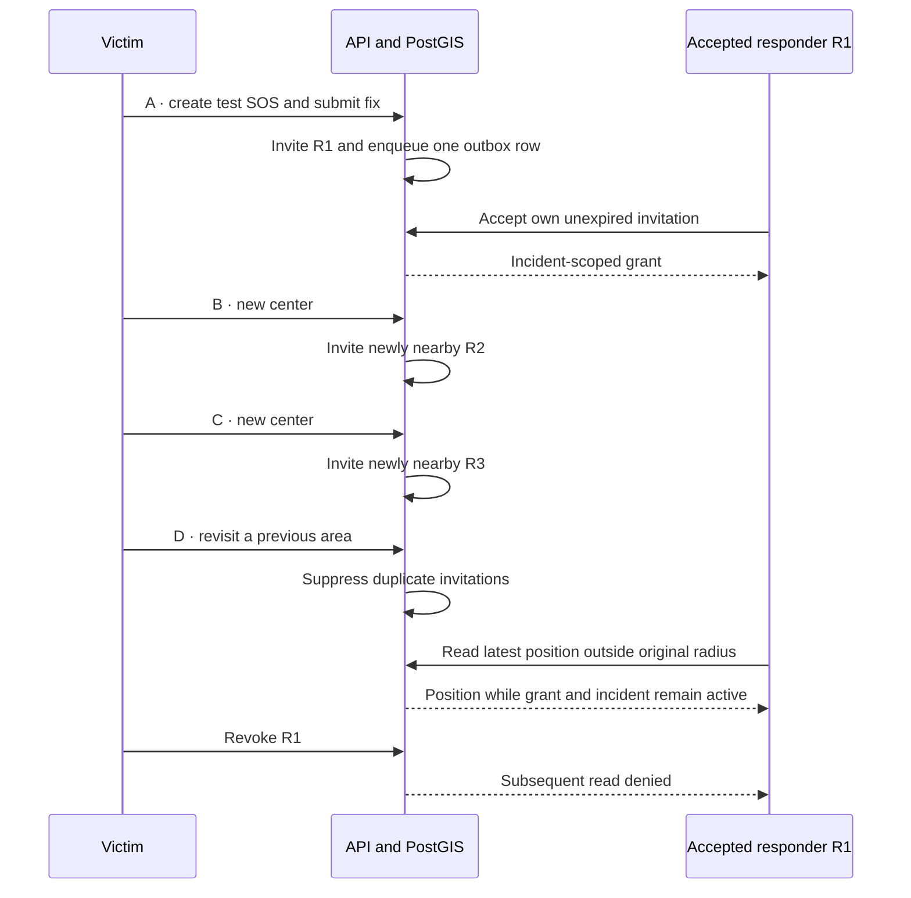
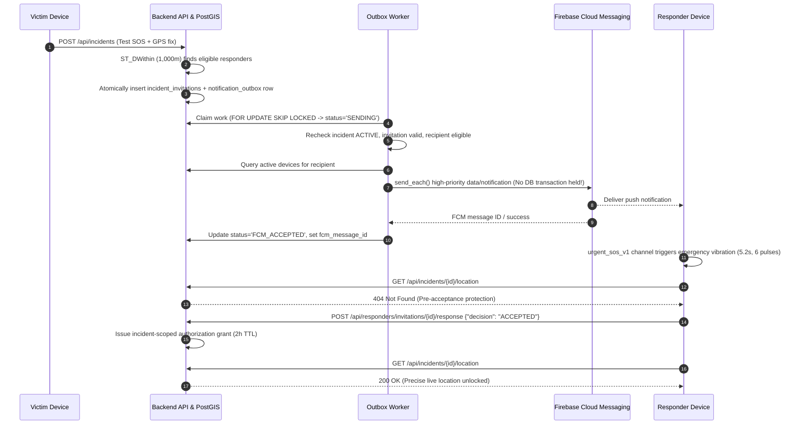
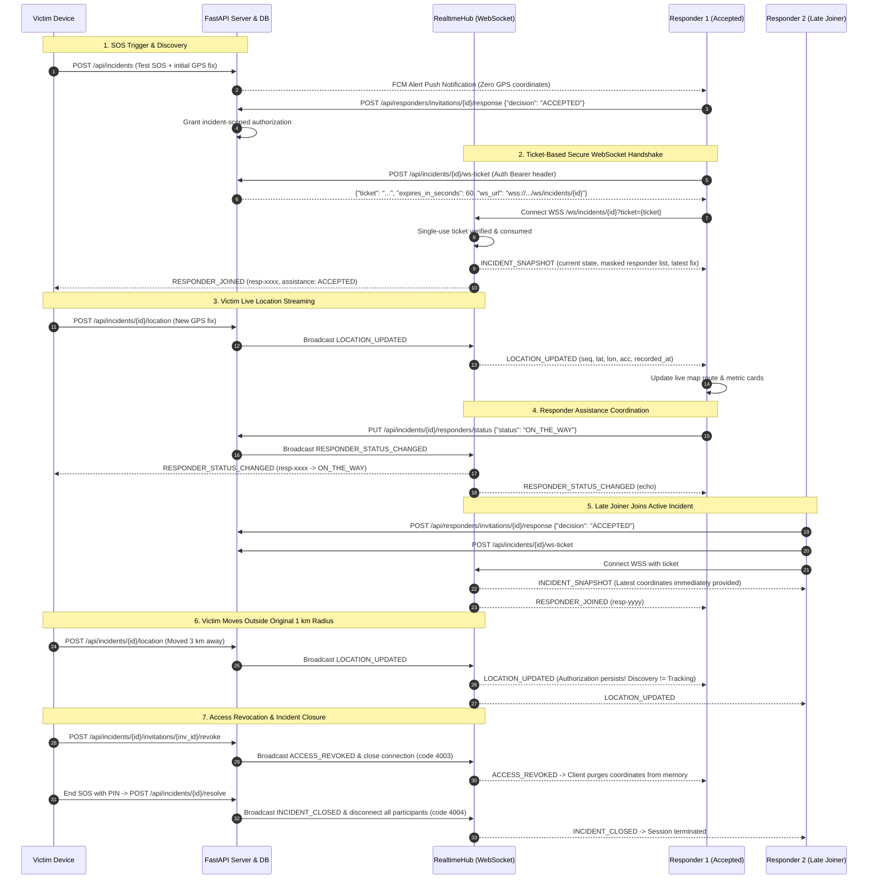
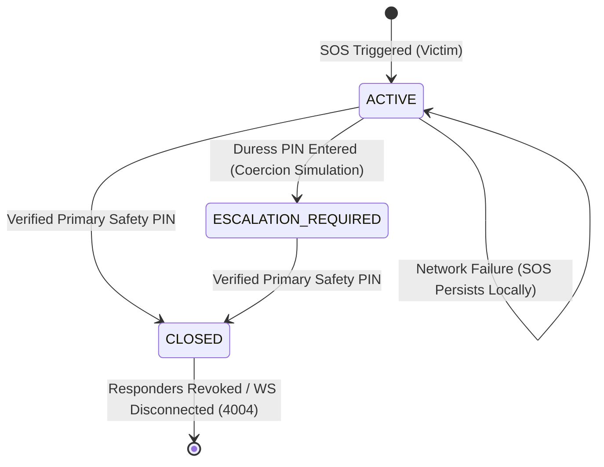

# SurakshaNet test incident API

This service records test incidents and invitations in PostgreSQL. Use a dedicated Firebase development project and consenting test accounts. Android offers local-only SOS or explicit per-incident test server sharing.

## Start locally

Run commands from `backend/`. Use Python 3.11–3.13. On Windows PowerShell:

```powershell
py -3.12 -m venv .venv
.\.venv\Scripts\python -m pip install -r requirements.txt
Copy-Item .env.example .env
docker compose up -d --wait
```

Before starting Docker, set POSTGRES_PASSWORD in your private shell or ignored .env. Set DATABASE_URL there to `postgresql+asyncpg://suraksha:<url-encoded-local-password>@127.0.0.1:55432/suraksha_dev`. The Compose database and bootstrap role are for local development. To stop it while retaining the local database, use `docker compose stop`.

Alternatively start PostgreSQL 15+ with PostGIS 3.x and create a dedicated database. As its administrator execute `CREATE EXTENSION IF NOT EXISTS postgis;` in each development and test database. The Docker image initializes the extension in its default database. Grant a separate migration role schema DDL privileges in deployed environments. Grant the runtime role only database connect, schema usage and required table DML permissions.

Set FIREBASE_PROJECT_ID to the Android app's Firebase project. Enable Email/Password and verify your test users' email addresses. Configure an application default credential with Firebase Auth user-read permissions for revocation checks, or set GOOGLE_APPLICATION_CREDENTIALS to the absolute path of a service-account file outside the repository. Use workload identity on deployed infrastructure. Never put this file in Android assets. Android's google-services.json is a separate client configuration.

```powershell
.\.venv\Scripts\python -m alembic upgrade head
.\.venv\Scripts\python -m uvicorn app.main:create_app --factory --host 127.0.0.1 --port 8000
```

Inspect `/docs` locally. GET /health checks the API process. GET /ready checks database connectivity and migrated incident/PostGIS objects. Startup requires a valid asyncpg URL, project configuration and Admin credential. Database readiness is independent of liveness. Migrations run explicitly. The v1 schema snapshot is immutable. Add a new Alembic revision for subsequent schema changes.

## Configuration

| Variable | Purpose |
|---|---|
| DATABASE_URL | SQLAlchemy asyncpg PostgreSQL URL |
| FIREBASE_PROJECT_ID | Firebase token audience/project |
| GOOGLE_APPLICATION_CREDENTIALS | Optional external credential file, otherwise application default credentials |
| ENVIRONMENT | development, test or production. All incidents are test-only in every environment. Production rejects mock input and excludes stored mock responder fixes. |
| ALLOWED_ORIGINS | JSON array of exact browser origins, empty by default |
| MAX_LOCATION_AGE_SECONDS | Maximum device fix age, default 120 seconds. Future tolerance is five seconds. |
| MAX_ACCURACY_METERS | Maximum reported uncertainty, default 100 metres |
| LOG_LEVEL | Application logger level. Configure Uvicorn separately with --log-level. |
| TEST_DATABASE_URL | Isolated, migrated database with a name ending in _test |
| POSTGRES_PASSWORD | Local Docker initialization only |

## API walkthrough

Use freshly obtained Firebase ID tokens from two verified test accounts. Send them only to your trusted development server over HTTPS, or to the loopback test server on your own machine. For the examples below replace angle-bracket placeholders and generate current UTC timestamps. Numeric positions are synthetic. Never paste real tokens into issues or logs.

```http
GET /api/users/me
Authorization: Bearer <responder-id-token>

PUT /api/users/me
Authorization: Bearer <responder-id-token>
Content-Type: application/json

{"display_name":"Test responder","responder_opt_in":true,"responder_available":true}

PUT /api/responders/location
Authorization: Bearer <responder-id-token>
Content-Type: application/json

{"latitude":0,"longitude":0.0045,"accuracy_meters":10,"is_mock":true,"recorded_at":"<current-UTC-timestamp>"}

POST /api/incidents
Authorization: Bearer <owner-id-token>
Idempotency-Key: <new-uuid>
Content-Type: application/json

{"is_test":true,"location":{"latitude":0,"longitude":0,"accuracy_meters":8,"is_mock":true,"recorded_at":"<current-UTC-timestamp>"}}
```

Retry creation with the same key and payload. A different payload or a second open incident returns 409. POST /api/incidents/{id}/location accepts a Fix from the owner. An exact replay of the latest sample succeeds. Older or conflicting updates return 409. Device recording and server receipt times remain distinct. A missing initial fix leaves the incident location empty until the first update.

Each due evaluation runs indexed ST_DWithin on geography(Point,4326) in metres. Filtering covers consent, availability, verified active accounts, freshness, accuracy and self-exclusion. The service computes distances internally. Invitations and audit events commit in the same transaction as the fix. A unique incident/recipient pair suppresses repeated invitations even if the recipient declines or leaves the radius.

GET /api/responders/invitations lists the authenticated recipient's invitations without coordinates. POST /api/responders/invitations/{id}/response takes `{"decision":"ACCEPTED"}` or `{"decision":"DECLINED"}`. Pending invitations expire after five minutes. Accepted grants last up to two hours. GET /api/incidents/{id}/location checks owner or accepted, current, eligible grant on every read. Moving outside the discovery circle does not revoke an accepted grant. Going off duty revokes grants. Opting out also removes the saved responder position. Returning to availability rechecks the last fix if it is still fresh. Authentication verifies revocation with Firebase on every protected request. The client cannot set UID, verification or account status.

The owner closes a shared incident through POST /api/incidents/{id}/resolve with a Safety PIN. Configure TEST_ACCOUNT_UIDS as a JSON array of verified development Firebase UIDs. The default empty allowlist disables authenticated test access and invitation delivery. Keep request bodies, credential-bearing URLs, device tokens and coordinates out of logs.

## Tests

```powershell
.\.venv\Scripts\python -m pytest -q tests/test_api.py
docker compose exec db createdb -U suraksha suraksha_test
docker compose exec db psql -U suraksha -d suraksha_test -c "CREATE EXTENSION IF NOT EXISTS postgis"
```

Set TEST_DATABASE_URL in the shell to the isolated test URL, then run:

```powershell
$env:DATABASE_URL = $env:TEST_DATABASE_URL
.\.venv\Scripts\python -m alembic upgrade head
.\.venv\Scripts\python -m pytest -q
Remove-Item Env:DATABASE_URL
```

Integration tests use actual geography calculations at the equator, moving search centers and independent identities. Single-connection cases roll back. Multi-connection concurrency cases create and remove a randomly named test schema. Only the Firebase verifier is substituted. Without TEST_DATABASE_URL the PostGIS tests skip. Clearing the shell override returns subsequent commands to the development URL in .env.

## Android

Set `surakshaDevApiUrl=https://your-trusted-dev-host/` or `surakshaProdApiUrl=https://your-production-host/` in the user's Gradle properties, then rebuild the corresponding variant. Include the trailing slash. A trusted HTTPS reverse proxy can forward to the local Uvicorn port. On a phone, localhost refers to the phone. Use a host reachable from the device with a certificate trusted by Android. The client enforces TLS, retains normal certificate verification, and disables redirects. An empty URL leaves the backend unconfigured.

Open Profile → Check server health. This calls only /health. Protected Retrofit calls acquire an SDK-managed Firebase ID token on the OkHttp worker thread. Home offers a per-incident checkbox when an HTTPS URL is configured. Selecting it and holding SOS authorizes sharing this session’s fixes. The client uses the local session UUID for idempotency, checks the expected Firebase UID in OkHttp and uploads only the newest fix from the active foreground tracking session. The active screen reports the last server acknowledgment separately from local GPS. Test closure retries with the owning account. Offline closure can leave the remote incident open until reconnection. Profile and responder preferences are still local on Android; use the authenticated responder API for integration testing.


## Moving geofence and authorization

The dynamic moving geofence engine is implemented in `app/services/moving_geofence.py` (with `app/services/geofence.py` retained as an alias). An incident row lock serializes location writes, searches, acceptance, owner revocation and closure. Each accepted device timestamp advances the stored fix. Search checkpoints are separate from that fix. The first valid fix triggers search. Further searches use PostGIS geography distance from the last evaluated center, a small time floor and the larger of the movement threshold and current reported uncertainty. A periodic pass covers stationary victims and deferred movement. No search uses stale victim data. Responder writes run a reverse indexed query against active centers. Availability changes evaluate immediately; a busy incident skipped by another worker is picked up by a later periodic pass.

| Setting | Default |
|---|---:|
| RADIUS_METERS | 1000, adjustable downwards |
| MOVEMENT_THRESHOLD_METERS | 30 |
| MIN_SEARCH_INTERVAL_SECONDS | 2 |
| REEVALUATION_SECONDS | 30 |
| MAX_LOCATION_AGE_SECONDS | 120 |
| MAX_ACCURACY_METERS | 100 |
| INVITATION_TTL_SECONDS | 300 |

Mock fixes match only mock incident centers. A session cannot switch source type. Production configuration rejects mock fixes. A client-reported mock flag is not attestation. Only active, verified, opted-in, available accounts with fresh matching fixes can accept. Distance controls discovery; server-side incident-specific grants control access after acceptance. Replaying an acceptance rechecks the grant. Revocation also invalidates an unanswered invitation.

The invitation insert uses an anti-join and a unique incident/recipient constraint. Only rows actually inserted are returned to the outbox insert within the same transaction. A unique invitation ID in notification_outbox prevents duplicate queue entries. It contains identifiers, event type, timestamps and delivery state, with no coordinate payload. No delivery worker is installed. Before future delivery, revalidate the incident and invitation even if the queue entry is still pending.



Each API worker sleeps between bounded periodic batches. PostgreSQL SKIP LOCKED permits concurrent workers. At larger scale monitor overdue checkpoints, spatial query plans and queue growth, then size worker batches or run the same tick service in a dedicated scheduler. No network calls are made while processing invitations.

## Retention

Schedule `python -m app.maintenance` using your deployment scheduler. Each invocation processes at most 250 rows per cleanup operation. Closed center and last fix are cleared after CLOSED_LOCATION_HOURS (24). Expired invitations are removed after EXPIRED_INVITATION_DAYS (7) on closed incidents, with their outbox rows. Active incidents retain invitation identities for deduplication. Expired or revoked grants can be removed after EXPIRED_GRANT_DAYS (7). Minimal audit events expire after AUDIT_DAYS (30). The job never deletes incident rows or live grants. Review consent, legal holds, backups and retention before production.

## Isolated verification and two-account exercise

With PostgreSQL binaries on PATH and PostGIS installed into that distribution, run `python tests/run_isolated.py` from backend/. The runner creates a new password-protected loopback cluster in a temporary directory, checks current_database(), enables PostGIS, runs both migrations and pytest, then stops and removes only that cluster. Alternatively use the explicitly configured _test database described above. Multi-worker tests use independent connections. The in-process identity override is scoped to pytest and has no HTTP activation switch.

For a remote exercise configure a development HTTPS server, two verified development accounts and fresh Firebase tokens. Use the authenticated requests above with synthetic mock coordinates. A creates the test incident; B opts in and submits a fix inside the radius. Use B’s inbox to obtain its own invitation ID. Confirm a location read returns 404 before acceptance. Accept, move A several kilometres, then confirm B reads the new fix. As A, POST /api/incidents/{incident}/invitations/{invitation}/revoke and verify B gets 404. Request resolution and close the test incident. On Android also verify the sharing checkbox is off on the next activation and that disconnection changes sync status without stopping local GPS.

## Phase 6 FCM Notifications, Outbox Worker & Emergency Vibration

SurakshaNet decouples notification delivery from precise-location authorization:



### Notification Delivery States

| State | Meaning |
|---|---|
| `PENDING` | Outbox item created atomically with invitation, awaiting worker pickup. |
| `SENDING` | Atomically claimed by worker (`FOR UPDATE SKIP LOCKED`), external send in progress. |
| `FCM_ACCEPTED` | Push gateway successfully accepted message for delivery. Contains `fcm_message_id`. |
| `RETRY_SCHEDULED` | Transient gateway failure; exponential backoff scheduled (`next_attempt_at`). |
| `PERMANENT_FAILURE` | Tokens unregistered or max retry attempts (5) exceeded. Token deactivated. |
| `CANCELLED` | Incident closed, invitation answered/expired, or recipient went off-duty before delivery. |

### Device Registration APIs

- `POST /api/devices/register`: Associates FCM registration token with authenticated Firebase user. Automatically deactivates old user associations if device was shared or re-registered.
- `DELETE /api/devices/{token}`: Authenticated device unregistration upon logout.
- `POST /api/devices/test-alert`: Requests an authorized test notification sent **only** to the calling user's registered device (used by the Safety Readiness screen).

### Emergency Notification Channel & Vibration

- Channel ID: `urgent_sos_v1`
- Importance: `NotificationManager.IMPORTANCE_HIGH`
- Vibration Pattern: `longArrayOf(0, 700, 200, 700, 200, 700, 200, 700, 200, 700, 200, 700)` (~5.2s total duration across 6 noticeable pulses).
- Privacy Guard: Outgoing FCM payloads contain **zero coordinates** (`event_type`, `invitation_id`, `incident_id`, `created_at`, `expires_at`). Client-side receiver drops any malformed message containing coordinates.

## Phase 7 Real-Time Incident Tracking, Responder Coordination & Authorization

SurakshaNet provides end-to-end authenticated real-time incident tracking and responder coordination over WebSockets:



### WebSocket Endpoint & Ticket Authorization

- **Endpoint**: `/ws/incidents/{incident_id}` (or `/api/ws/incidents/{incident_id}`)
- **Ticket Request**: `POST /api/incidents/{incident_id}/ws-ticket` (authenticated via Firebase ID Token `Authorization: Bearer <token>`).
- **Ticket TTL**: 60 seconds, single-use, cryptographically secure token.
- **Connection**: Pass ticket via `?ticket=<ticket>` or header `X-WS-Ticket: <ticket>`.
- **Security Invariant**: Connecting without a valid ticket or after ticket expiration is rejected with HTTP 403 / close code 4001.

### Real-Time Event Protocol

Every frame sent over the WebSocket is JSON with `version`, `event`, `incident_id`, and `timestamp`:

| Event | Direction | Description |
|---|---|---|
| `INCIDENT_SNAPSHOT` | Server -> Client | Sent immediately on connection. Contains full incident status, masked responder list, summaries, and latest location. |
| `LOCATION_UPDATED` | Server -> Client | Broadcasted when a new valid victim GPS fix is saved. Includes monotonic `sequence`, `latitude`, `longitude`, `accuracy_meters`, `is_mock`. |
| `RESPONDER_JOINED` | Server -> Client | Broadcasted when a new authorized responder joins the tracking session. |
| `RESPONDER_LEFT` | Server -> Client | Broadcasted when a responder opts out, goes off duty, or leaves the session. |
| `RESPONDER_STATUS_CHANGED` | Server -> Client | Broadcasted when a responder updates assistance status (`ACCEPTED`, `ON_THE_WAY`, `HELPING`, `UNABLE_TO_HELP`, `LEFT_INCIDENT`). |
| `INCIDENT_STATUS_CHANGED` | Server -> Client | Broadcasted when incident state changes (e.g. `RESOLUTION_REQUESTED`). |
| `ACCESS_REVOKED` | Server -> Client | Sent specifically to revoked user prior to disconnection (code 4003). Client must purge coordinates immediately. |
| `INCIDENT_CLOSED` | Server -> Client | Broadcasted when owner ends the incident with safety PIN. Disconnects all clients (code 4004). |
| `LOCATION_STALE` | Server -> Client | Notifies clients that victim location has not updated within 60 seconds. |
| `ERROR` | Server -> Client | Protocol or authorization error payload. |

### Privacy and Security Architecture

1. **Zero Responder Coordinates**: Responders' private GPS coordinates are **never** broadcasted to other responders or the victim.
2. **Masked Public Identifiers**: Responders are identified in public event payloads by pseudonymous masked IDs (e.g. `resp-a1b2c3d4`).
3. **No Prior Breadcrumb History**: Responders receive only the current latest fix and subsequent live updates, never the victim's historical path prior to acceptance.
4. **Immediate Coordinate Purging**: If a responder's access is revoked (by victim, account suspension, or expiry), `ACCESS_REVOKED` is dispatched and the Android `IncidentTrackingRepository` immediately nulls out all coordinate records in memory.
5. **Periodic Lifetime Verification**: In addition to event-driven push, the WebSocket hub periodically re-verifies that participating accounts are active, opted in, and not suspended in the database.

### Multi-Worker and Distributed Deployments

The default `RealtimeHub` implementation is an in-process asyncio hub suitable for single-process deployments and testing. For multi-node or multi-worker production deployments:
- Configure a Pub/Sub backplane (such as **Redis Pub/Sub** or **PostgreSQL LISTEN/NOTIFY** on the `incidents` channel).
- When a location or status event occurs on Worker A, Worker A publishes the event to Redis / PostgreSQL.
- Workers B and C receive the event notification and broadcast to their locally connected WebSockets.
- Ticket verification is backed by the shared database (`incident_responders` and `incidents`).

---

## 3-Phone Live Demonstration / Testing Guide

This guide walks through testing Phase 7 real-time tracking with 3 physical devices or Android emulators:

### Participants
- **Phone A (Victim)**: Allowlisted test account `victim@test.org`.
- **Phone B (Responder 1 - Initial Nearby)**: Allowlisted test account `responder1@test.org`. Located within 1 km of Phone A.
- **Phone C (Responder 2 - Late Joiner)**: Allowlisted test account `responder2@test.org`. Located within 1 km or joining while incident is already in progress.

### Step-by-Step Scenario

1. **Pre-flight Readiness**:
   - On Phone B and Phone C, open the **Responder** tab. Enable **Community Responder Mode** and switch **Duty Active** to ON.
   - Verify on the backend that responder locations are stored within 1,000 m of Phone A (or set via `PUT /api/responders/location`).
2. **Trigger SOS (Phone A)**:
   - On Phone A, select "Share demo GPS with test server" and hold the **EMERGENCY SOS** button for 2 seconds.
   - Phone A begins streaming foreground GPS updates. An incident is created on FastAPI.
3. **Emergency Alert & Acceptance (Phone B)**:
   - Phone B receives the high-priority emergency push notification with 5.2s emergency vibration.
   - Phone B taps **View Request** -> sees distance (~340m), ETA, and 1 km zone.
   - Phone B taps **Accept and Help**.
   - Phone B requests a short-lived WS ticket and connects to `/ws/incidents/{id}`.
   - Phone B immediately receives `INCIDENT_SNAPSHOT` with live coordinates and transitions to `ResponderTrackingView` showing "LIVE · CONNECTED".
4. **Real-Time GPS Updates**:
   - Phone A moves or submits a new GPS coordinate.
   - Within milliseconds, Phone B receives `LOCATION_UPDATED` over the WebSocket. The route map, accuracy, and distance update in real time without refreshing.
5. **Responder Assistance Coordination**:
   - On Phone B, tap the **En Route** (`ON_THE_WAY`) chip.
   - Phone B sends `PUT /api/incidents/{id}/responders/status`.
   - Both Phone A (victim) and the backend receive `RESPONDER_STATUS_CHANGED`. The victim screen displays "Responder En Route".
   - When arriving, Phone B taps **Helping** (`HELPING`). Status pill updates to green.
6. **Late Joiner Joins Active Incident (Phone C)**:
   - Phone C accepts their invitation 2 minutes into the incident.
   - Phone C requests a WS ticket and connects.
   - Phone C receives `INCIDENT_SNAPSHOT` with the latest victim coordinates immediately.
   - Phone B's connected responders card dynamically updates to show 2 Accepted responders.
7. **Victim Moves Outside Original 1 km Radius**:
   - Phone A moves 2.5 km away (outside the original 1 km discovery circle).
   - Phone A submits updated coordinates.
   - Phone B and Phone C **continue receiving live GPS coordinates** without interruption. (Discovery radius is for initial matching only; tracking authorization persists throughout the incident lifetime).
8. **End Incident with Backend Safety PIN (Phone A)**:
   - On Phone A, tap **End SOS with Safety PIN**.
   - Enter your 6-digit Safety PIN.
   - Phone A calls `POST /api/incidents/{id}/resolve`.
   - The backend validates the PIN with Argon2id, transitions the incident to `CLOSED`, revokes responder grants, and broadcasts `INCIDENT_CLOSED`.
   - The WebSocket hub closes all responder connections (code 4004).
   - On Phone B and Phone C, the screen immediately displays "Emergency Incident Resolved and Closed", and live tracking coordinates are purged from memory.

---

## Phase 8: Secure Safety PIN, Protected Incident Resolution, Duress Safeguards & Access Revocation

SurakshaNet enforces a backend-controlled incident resolution architecture to prevent accidental or coerced cancellation.

### Core Security Principles

1. **Backend-Controlled Lifecycle**: Closing the Android app, navigating Back, or dismissing screens **never** terminates an active SOS on the server.
2. **Argon2id Hashing**: PIN credentials use modern `Argon2id` password hashing (`time_cost=2`, `memory_cost=65536` KiB, `parallelism=1`, `hash_len=32`) with a per-user cryptographically random 16-byte salt (`os.urandom(16)`).
3. **Zero Plaintext Storage**: Plaintext PINs are never stored in the database, audit tables, crash logs, or telemetry frames.
4. **Independent Authentication**: Safety PIN verification is separate from ordinary account login and phone unlock.
5. **Pattern Validation & Brute-Force Rate Limiting**:
   - 6-digit numeric PIN requirement.
   - Trivial repetitive patterns (`111111`, `000000`, etc.) and sequential sequences (`123456`, `654321`, etc.) are rejected during setup.
   - Max 5 consecutive incorrect attempts allowed per rolling window. The 5th failure triggers an automatic 5-minute lockout (`429 Too Many Requests`).
   - Every verification attempt is audited in `incident_resolution_attempts` with `result` (`SUCCESS`, `INVALID_PIN`, `RATE_LIMITED`, `DURESS_SIMULATION`), attempt number, and timestamp.



### Safety PIN & Resolution Endpoints

| Endpoint | Method | Auth | Description |
|---|---|---|---|
| `/api/security/safety-pin/setup` | `POST` | Bearer | Initial enrollment of 6-digit Primary or Duress PIN. |
| `/api/security/safety-pin/change` | `POST` | Bearer | Authenticated update requiring current PIN verification. |
| `/api/security/safety-pin/status` | `GET` | Bearer | Returns credential status (`has_primary_pin`, `has_duress_pin`, lockout state, `retry_after_seconds`). |
| `/api/security/safety-pin/recover` | `POST` | Bearer | Reset PIN using verified account re-authentication without silently canceling active SOS. |
| `/api/incidents/{incident_id}/resolve` | `POST` | Bearer | Authenticated incident resolution with Safety PIN verification. |

### Protected Resolution Workflow

When `POST /api/incidents/{id}/resolve` is called:
1. **Verification**: Verifies caller is the incident owner and status is `ACTIVE` (or `ESCALATION_REQUIRED`).
2. **Lockout Check**: Enforces temporary lockout if `locked_until > now()`.
3. **Primary PIN Match**:
   - Updates incident status to `CLOSED` with `ended_at = now()`.
   - Revokes all responder grants (`incident_responders.status = 'ENDED'`).
   - Cancels pending outbox notification deliveries (`notification_outbox.status = 'CANCELLED'`).
   - Revokes unanswered invitations (`incident_invitations.status = 'REVOKED'`).
   - Dispatches `INCIDENT_CLOSED` event to WebSocket subscribers and terminates connections (`code=4004`).
   - Android client stops the foreground location service, dismisses the ongoing notification, and returns to standby.
4. **Duress PIN Match (Simulation Safeguard)**:
   - Incident transitions to `ESCALATION_REQUIRED`.
   - Recorded as `DURESS_SIMULATION` in resolution requests.
   - Returns simulated success response to UI without closing the emergency.
   - Background GPS streaming and responder WebSocket connections remain active.
   - *Disclaimer*: Simulated safeguard for testing under coercion; no real 112 emergency calls are placed.

### Network Failure Resilience

If the victim device loses network connectivity during resolution:
- The Android app explicitly informs the user: *"Network offline. Server closure could not be verified. SOS remains active."*
- Local tracking service and ongoing notifications **remain running**.
- Responders are not falsely dismissed. The app allows the victim to retry once connectivity is restored.


