# Maitri architecture

Part of the [project handbook](../../PROJECT_HANDBOOK.md#2-architecture). Every arrow is labelled with what is sent;
section 2 of the handbook explains when and cites the code.

```mermaid
flowchart TB
  subgraph Phone["Android phone (app/src/main/java/in/maitri/app)"]
    UI["Compose screens\nui/*.kt, navigation/SafetyApp.kt"]
    Sync["SOS sync + offline queue\nnetwork/TestIncidentSync.kt\nlocation/IncidentFixQueue.kt"]
    Loc["SosLocationService\nFusedLocationSource"]
    Pre["Preloader + StartupCache\nstartup/*"]
    Msg["SosFirebaseMessagingService\nSosRequestAlerts"]
    Up["Uploads + SosMedia\nnetwork/Uploads.kt"]
    Map["MaitriMap (MapLibre)\nMapWarmup"]
  end

  subgraph Firebase["Firebase (Google)"]
    Auth["Authentication"]
    FCM["Cloud Messaging"]
    Crash["Crashlytics"]
    AD["App Distribution"]
  end

  subgraph Render["Render Free: surakshanet-api (Docker, 1 worker)"]
    Routes["FastAPI routes\nbackend/app/*.py"]
    Loops["Background loops\ngeofence 30 s, outbox 2 s, check-ins"]
    Hub["Realtime hub (in-memory)\nservices/realtime.py"]
    Admin["/admin page\nadmin.py"]
    Live["/l/token page\nlive_link.py"]
  end

  DB[("Neon PostgreSQL 16 + PostGIS\n25 tables")]
  R2[("Cloudflare R2\nprivate bucket")]
  Cron["cron-job.org"]
  Sentry["Sentry"]
  OFM["OpenFreeMap\n(OpenStreetMap data)"]
  Pages["GitHub Pages\nprivacy, terms, delete-account"]
  Browser["Browser: admin\nor circle member"]

  UI -- "email/Google sign-in" --> Auth
  Auth -- "ID token (JWT)" --> UI
  UI -- "HTTPS JSON + Bearer token" --> Routes
  Sync -- "POST /api/incidents, /location every ~5 s" --> Routes
  Loc -- "GPS fixes" --> Sync
  Pre -- "GET /ready, /api/incidents/active,\nprofile, inbox, PIN, circle" --> Routes
  Up -- "POST /api/files/upload-url, /complete" --> Routes
  Up -- "PUT bytes (presigned, 5 min)" --> R2
  Map -- "style + vector tiles" --> OFM
  UI -- "crash report (release, opt-out)" --> Crash
  AD -- "release APK" --> UI
  UI -- "WebSocket /ws/incidents/{id} (ticket)" --> Hub

  Routes -- "verify token, revoked?, admin claim" --> Auth
  Routes -- "SQL via asyncpg" --> DB
  Loops -- "SQL (only while busy + hourly sweep)" --> DB
  Routes -- "sign URLs, delete objects" --> R2
  Loops -- "data messages: invitations, inbox pushes" --> FCM
  FCM -- "push (no coordinates)" --> Msg
  Routes -- "errors, scrubbed" --> Sentry
  Routes -- "events" --> Hub

  Cron -- "GET /ready every 10 min (no DB)" --> Routes
  Browser -- "Firebase web sign-in, /api/admin/*" --> Admin
  Browser -- "poll /l/token/location" --> Live
  UI -- "open policy links" --> Pages
```

Legend:
- **Solid arrows** are network calls. Everything is HTTPS.
- **Background loops** only touch the database while the API had a request in the last 15 minutes, plus one sweep an
  hour (`backend/app/activity.py`), so Neon can sleep.
- **Push payloads** carry ids and times only; the phone fetches details with its own token
  (`services/outbox_worker.py`, `inbox.py`).
