# Database ER diagram

Part of the [project handbook](../../PROJECT_HANDBOOK.md#81-database-schema). The relationships come from the
`REFERENCES` clauses in `backend/alembic/versions/` and `reference(...)` in `backend/app/database/v1.py`. Only key
columns are shown; every column is listed in section 8.1 of the handbook. `volunteer_documents` is a legacy table
that no code uses.

```mermaid
erDiagram
  users ||--o{ devices : "has push tokens"
  users ||--o| responder_locations : "last position (volunteer)"
  users ||--o{ incidents : "victim_user_id"
  users ||--o{ trusted_contacts : "owner_user_id"
  users ||--o{ safety_credentials : "PINs"
  users ||--o| volunteer_applications : "applies"
  users ||--o{ stored_files : "owns files"
  users ||--o{ inbox_items : "receives"
  users ||--o{ circle_sessions : "owns trips/check-ins"
  stored_files |o--o| users : "photo_file_id"

  incidents ||--o{ incident_invitations : "volunteers asked"
  incidents ||--o{ incident_responders : "volunteers accepted"
  incidents ||--o{ incident_events : "audit trail"
  incidents ||--o{ incident_resolution_requests : "end requests"
  incidents ||--o{ incident_resolution_attempts : "PIN tries"
  incidents ||--o{ incident_contact_alerts : "circle alerted"
  incidents ||--o{ trusted_contact_grants : "circle access"
  incidents ||--o{ notification_outbox : "pushes to send"
  incidents ||--o{ stored_files : "SOS photos/voice"
  incidents ||--o{ inbox_items : "related items"
  users ||--o{ incident_invitations : "recipient_user_id"
  users ||--o{ incident_responders : "responder_user_id"
  incident_invitations ||--o| notification_outbox : "one push each"

  trusted_contacts ||--o{ circle_links : "contact linked to account"
  trusted_contacts ||--o{ circle_invites : "codes / requests"
  trusted_contacts ||--o{ incident_contact_alerts : "per SOS"
  trusted_contacts ||--o{ trusted_contact_grants : "per SOS"
  users ||--o{ circle_links : "owner_id / recipient_id"
  users ||--o{ circle_invites : "owner_id / target_user_id"
  users ||--o{ circle_pairing_codes : "owner / recipient"
  inbox_items ||--o| incident_contact_alerts : "push item"

  circle_sessions ||--o{ circle_session_recipients : "who receives"
  circle_links ||--o{ circle_session_recipients : "via link"

  volunteer_applications ||--o{ admin_audit_log : "reviews"
  volunteer_applications ||--o{ volunteer_documents : "legacy"

  users {
    uuid id PK
    string firebase_uid UK
    bool responder_opt_in
    bool responder_available
    bytea medical_notes "AES-256-GCM"
  }
  incidents {
    uuid id PK
    uuid victim_user_id FK
    uuid idempotency_key
    string status "ACTIVE/CLOSED/ESCALATION_REQUIRED"
    geography latest_location "latest only"
    bool is_test
  }
  incident_invitations {
    uuid id PK
    uuid incident_id FK
    uuid recipient_user_id FK
    string status "PENDING/ACCEPTED/DECLINED/EXPIRED"
    timestamptz expires_at
  }
  responder_locations {
    uuid user_id PK
    geography location
    timestamptz recorded_at
  }
  trusted_contacts {
    uuid id PK
    uuid owner_user_id FK
    text normalized_phone_number
    bool notify_on_sos
  }
  circle_links {
    uuid id PK
    uuid owner_id FK
    uuid contact_id FK
    uuid recipient_id FK
  }
  stored_files {
    uuid id PK
    uuid owner_user_id FK
    text kind "VOLUNTEER_DOC/SOS_PHOTO/SOS_VOICE/PROFILE_PHOTO"
    text object_key "R2 key"
  }
  inbox_items {
    uuid id PK
    uuid user_id FK
    text kind
    text push_status
  }
```

