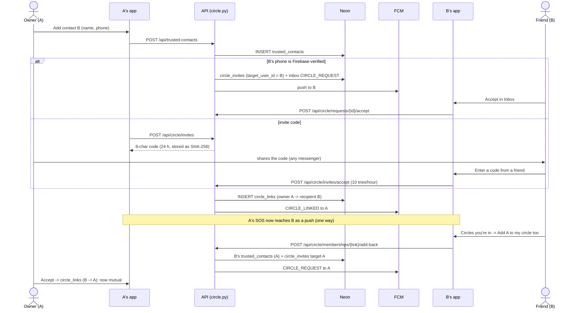
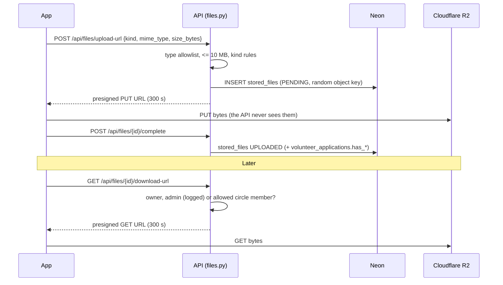

# Other flows

Part of the [project handbook](../../PROJECT_HANDBOOK.md#6-key-flows-end-to-end). Sign-in, startup, trips and
check-ins, volunteer review and keep-alive are drawn inline in section 6. These are the two longer ones.

## Circle linking: invite code, phone match and add back

## Presigned upload and download

